# Day 1 — Kubernetes From Zero, in Very Simple Words

## What you will learn today

Do not worry if words such as **Pod**, **Scheduler**, **CNI**, or **etcd** are new to you.

We will build the meaning slowly.

By the end of Day 1, you should understand:

- what Kubernetes is;
- why people use it;
- what a container is;
- what a Kubernetes cluster is;
- what the control plane does;
- what a worker node does;
- the purpose and working of every important Kubernetes component;
- how a Pod is created from beginning to end;
- the difference between Pods, Deployments, StatefulSets, DaemonSets, Jobs, and CronJobs;
- how health checks, CPU, memory, configuration, and Secrets work;
- how to deploy and inspect your first application.

You do not need advanced Kubernetes knowledge before reading this file.

**Estimated study time:** 6–8 hours. Take breaks. Do not try to memorize everything in one reading.

Official references:

- [Kubernetes overview](https://kubernetes.io/docs/concepts/overview/)
- [Kubernetes components](https://kubernetes.io/docs/concepts/overview/components/)
- [Cluster architecture](https://kubernetes.io/docs/concepts/architecture/)
- [Pods](https://kubernetes.io/docs/concepts/workloads/pods/)
- [Workload controllers](https://kubernetes.io/docs/concepts/workloads/controllers/)

---

# Part 1 — First understand the problem

## 1. What happens without Kubernetes?

Imagine that you created an online shopping application.

It has three parts:

```text
Frontend  →  Backend API  →  Database
```

- The **frontend** shows the website.
- The **backend** processes orders.
- The **database** stores products and orders.

At first, you run everything on one server.

```text
One server
├── Frontend
├── Backend
└── Database
```

This may work for a small application. Later, you get more users.

Now you need to answer these questions:

1. What happens if the server stops working?
2. How do you run five copies of the backend?
3. Which server should run each copy?
4. What happens if one copy crashes?
5. How do you update the application without a long outage?
6. How does the frontend find the backend when its IP address changes?
7. How do you give CPU and memory fairly to different applications?
8. How do you attach permanent storage?

You could do all of this manually. But manual work becomes slow and unsafe when you have many applications and servers.

Kubernetes helps automate this work.

---

## 2. What is Kubernetes?

Kubernetes is a system that manages containerized applications on one or more machines.

In very simple words:

> You tell Kubernetes what you want. Kubernetes keeps trying to make the real system match what you asked for.

Example:

```text
You say:       “I want 3 copies of my web application.”
Kubernetes:    Runs 3 copies.
One copy dies: Only 2 copies remain.
Kubernetes:    Creates a new copy.
Final result:  3 copies are running again.
```

This repeated checking and fixing is called **reconciliation**.

### Reconciliation in simple words

**Reconciliation** means:

1. Check what the user wants.
2. Check what is really running.
3. Find the difference.
4. Take action to remove the difference.
5. Repeat forever.

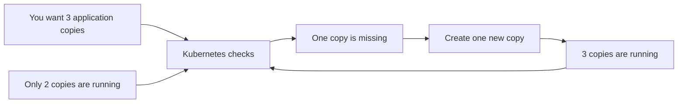

This is one of the most important ideas in Kubernetes.

---

## 3. What Kubernetes does

Kubernetes can help with:

- placing applications on machines;
- restarting failed containers;
- keeping a requested number of application copies;
- updating applications gradually;
- giving applications stable network names;
- attaching configuration and storage;
- controlling access;
- checking application health;
- scaling applications up and down.

## 4. What Kubernetes does not do automatically

Kubernetes does not automatically:

- write your application code;
- fix a bug inside your application;
- build a correct database design;
- back up your database unless you configure a backup system;
- make every application secure;
- make every application highly available simply because it runs in Kubernetes.

Kubernetes is a management platform. Your application still needs good design.

---

# Part 2 — Containers before Kubernetes

## 5. What is an application process?

When you start a program, the operating system runs it as a **process**.

Examples:

- an Nginx web server process;
- a Python API process;
- a PostgreSQL database process.

A process needs files, libraries, environment variables, CPU, memory, and network access.

## 6. What is a container image?

A **container image** is a packaged set of files needed to run an application.

It can contain:

- application code;
- libraries;
- command to start the application;
- basic operating-system files;
- default configuration.

Think of an image as a sealed application package.

```text
Container image
├── Application code
├── Libraries
├── Required files
└── Starting command
```

An image is not a running application. It is the package used to start one.

## 7. What is a container?

A **container** is a running instance of an image.

Simple comparison:

```text
Image      = application package
Container  = running application created from that package
```

One image can start many containers.

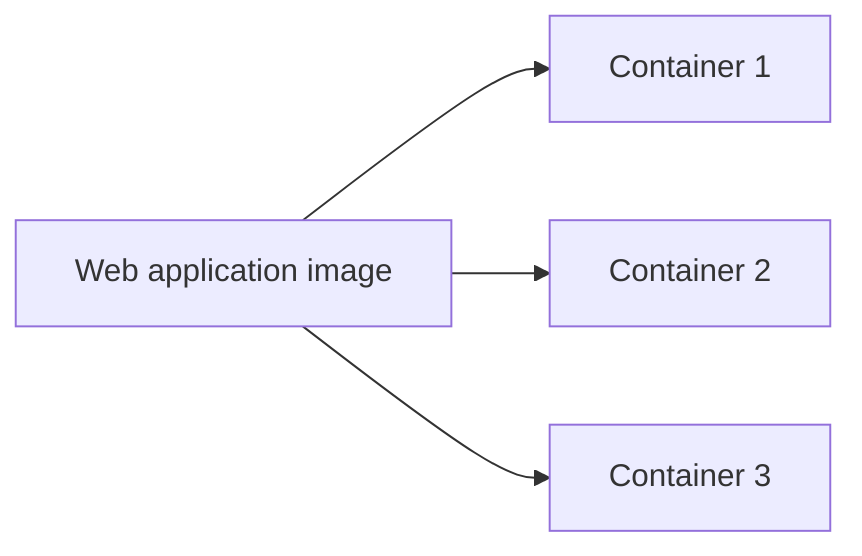

## 8. What is a container runtime?

A **container runtime** is software that actually starts and stops containers.

Common examples:

- `containerd`;
- CRI-O.

The runtime can:

1. download an image;
2. create a container from the image;
3. start the container;
4. stop the container;
5. report whether the container is running or stopped.

Important:

> Kubernetes plans and manages the work. The container runtime performs the low-level container work.

## 9. Docker and Kubernetes are not the same thing

Docker tools can build images and run containers.

Kubernetes manages applications across machines.

```text
Docker/build tool  → builds an image
Container runtime  → runs the container
Kubernetes         → decides where and how the application should run
```

A Docker-built image can run in Kubernetes when it uses a standard container-image format.

## 10. Container versus virtual machine

### Virtual machine

A virtual machine normally contains:

- a complete guest operating system;
- its own kernel;
- application processes.

### Container

A container normally:

- shares the host machine's kernel;
- isolates the application process;
- starts faster;
- uses fewer resources than a complete virtual machine.

```text
Virtual machine                 Container
----------------------------    -------------------------
Application                     Application
Libraries                       Libraries
Guest operating system          Shares host kernel
Guest kernel
Virtual hardware
```

Containers are lighter, but sharing a host kernel means their isolation is not exactly the same as a separate virtual machine.

## 11. Docker Compose versus Kubernetes

Docker Compose is useful for running several related containers, especially on a developer's machine.

Kubernetes is designed for managing applications across a cluster of machines.

```text
Docker Compose
└── Usually simple, local, or single-machine application setup

Kubernetes
├── Multiple machines
├── Automatic placement
├── Replacement of failed Pods
├── Rolling updates
├── Stable Services
└── Access, policy, and extension systems
```

Kubernetes is more powerful, but it is also more complex.

---

# Part 3 — The Kubernetes cluster

## 12. What is a cluster?

A **Kubernetes cluster** is a group of machines working together to run and manage applications.

A cluster has two main sides:

1. **Control plane** — makes management decisions.
2. **Worker nodes** — run application Pods.

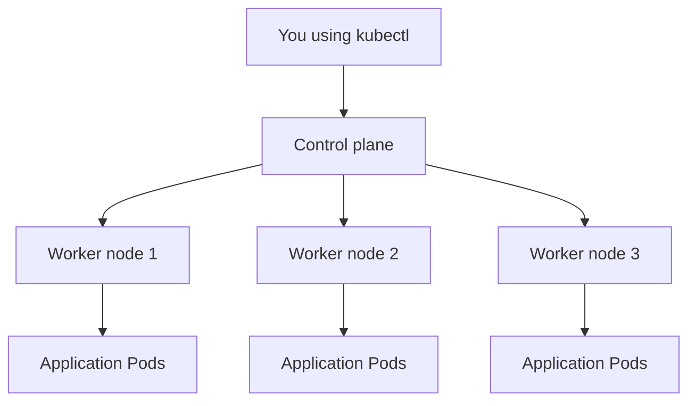

### Simple company example

This analogy is not technically perfect, but it helps you remember responsibilities:

```text
Control plane        = company management office
Worker node          = factory building
Scheduler            = person choosing a factory
Controller           = supervisor checking required quantity
Kubelet              = manager inside one factory
Container runtime    = machinery that starts the work
CNI                   = roads and addresses
CSI                   = storage delivery connection
CoreDNS               = phonebook
```

Now we will explain every component separately.

---

# Part 4 — Control-plane components

## 13. Kubernetes API

Before the API server, understand the word **API**.

An **API** is a defined way for one program to communicate with another program.

Example:

```text
kubectl: “Please create this Deployment.”
Kubernetes API: “Request accepted,” or “Request rejected because...”
```

Kubernetes objects such as Pods and Deployments are created, read, updated, and deleted through the Kubernetes API.

---

## 14. kubectl

### What is kubectl?

`kubectl` is a command-line program used to communicate with the Kubernetes API server.

### Purpose

It gives humans and scripts an easy way to send Kubernetes API requests.

### Where does it run?

Usually on:

- your laptop;
- an administrator machine;
- a CI/CD server.

It is not normally a permanent control-plane process.

### How does it work?

When you run:

```bash
kubectl get pods
```

the simple flow is:

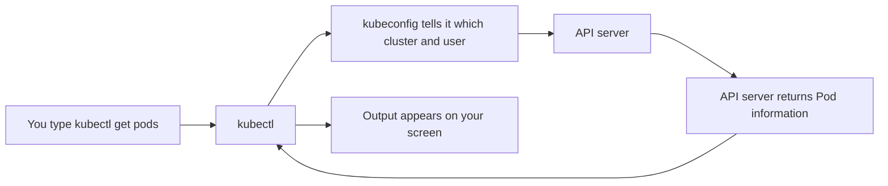

### What kubectl does not do

`kubectl` does not:

- directly start a container;
- directly choose a worker node;
- directly write into etcd;
- stay running to keep your Pods alive.

You can close your terminal after creating a Deployment. Kubernetes continues working.

---

## 15. kube-apiserver

The full component name is `kube-apiserver`. We usually call it the **API server**.

### What is it?

The API server is the main entry door of the Kubernetes control plane.

Almost every important Kubernetes component communicates through it.

### Purpose

Its purpose is to provide one controlled place for reading and changing Kubernetes information.

### Where does it run?

It runs on the control-plane side of the cluster.

In a highly available cluster, multiple API servers may run behind one stable address.

### How does it work?

Suppose you create a Pod.

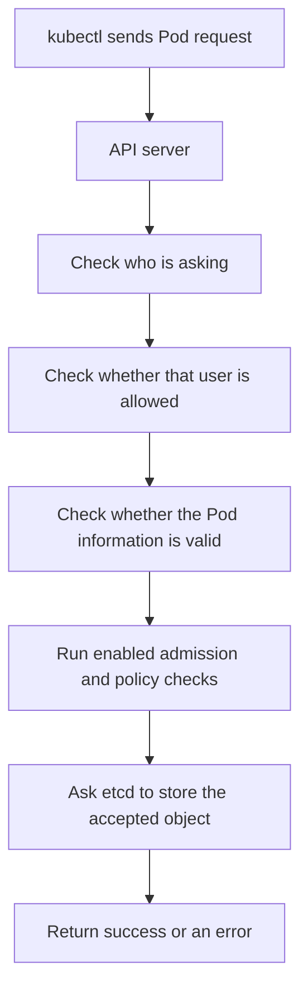

In simple steps:

1. Receive the request.
2. Check the caller's identity.
3. Check the caller's permission.
4. Check the submitted object.
5. Run configured rules.
6. Store accepted information through the storage layer into etcd.
7. Return a response.

Day 2 and Day 3 explain these checks deeply. For today, remember that the API server is the front door.

### Example

```bash
kubectl apply -f deployment.yaml
```

`kubectl` sends the Deployment to the API server. The API server does not start its containers. It accepts and stores the request so other components can act.

### If the API server stops working

- Existing containers may continue running.
- `kubectl` requests fail.
- New objects cannot be created normally.
- Controllers, scheduler, and kubelets cannot communicate normally with the control plane.
- New desired changes stop progressing.

### What the API server does not do

It does not:

- choose the node for a Pod;
- download application images on worker nodes;
- start the application container;
- carry normal user traffic to your web application.

---

## 16. etcd

The name is written as `etcd`.

### What is it?

etcd is the main database used for Kubernetes API information.

It stores data as keys and values.

Simple example:

```text
Key:   /some/path/for/a/deployment
Value: information describing that Deployment
```

You do not normally work with those internal keys yourself.

### Purpose

Kubernetes needs a trusted place to remember:

- which objects exist;
- what users requested;
- configuration and policy objects;
- current object information reported through the API.

### Where does it run?

etcd runs as part of, or near, the control plane.

Production clusters often use several etcd members so the data can survive some machine failures.

### How does it work with Kubernetes?

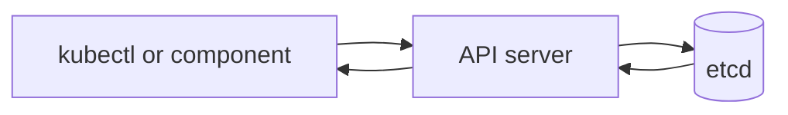

Important rule:

> Normal Kubernetes clients talk to the API server. They do not directly change etcd.

Example flow:

1. You send a Deployment to the API server.
2. The API server checks it.
3. The API server stores it in etcd.
4. A controller later reads the Deployment through the API server.

### What etcd stores

It stores Kubernetes API objects, for example:

- Deployments;
- Pods;
- Services;
- ConfigMaps;
- Secrets;
- Roles and other cluster configuration.

### What etcd does not store

etcd does not normally store:

- your container images;
- files written inside a container;
- your application's database rows;
- PersistentVolume file contents;
- all application logs.

These use different storage systems.

### If etcd stops working

If etcd cannot safely read or write the required cluster data:

- API changes fail;
- new Pods cannot be managed normally;
- controllers cannot save their updates;
- existing running containers may continue temporarily;
- the cluster cannot safely manage new desired state.

### Senior-engineer warning

etcd contains very sensitive cluster information. Back it up, protect its certificates, restrict network access, and test restoration. Do not edit etcd directly during normal work.

---

## 17. kube-scheduler

The full component name is `kube-scheduler`. We usually call it the **Scheduler**.

### What is it?

The Scheduler chooses a worker node for a new Pod.

### Why is it needed?

Imagine you have three worker nodes:

```text
Node 1: has free CPU and memory
Node 2: almost full
Node 3: has special GPU hardware
```

When a new Pod is created, somebody must decide where it should run. The Scheduler makes that decision.

### Where does it run?

It runs in the control plane.

### What information does it use?

It can consider:

- how much CPU the Pod asks for;
- how much memory the Pod asks for;
- which nodes are healthy;
- node labels;
- rules saying “run here” or “do not run here”;
- special hardware requirements;
- storage location requirements;
- taints and tolerations.

You will study these rules deeply on Day 4.

### How does it work?

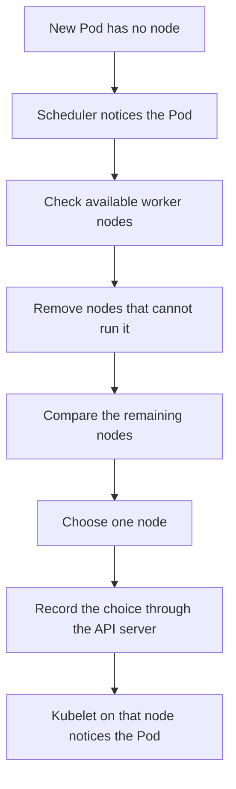

Step by step:

1. A Pod object exists, but it has no selected node.
2. The Scheduler sees it through the API server.
3. The Scheduler checks every possible node.
4. It removes nodes that cannot meet the Pod's requirements.
5. It gives scores to the remaining nodes.
6. It chooses a suitable node.
7. It saves that choice through the API server.

### Simple example

```text
Pod asks for: 2 GB memory

Node 1 free memory: 4 GB  → possible
Node 2 free memory: 1 GB  → not possible
Node 3 free memory: 3 GB  → possible

Scheduler compares Node 1 and Node 3, then chooses one.
```

### Very important: what happens next?

The Scheduler only records the selected node.

It does not start the container.

The **kubelet** on the chosen node starts the next part of the work.

### If the Scheduler stops working

- Already-running Pods normally keep running.
- New Pods can be accepted by the API server.
- New Pods that need scheduling remain `Pending`.
- When the Scheduler returns, it can schedule those waiting Pods.

### What the Scheduler does not do

It does not:

- create the original Pod request;
- start containers;
- download images;
- configure the Pod network;
- keep a Deployment at three replicas.

---

## 18. kube-controller-manager and controllers

### First: what is a controller?

A **controller** is a program that watches Kubernetes objects and tries to make reality match the requested state.

### Purpose

Controllers give Kubernetes its automatic repair behavior.

### Simple example

You ask for three application copies.

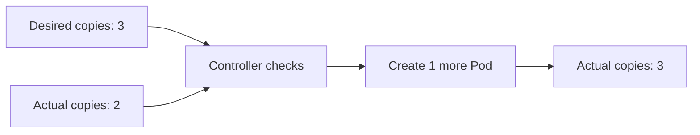

### What is kube-controller-manager?

`kube-controller-manager` is a control-plane program that runs many built-in controllers.

Think of it as one building containing many supervisors.

Examples of controllers inside or related to this control-plane work include:

- Deployment controller;
- ReplicaSet controller;
- Job controller;
- Node controller;
- EndpointSlice controller;
- namespace controller;
- garbage-collection controller.

### How does a controller work?

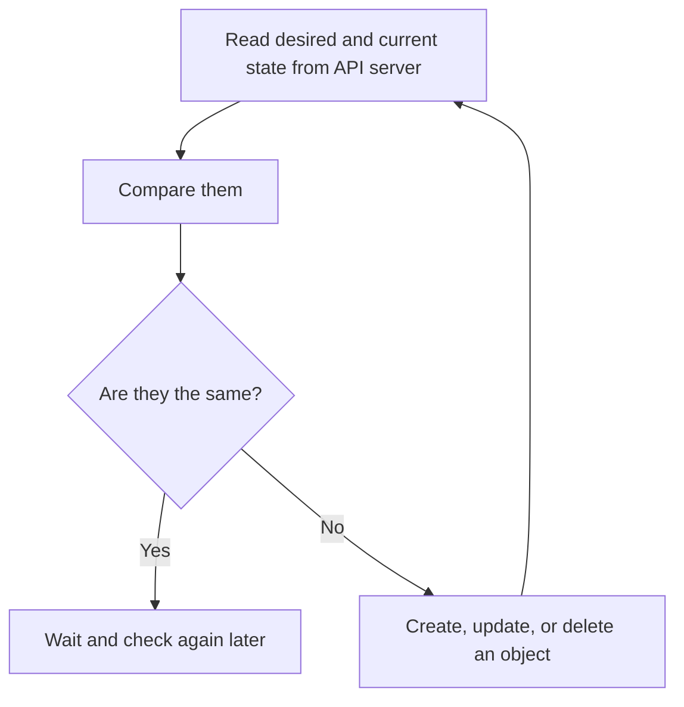

### Deployment and ReplicaSet example

When you create a Deployment:

```text
Deployment controller creates or updates a ReplicaSet.
ReplicaSet controller creates the required Pods.
Scheduler chooses nodes for those Pods.
Kubelets run them.
```

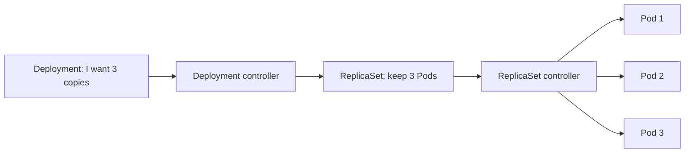

### If a managed Pod is deleted

1. The Pod disappears.
2. The ReplicaSet controller sees only two Pods instead of three.
3. It creates one new Pod.
4. The Scheduler selects a node.
5. A kubelet starts the new Pod.

The deleted Pod is not brought back with the same identity. A new Pod is created.

### If controller-manager stops working

- Existing Pods may continue running.
- Missing replicas are not replaced during the failure.
- Deployment updates stop progressing.
- Some cleanup and other automatic actions stop.
- When controllers recover, they check current state and continue fixing it.

### What controllers do not do

Controllers do not normally:

- directly edit etcd;
- directly start a container on a node;
- choose a node for a Pod.

They create or update objects through the API server.

---

## 19. cloud-controller-manager

### What is it?

`cloud-controller-manager` is an optional control-plane component that connects Kubernetes to a cloud provider.

Examples of cloud providers are AWS, Azure, Google Cloud, and OpenStack.

### Purpose

Kubernetes itself should not contain every cloud provider's private details. This component allows cloud-specific logic to live separately.

### What can it do?

Depending on the provider, it can help with:

- cloud information for Nodes;
- external load balancers;
- cloud network routes;
- removing information for deleted cloud machines.

### How does a LoadBalancer Service use it?

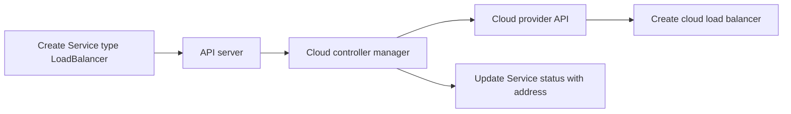

### Is it always present?

No.

- A local `kind` cluster may not use it.
- A bare-metal cluster may use another load-balancer solution.
- A managed Kubernetes service may hide its implementation from you.

### If it fails

Core application Pods may keep running, but cloud-related changes such as creating a new external load balancer can stop or remain pending.

---

# Part 5 — Worker-node components

## 20. What is a worker node?

A **worker node** is a machine that runs application Pods.

It can be:

- a physical server;
- a virtual machine;
- in some learning setups, a container acting like a node.

A worker node normally has:

```text
Worker node
├── kubelet
├── container runtime
├── CNI/network components
├── kube-proxy or another Service implementation
└── application Pods
```

---

## 21. kubelet

### What is it?

The kubelet is the main Kubernetes agent running on each worker node.

An **agent** is a program that performs work for a larger system.

### Purpose

The kubelet makes sure the Pods assigned to its node are actually running as requested.

### Where does it run?

One kubelet normally runs on every node.

### How does it work?

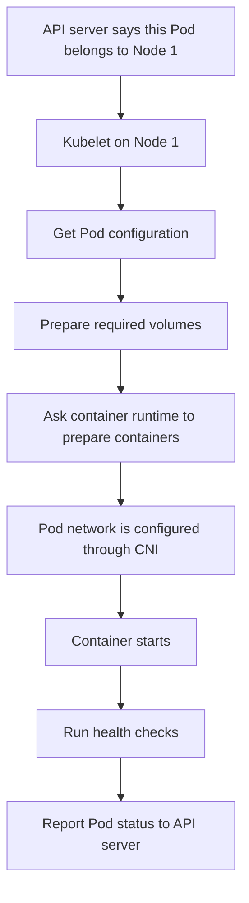

Step by step:

1. The Scheduler records that a Pod should run on this node.
2. The kubelet notices the assigned Pod through the API server.
3. It reads the Pod instructions.
4. It prepares configuration, Secrets, and volumes.
5. It asks the container runtime to prepare and start containers.
6. The runtime and CNI path prepare the Pod network.
7. The kubelet runs health checks.
8. It reports the Pod status back to the API server.
9. It keeps checking the Pod.

### Container restart

If a container crashes and its restart policy says it should restart, kubelet asks the runtime to start it again.

### Node status

Kubelet also reports information about the node, such as:

- whether the node is ready;
- available resources;
- container runtime version;
- pressure caused by low memory or disk space.

### If kubelet stops working

- Existing containers may keep running for some time.
- New assigned Pods cannot start normally on that node.
- health checks and container restarts stop being managed correctly;
- node and Pod status become old;
- the control plane eventually considers the node unhealthy;
- controller-managed Pods may later be replaced on other nodes.

### What kubelet does not do

It does not:

- choose which node should receive a Pod;
- decide how many Deployment replicas should exist;
- store the whole cluster state;
- provide the main Kubernetes API.

---

## 22. Container runtime

### What is it?

The container runtime is the node software that performs container operations.

Examples:

- containerd;
- CRI-O.

### Purpose

The kubelet needs another program that knows how to work with images and containers.

### How does it work?

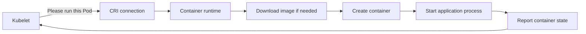

The runtime can:

- pull images;
- create the Pod's container environment;
- start containers;
- stop containers;
- remove containers;
- report container state.

### If the runtime fails

- New containers cannot start.
- Existing containers may be affected depending on the failure.
- Pods can show errors such as container creation failure.
- Kubelet reports the problem through Pod status and Events.

### What the runtime does not do

It does not decide:

- which node is best;
- how many replicas should exist;
- which user is allowed to create a Deployment.

---

## 23. CRI — Container Runtime Interface

The word **interface** can sound difficult. Here it means an agreed communication method.

### What is CRI?

CRI stands for **Container Runtime Interface**.

It is the agreed way kubelet communicates with a compatible container runtime.

### Why does it exist?

Without a common interface, kubelet would need completely different code for every runtime.

With CRI:

```text
Kubelet speaks one agreed language.
Different compatible runtimes understand that language.
```

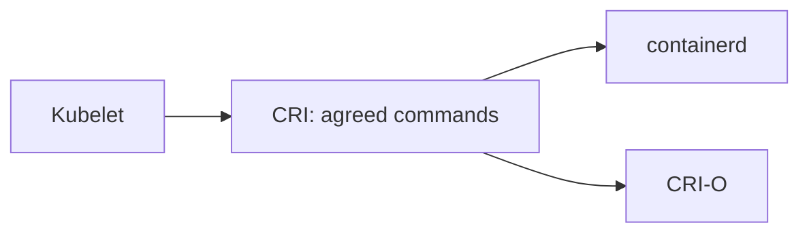

### Important difference

```text
CRI                 = communication agreement
containerd / CRI-O  = software implementing runtime work
```

CRI is not itself the program that runs your application.

---

## 24. CNI — Container Network Interface

This is one of the areas that often confuses new learners. We will build it slowly.

### First: why does a Pod need networking?

A backend Pod may need to:

- receive a request from a frontend Pod;
- connect to a database;
- contact DNS;
- download or send information.

For this, the Pod normally needs:

- a network interface;
- an IP address;
- network routes telling packets where to go.

### What is CNI?

CNI stands for **Container Network Interface**.

It is an agreed plugin system used to set up container or Pod networking.

### What is a CNI plugin?

A CNI plugin is software that implements this network setup.

Examples of Kubernetes networking projects include Cilium, Calico, and Flannel. Their features are different.

### Purpose

The main purpose is to make Pod networking possible.

### How does it work when a Pod starts?

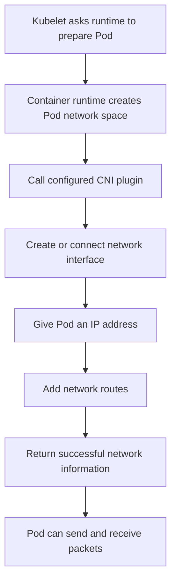

Step by step:

1. The Pod is assigned to a node.
2. Kubelet asks the runtime to prepare it.
3. The runtime uses the configured CNI system.
4. The CNI plugin creates or connects a network interface.
5. It gives the Pod an IP address.
6. It adds the required network routes.
7. It returns the network result.
8. The Pod can communicate according to network rules.

### Simple example

```text
Frontend Pod IP: 10.10.1.5
Backend Pod IP:  10.10.2.8

The CNI implementation helps the cluster network deliver packets
between these Pod addresses, even when the Pods are on different nodes.
```

### What else can a networking implementation do?

Depending on the implementation, it may also provide:

- NetworkPolicy enforcement;
- traffic encryption;
- network visibility;
- Service handling that replaces kube-proxy;
- different routing methods.

These extra features are not provided by every CNI implementation.

### If CNI setup fails

- The Pod may stay in `ContainerCreating` or show sandbox/network errors.
- The Pod may not receive an IP address.
- Containers may not start normally.
- Pod-to-Pod communication may fail.

Look at:

```bash
kubectl describe pod <pod-name>
kubectl get pods -n kube-system
```

The exact networking Pods and logs depend on the installed CNI project.

### What CNI does not do by itself

CNI does not automatically:

- decide which node runs the Pod;
- create the Deployment;
- store Kubernetes objects;
- provide application-level usernames and permissions;
- guarantee that every CNI product has the same features.

---

## 25. kube-proxy and Service traffic

### First: why is a Service needed?

Pod IP addresses can change when Pods are replaced.

Suppose three backend Pods exist:

```text
10.10.1.5
10.10.2.8
10.10.3.4
```

If one Pod is replaced, its new IP may be different. A frontend should not keep a fixed list of changing Pod IPs.

A Kubernetes **Service** provides a stable name and usually a stable virtual IP in front of matching Pods.

### What is kube-proxy?

`kube-proxy` is the default Kubernetes component that helps implement Service network traffic on nodes.

Some networking systems replace kube-proxy, so it is not present in every cluster.

### Purpose

It helps send traffic addressed to a Service toward one of that Service's available Pod endpoints.

### How does it work?

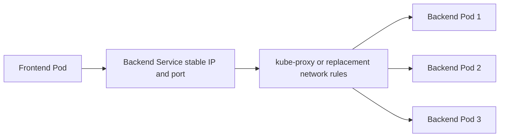

Step by step:

1. A Service selects Pods using labels.
2. Kubernetes creates EndpointSlice information containing suitable Pod addresses.
3. kube-proxy or another Service implementation watches Services and EndpointSlices.
4. It creates network rules on nodes.
5. A client sends traffic to the Service address.
6. The rules send that connection to one suitable Pod.

### If kube-proxy fails

Depending on the cluster design:

- direct Pod-to-Pod traffic may still work;
- Service IP traffic on the affected node may fail;
- NodePort traffic may fail;
- existing rules may remain for some time but stop updating.

### What kube-proxy does not do

It does not:

- create Pod IP addresses as the main CNI job;
- create Pods;
- decide whether a user can create a Service;
- fix an application that is not listening on its target port.

---

## 26. CSI — Container Storage Interface

### First: why is storage needed?

A container's local writable data is not safe permanent storage.

When a Pod is replaced, the new Pod may run on another node and may not see old local files.

Databases and other stateful applications need storage that can live beyond one Pod.

### What is CSI?

CSI stands for **Container Storage Interface**.

It is an agreed way for Kubernetes to work with different storage systems.

### Purpose

CSI allows storage providers to create drivers that Kubernetes can use without putting every storage system directly inside Kubernetes.

### Simple storage objects

- **PersistentVolumeClaim (PVC):** an application's request for storage.
- **PersistentVolume (PV):** Kubernetes information representing storage.
- **StorageClass:** describes how a type of storage should be created.
- **CSI driver:** performs operations with the real storage system.

### How dynamic storage works

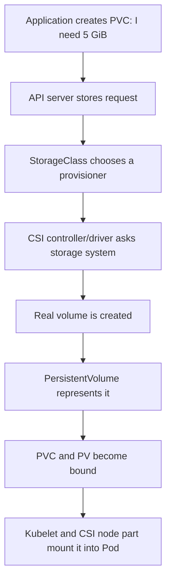

### If CSI or storage fails

- A PVC may remain `Pending`.
- A volume may fail to attach.
- A Pod may be scheduled but fail to mount its volume.
- The Pod can remain `Pending` or `ContainerCreating` with storage Events.

### What CSI does not do

It does not automatically:

- back up your database correctly;
- guarantee that every storage system supports every access mode;
- store Kubernetes control-plane state instead of etcd;
- decide where all Pods run.

---

## 27. CoreDNS

### What is DNS?

DNS changes easy names into network addresses.

Example:

```text
Name: backend.shop.svc.cluster.local
Result: the network address for the backend Service
```

### What is CoreDNS?

CoreDNS is the common DNS add-on used in Kubernetes clusters.

### Purpose

It helps applications find Services using names instead of remembering IP addresses.

### How does it work?

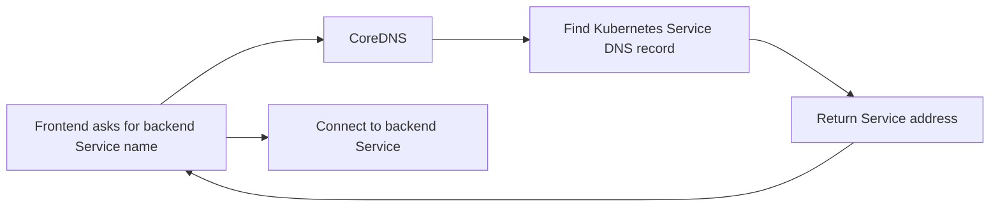

### Example

A Pod in the same namespace may connect using:

```text
http://backend
```

A complete Service name may look like:

```text
backend.shop.svc.cluster.local
```

The exact cluster domain can be configured differently.

### If CoreDNS fails

- Applications may fail to find Services by name.
- Direct IP connections may still work.
- You may see errors such as “name not known” or DNS timeouts.

### What CoreDNS does not do

It does not normally:

- start application Pods;
- choose a node;
- guarantee that the Service has healthy backend Pods;
- replace application traffic routing after returning the address.

---

## 28. Metrics Server, Dashboard, Ingress, and other add-ons

These are useful, but they are not all required core components.

### Metrics Server

Collects recent CPU and memory information used by commands such as:

```bash
kubectl top pods
```

If it is not installed, Pods can still run, but `kubectl top` and some autoscaling functions may not work.

### Dashboard

An optional web interface. It is not required to operate Kubernetes, and it must be secured carefully.

### Ingress or Gateway controller

Watches routing objects and configures a proxy or load balancer so external HTTP/HTTPS traffic can reach Services.

Creating an Ingress object without a controller does not automatically expose the application.

### CRDs and Operators

- A **CustomResourceDefinition (CRD)** teaches Kubernetes a new object type.
- An **Operator** is usually a custom controller that manages something using Kubernetes-style desired state.

These extend Kubernetes. They are not part of every basic cluster.

---

# Part 6 — See all components together

## 29. Complete Kubernetes architecture in a simple diagram

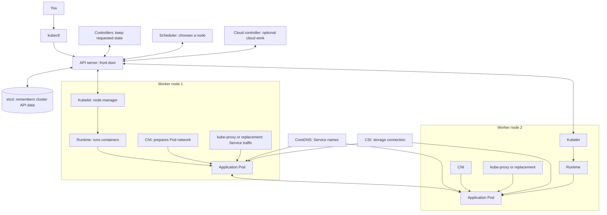

### One-line responsibility map

| Component | Very simple job |
|---|---|
| `kubectl` | Sends your requests to Kubernetes |
| API server | Main protected door to the cluster API |
| etcd | Remembers Kubernetes API information |
| Scheduler | Chooses a node for a new Pod |
| Controller manager | Runs loops that keep requested state |
| Cloud controller manager | Connects Kubernetes to cloud systems |
| Worker node | Machine that runs application Pods |
| Kubelet | Manages assigned Pods on one node |
| Container runtime | Pulls images and starts/stops containers |
| CRI | Agreed communication between kubelet and runtime |
| CNI | Agreed plugin system for Pod networking |
| kube-proxy/replacement | Implements Service traffic rules |
| CSI | Agreed plugin system for storage |
| CoreDNS | Converts Service names to addresses |

---

# Part 7 — Complete working: from YAML to a running application

## 30. The example

You want two copies of an Nginx web application.

You write a Deployment file:

```yaml
apiVersion: apps/v1
kind: Deployment
metadata:
  name: web
spec:
  replicas: 2
  selector:
    matchLabels:
      app: web
  template:
    metadata:
      labels:
        app: web
    spec:
      containers:
        - name: nginx
          image: nginx:1.27-alpine
          ports:
            - containerPort: 80
```

## 31. Complete step-by-step flow

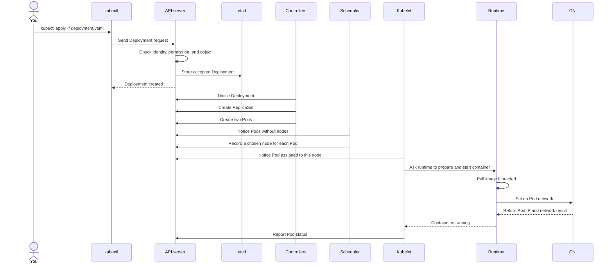

Now read the same flow in very simple numbered steps.

### Step 1 — You run kubectl

```bash
kubectl apply -f deployment.yaml
```

`kubectl` reads the file and finds the API server information in your kubeconfig.

### Step 2 — kubectl contacts the API server

The Deployment request is sent to the API server.

### Step 3 — API server checks the request

It checks:

- Who are you?
- Are you allowed to create a Deployment?
- Is the Deployment structure valid?
- Do enabled policies allow it?

If a check fails, the request is rejected.

### Step 4 — etcd remembers the Deployment

If accepted, the API server stores the Deployment information in etcd.

At this moment, receiving “created” does not necessarily mean the application containers are already running.

### Step 5 — Deployment controller notices it

The Deployment controller sees the new Deployment and creates a ReplicaSet.

### Step 6 — ReplicaSet controller creates two Pods

The Deployment asked for two copies. The ReplicaSet controller creates two Pod objects.

### Step 7 — Scheduler chooses nodes

Each new Pod has no node yet. The Scheduler checks the worker nodes and chooses a suitable node for each Pod.

### Step 8 — Kubelet notices its assigned Pod

The kubelet on the selected node sees that the Pod belongs to its node.

### Step 9 — Volumes are prepared if needed

If the Pod uses storage, kubelet and the storage system/CSI path prepare and mount it.

This Nginx example does not need a persistent volume.

### Step 10 — Runtime prepares the container

Kubelet asks the runtime to run the container.

The runtime downloads `nginx:1.27-alpine` if it is not already available according to image-pull behavior.

### Step 11 — CNI networking is prepared

The runtime uses the configured CNI system to give the Pod network access and an IP address.

### Step 12 — Container starts

The runtime starts the Nginx process inside the container.

### Step 13 — Kubelet reports status

Kubelet reports information such as container state, Pod IP, and health to the API server.

### Step 14 — Health checks are evaluated

If probes are configured, kubelet runs them. Readiness decides whether the Pod should receive Service traffic.

### Step 15 — A Service can send traffic to ready Pods

If you create a Service with matching labels, EndpointSlices contain eligible Pod addresses. kube-proxy or its replacement implements the traffic path.

This is the full journey from your YAML file to a running application.

---

# Part 8 — Kubernetes objects and YAML

## 32. What is a Kubernetes object?

A Kubernetes object is a saved record describing something in the cluster.

Examples:

- Pod object;
- Deployment object;
- Service object;
- ConfigMap object;
- Secret object.

Objects are handled through the Kubernetes API.

## 33. What is YAML?

YAML is a human-readable text format often used to describe Kubernetes objects.

Simple Pod example:

```yaml
apiVersion: v1
kind: Pod
metadata:
  name: my-web-pod
spec:
  containers:
    - name: web
      image: nginx:1.27-alpine
```

### Explain every main field

#### `apiVersion`

Tells Kubernetes which API group and version describe this object.

```yaml
apiVersion: v1
```

#### `kind`

Tells Kubernetes the object type.

```yaml
kind: Pod
```

#### `metadata`

Information used to identify or organize the object.

```yaml
metadata:
  name: my-web-pod
```

#### `spec`

Describes what you want.

```yaml
spec:
  containers:
    - name: web
      image: nginx:1.27-alpine
```

#### `status`

Describes what Kubernetes currently observes.

You normally provide `spec`. Kubernetes components update `status`.

## 34. Desired state and actual state

### Desired state

What you want.

Example:

```text
I want 3 web Pods.
```

### Actual state

What exists right now.

Example:

```text
Only 2 web Pods are running.
```

### Controller action

```text
Desired: 3
Actual:  2
Action:  Create 1
```

```mermaid
flowchart LR
    SPEC[spec says 3 replicas] --> CONTROLLER[Controller]
    STATUS[status shows 2 replicas] --> CONTROLLER
    CONTROLLER --> NEW[Create 1 Pod]
    NEW --> MATCH[Desired and actual become 3]
```

## 35. Declarative configuration

**Declarative** means you describe the final result.

```text
Declarative: “Keep 3 copies running.”

Imperative step list:
“Start copy 1, start copy 2, start copy 3,
and if copy 2 fails, start another copy.”
```

Kubernetes is mainly built around declarative desired state.

---

## 36. Labels and selectors

### What is a label?

A label is a small key/value tag attached to an object.

```yaml
labels:
  app: web
  environment: test
```

### Why are labels needed?

Kubernetes needs a flexible way to group and find objects.

Examples:

- find every Pod belonging to `app: web`;
- find test-environment objects;
- let a Service find backend Pods.

### What is a selector?

A selector is a rule that finds objects with matching labels.

```text
Selector: app=web

Matches:
Pod A labels: app=web       yes
Pod B labels: app=database  no
Pod C labels: app=web       yes
```

```mermaid
flowchart LR
    S[Service selector app=web] --> P1[Pod 1 label app=web]
    S --> P2[Pod 2 label app=web]
    DB[Pod 3 label app=database]
```

### Common mistake

If a Service selector says `app: backend` but the Pod label says `app: api`, the Service will not find that Pod.

---

## 37. Namespace

### What is it?

A Namespace is a way to group many Kubernetes objects inside one cluster.

Example:

```text
Cluster
├── Namespace: development
│   ├── Deployment: web
│   └── Service: web
└── Namespace: production
    ├── Deployment: web
    └── Service: web
```

The same object name can exist in different Namespaces.

### Purpose

Namespaces help with:

- organizing team or environment resources;
- applying permissions;
- applying quotas;
- applying some security and network rules.

### Important limitation

A Namespace is not a complete security wall by itself.

Security also needs RBAC, network rules, Pod security, quotas, and careful cluster design.

### Namespaced and cluster-wide objects

Some objects live inside Namespaces:

- Pods;
- Deployments;
- Services;
- ConfigMaps;
- Secrets.

Some are cluster-wide:

- Nodes;
- PersistentVolumes;
- StorageClasses;
- ClusterRoles.

---

# Part 9 — Pods from zero

## 38. What is a Pod?

A Pod is the smallest application unit that Kubernetes schedules onto a node.

A Pod contains one or more containers that must live together.

Most Pods contain one main application container.

```text
Pod
└── Main application container
```

Sometimes a Pod contains closely related containers:

```text
Pod
├── Main application container
└── Helper sidecar container
```

### Why does Kubernetes use Pods instead of scheduling containers directly?

Containers inside one Pod share important things:

- the same Pod IP address;
- the same network space;
- `localhost` communication;
- the same node;
- declared shared volumes;
- one overall Pod lifecycle.

Kubernetes therefore places the complete Pod on one node.

### Pod networking example

```mermaid
flowchart TB
    subgraph POD[One Pod with IP 10.10.1.5]
      APP[Application container on port 8080]
      HELPER[Helper container]
      APP <-->|localhost| HELPER
    end
    POD --> NETWORK[Cluster network]
```

### Important: Pods are replaceable

A Pod is not normally treated like a permanent pet server.

If a controller replaces it:

- the new Pod has a new UID;
- it may have a new IP address;
- it may run on another node;
- local temporary data may be gone.

Use a controller and persistent storage when needed.

---

## 39. Pod phases

A Pod phase is a simple summary of where the Pod is in its lifecycle.

### Pending

The Pod was accepted, but it is not fully running yet.

Possible reasons:

- waiting for the Scheduler;
- downloading an image;
- preparing a volume;
- setting up networking.

`Pending` does not always mean a Scheduler problem. Check whether a node is already assigned.

### Running

The Pod is assigned to a node and at least one container is running, starting, or restarting.

`Running` does not guarantee that the application is ready to receive traffic.

### Succeeded

All containers completed successfully and will not restart. Common for completed Jobs.

### Failed

All containers stopped and at least one ended unsuccessfully, or the Pod ended in failure.

### Unknown

Kubernetes cannot obtain the Pod state, often because communication with the node is lost.

---

## 40. Container states inside a Pod

A container can be:

- `Waiting` — not running yet;
- `Running` — process is running;
- `Terminated` — process stopped.

Examples:

```text
Waiting:    image is being pulled
Running:    web server is active
Terminated: process exited with code 1
```

## 41. Restart policy

The Pod has a `restartPolicy`:

- `Always` — restart stopped application containers;
- `OnFailure` — restart when a container exits unsuccessfully;
- `Never` — do not restart it.

Deployments use Pods whose normal restart policy is `Always`.

Do not confuse:

- kubelet restarting a container inside the same Pod;
- a controller creating a completely new replacement Pod.

---

## 42. Init container

### What is it?

An init container performs setup work before the normal application containers start.

### Purpose

Use it for work that must finish first.

Examples:

- wait for a dependency;
- create initial files;
- prepare configuration.

### Working

```mermaid
flowchart LR
    POD[Pod starts] --> I1[Init container 1]
    I1 -->|success| I2[Init container 2]
    I2 -->|success| APP[Application container starts]
    I1 -->|failure| RETRY[Retry based on Pod behavior]
```

Normal init containers run one after another and must succeed before the main application starts.

---

## 43. Sidecar container

### What is it?

A sidecar is a helper container that runs beside the main application in the same Pod.

Examples:

- a proxy;
- a log helper;
- a file synchronization helper.

```text
Pod
├── Main application
└── Sidecar helper
```

Because they share the Pod network, they can communicate using `localhost`.

Do not add sidecars without a reason. Every sidecar uses resources and adds another failure path.

---

## 44. Ephemeral container

An ephemeral container is a temporary debugging container added to a running Pod.

Purpose:

- investigate a Pod whose application image has no shell or debugging tools.

It is different from a normal application container:

- it is mainly for debugging;
- it is not automatically restarted like a normal app container;
- it does not have all normal container fields;
- using it needs special permission.

---

## 45. Static Pod

A static Pod is managed directly by a kubelet from a file on one node.

```mermaid
flowchart LR
    FILE[Static Pod file on node] --> K[Kubelet]
    K --> POD[Run Pod on that same node]
    K --> MIRROR[Optional mirror Pod visible in API]
```

It does not need the normal API-created Pod flow to start.

kubeadm commonly uses static Pods for control-plane components.

A static Pod is tied to one node and is advanced cluster-administration knowledge. Do not use it as a normal replacement for a Deployment.

---

# Part 10 — Workload objects

## 46. Why not create only bare Pods?

If you create one Pod directly and it is deleted, no Deployment or ReplicaSet exists to replace it.

For normal applications, use a higher-level workload object.

```text
Bare Pod deleted          → stays deleted
Deployment Pod deleted    → controller creates a replacement
```

---

## 47. ReplicaSet

### What is it?

A ReplicaSet keeps a requested number of matching Pods.

### Purpose

If there are too few Pods, it creates more. If there are too many, it removes extras.

### How it works

```mermaid
flowchart TD
    RS[ReplicaSet wants 3 Pods] --> COUNT[Count matching Pods]
    COUNT --> RESULT{How many exist?}
    RESULT -->|2| ADD[Create 1 Pod]
    RESULT -->|3| NOTHING[No change]
    RESULT -->|4| REMOVE[Remove 1 Pod]
```

You normally let a Deployment manage ReplicaSets instead of creating them yourself.

---

## 48. Deployment

### What is it?

A Deployment manages interchangeable application Pods through ReplicaSets.

### Purpose

It is the usual choice for long-running stateless applications such as:

- web frontends;
- REST APIs;
- workers whose copies are interchangeable.

### How it works

```mermaid
flowchart LR
    D[Deployment] --> RS1[Current ReplicaSet]
    RS1 --> P1[Pod]
    RS1 --> P2[Pod]
    RS1 --> P3[Pod]
```

When you change the image:

1. Deployment creates a new ReplicaSet.
2. New Pods start gradually.
3. Old Pods are removed gradually.
4. Kubernetes tracks rollout status.

```mermaid
flowchart LR
    OLD[Old ReplicaSet and Pods] --> DEP[Deployment rollout]
    DEP --> NEW[New ReplicaSet and Pods]
    NEW --> SCALEUP[New Pods increase]
    SCALEUP --> SCALEDOWN[Old Pods decrease]
```

### What “stateless” means here

**Stateless** means any replica can usually handle a request without depending on unique local data stored only inside that Pod.

A stateless application can still use an external database.

### If one Deployment Pod crashes

- Kubelet may restart its container.
- If the Pod disappears, the ReplicaSet creates another Pod.
- A Service can direct traffic to ready copies.

---

## 49. StatefulSet

### What is it?

A StatefulSet manages Pods that need stable identities or stable storage relationships.

### Purpose

Use it when application instances are not completely interchangeable.

Examples can include databases and clustered systems, when the application supports Kubernetes operation.

### Stable names

StatefulSet Pods have ordered names:

```text
database-0
database-1
database-2
```

### Storage relationship

```mermaid
flowchart TB
    SS[StatefulSet]
    SS --> P0[database-0]
    SS --> P1[database-1]
    P0 --> V0[(volume for database-0)]
    P1 --> V1[(volume for database-1)]
```

If `database-0` is replaced, the replacement can be connected to the storage meant for ordinal `0`, depending on the storage design.

### What StatefulSet does not do

It does not automatically:

- make a database replicated;
- make data consistent;
- take backups;
- choose the correct database leader;
- guarantee safe failover.

The application and operator design must handle those concerns.

---

## 50. DaemonSet

### What is it?

A DaemonSet normally keeps one Pod on every suitable node, or on a selected group of nodes.

### Purpose

Use it for software that performs a node-level job.

Examples:

- log collector on each node;
- monitoring agent;
- CNI node component;
- storage node plugin;
- hardware/device plugin.

```mermaid
flowchart TB
    DS[DaemonSet]
    DS --> N1[Node 1: one agent Pod]
    DS --> N2[Node 2: one agent Pod]
    DS --> N3[Node 3: one agent Pod]
```

When a new suitable node joins, the DaemonSet controller creates the Pod there.

Do not use a DaemonSet merely because you want several application copies. Use a Deployment for normal replicated applications.

---

## 51. Job

### What is it?

A Job manages work that should finish successfully and then stop.

### Examples

- process a batch of files;
- create a report;
- run a one-time data task;
- perform a carefully designed migration.

```mermaid
flowchart LR
    JOB[Job] --> POD[Job Pod starts]
    POD --> WORK[Perform task]
    WORK -->|exit success| COMPLETE[Job complete]
    WORK -->|failure| RETRY[Retry according to Job policy]
```

A Job is different from a Deployment. Deployment processes normally keep running. Job processes normally finish.

---

## 52. CronJob

### What is it?

A CronJob creates Jobs on a schedule.

### Examples

- daily report at midnight;
- hourly cleanup;
- scheduled backup command, when designed safely.

```mermaid
flowchart LR
    TIME[Schedule time arrives] --> CJ[CronJob controller]
    CJ --> J[Create Job]
    J --> P[Create task Pod]
    P --> DONE[Task completes]
```

CronJob creates a Job. The Job creates/manages the task Pods.

Scheduled tasks should be safe if delayed or run more than once, because distributed systems can experience unusual timing or retries.

---

## 53. Which workload should I choose?

| Your need | Choose | Simple reason |
|---|---|---|
| Long-running stateless web/API copies | Deployment | Copies are interchangeable and updates are managed |
| Stable identity and storage relationship | StatefulSet | Pods keep ordered identities |
| One node agent on each suitable node | DaemonSet | Follows nodes |
| One task that finishes | Job | Tracks successful completion |
| Repeated scheduled task | CronJob | Creates Jobs on a schedule |
| One temporary learning test | Bare Pod | Simple, but no controller replacement |

---

# Part 11 — Application health checks

## 54. Why health checks are needed

A process can be running but unable to serve users.

Example:

```text
Process exists: yes
Application connected to database: no
Can it serve a user request: no
```

Kubernetes uses **probes** to check different kinds of health.

---

## 55. Startup probe

### Question it answers

“Has this application finished starting?”

### Purpose

Some applications take a long time to start. A startup probe gives them time before liveness and readiness checks take normal control.

### Failure behavior

If startup keeps failing past its configured threshold, kubelet restarts the container.

---

## 56. Readiness probe

### Question it answers

“Can this application receive traffic right now?”

### Purpose

Stop sending Service traffic to an application that is alive but temporarily unable to serve correctly.

### Failure behavior

- Pod becomes not Ready.
- It is removed from ready Service endpoints.
- The container is not restarted only because readiness failed.

Example:

```text
Application is updating its cache.
Process is alive.
Readiness says “not ready.”
Service temporarily stops sending new traffic to it.
```

---

## 57. Liveness probe

### Question it answers

“Is this application stuck and should its container be restarted?”

### Purpose

Recover from a process that is alive but permanently stuck.

### Failure behavior

After the configured failure threshold, kubelet restarts the container.

### Warning

A bad liveness probe can cause an outage by repeatedly restarting a slow but recoverable application.

---

## 58. Probe flow diagram

```mermaid
flowchart TD
    START[Container starts] --> SP{Startup probe configured?}
    SP -->|Yes| STARTCHECK[Check until startup succeeds]
    STARTCHECK -->|Keeps failing| RESTART[Restart container]
    STARTCHECK -->|Success| NORMAL[Begin normal checks]
    SP -->|No| NORMAL
    NORMAL --> READY{Readiness succeeds?}
    READY -->|Yes| TRAFFIC[Allow Service endpoint traffic]
    READY -->|No| NOTREADY[Do not use as ready endpoint]
    NORMAL --> LIVE{Liveness succeeds?}
    LIVE -->|No after threshold| RESTART
    LIVE -->|Yes| NORMAL
```

### Probe example

```yaml
startupProbe:
  httpGet:
    path: /health
    port: 8080
  periodSeconds: 2
  failureThreshold: 30

readinessProbe:
  httpGet:
    path: /ready
    port: 8080
  periodSeconds: 5

livenessProbe:
  httpGet:
    path: /health
    port: 8080
  periodSeconds: 10
  failureThreshold: 3
```

---

# Part 12 — CPU and memory

## 59. Resource request

A **request** tells Kubernetes how much CPU or memory a container needs for placement and resource planning.

Example:

```yaml
resources:
  requests:
    cpu: 100m
    memory: 128Mi
```

`100m` CPU means one tenth of one CPU core.

### How Scheduler uses it

```text
Pod memory request: 2 GiB

Node A has enough unrequested capacity → possible
Node B does not                       → rejected for this Pod
```

A Pod can remain `Pending` when no node has enough capacity for its requests.

---

## 60. Resource limit

A **limit** is a maximum runtime resource setting.

```yaml
resources:
  limits:
    cpu: 500m
    memory: 256Mi
```

### CPU limit

If a container tries to use more CPU than allowed, the system can slow it through CPU throttling.

### Memory limit

If a container uses more memory than its limit, it can be killed because memory cannot be slowed in exactly the same way as CPU.

This may appear as `OOMKilled`.

### Request versus limit diagram

```mermaid
flowchart LR
    REQUEST[Request] --> SCHED[Scheduler uses it to choose capacity]
    LIMIT[Limit] --> NODE[Node/runtime enforces runtime maximum]
    NODE --> CPU[CPU can be throttled]
    NODE --> MEM[Memory excess can cause OOM kill]
```

### Common mistake

A high memory limit does not reserve that memory for scheduling. The request is the important scheduling value.

---

# Part 13 — Application configuration

## 61. Environment variable

An environment variable gives a small value to a process.

```yaml
env:
  - name: LOG_LEVEL
    value: info
```

The application reads `LOG_LEVEL`.

## 62. ConfigMap

A ConfigMap stores non-secret configuration.

Examples:

- feature flag;
- log level;
- application configuration file;
- non-sensitive service setting.

It can be provided as environment variables or mounted files.

Do not put passwords in a ConfigMap.

## 63. Secret

A Secret is the Kubernetes object intended for sensitive data.

Examples:

- password;
- API token;
- TLS key.

Important:

> Base64 text inside a Secret is encoding, not encryption.

Protect Secrets with permissions and configure encryption at rest when required. Avoid printing them in logs or storing real values in Git.

## 64. Downward API

The Downward API gives a container selected information about its own Pod, such as:

- Pod name;
- Namespace;
- labels or annotations;
- requested resources.

It does not mean the application gets unrestricted access to the Kubernetes API.

## 65. Configuration flow

```mermaid
flowchart LR
    CM[ConfigMap: normal configuration] --> POD[Pod container]
    SEC[Secret: sensitive value] --> POD
    DOWN[Downward API: Pod information] --> POD
    ENV[Direct environment value] --> POD
```

### Update warning

Changing a ConfigMap or Secret does not guarantee that a running application immediately uses the new value.

- Environment values are normally fixed when the container starts.
- Mounted projections can update after some time.
- The application must reread changed files.
- Some applications need a restart or reload.

---

# Part 14 — What happens when something fails?

## 66. Failure map

```mermaid
flowchart TD
    PROBLEM[Pod is not working] --> EXISTS{Does the Pod object exist?}
    EXISTS -->|No| APIERR[Check kubectl error, namespace, API access]
    EXISTS -->|Yes| NODE{Has a node been selected?}
    NODE -->|No| SCHEDERR[Check Scheduler Events and resource requirements]
    NODE -->|Yes| STARTED{Did container start?}
    STARTED -->|No| SETUP[Check image, ConfigMap, Secret, volume, CNI, runtime]
    STARTED -->|Yes| READY{Is Pod Ready?}
    READY -->|No| HEALTH[Check probes and application logs]
    READY -->|Yes| TRAFFIC{Can users reach it?}
    TRAFFIC -->|No| NET[Check Service, labels, endpoints, DNS, policy]
    TRAFFIC -->|Yes| APP[Check application behavior]
```

## 67. Common states in simple words

### `ImagePullBackOff`

Kubernetes could not download the image and is waiting before retrying.

Check:

- image name and tag;
- registry access;
- registry credentials;
- node DNS and internet/network access.

### `CrashLoopBackOff`

The container starts, stops, and is restarted repeatedly. Kubernetes waits longer between retries.

Check:

- current and previous logs;
- starting command;
- environment/configuration;
- permissions;
- memory/OOM;
- liveness probe.

### `Pending`

The Pod is not fully running yet.

- No node selected: check scheduling.
- Node selected: check image, volume, CNI, and kubelet Events.

### `CreateContainerConfigError`

Kubelet cannot build the container configuration, often because a named ConfigMap or Secret is missing.

### Running but `0/1 Ready`

The process may be running, but its readiness check is failing.

---

# Part 15 — Hands-on lab

Use a local or disposable learning cluster. Do not perform destructive experiments in production.

## 68. Confirm the cluster

Run on the computer where `kubectl` is installed:

```bash
kubectl config current-context
kubectl cluster-info
kubectl get nodes
```

### What these commands mean

- `current-context` shows which cluster/user selection you are using.
- `cluster-info` checks the cluster endpoint.
- `get nodes` asks the API server for node information.

Expected result: at least one node should normally show `Ready`.

These commands do not change cluster objects.

---

## 69. Create a learning Namespace

```bash
kubectl create namespace learning
```

This creates a cluster object, so it changes cluster state.

Use the namespace explicitly in each command so it is always clear where you are working.

---

## 70. Create a Deployment

Save this as `web-deployment.yaml`:

```yaml
apiVersion: apps/v1
kind: Deployment
metadata:
  name: web
  namespace: learning
spec:
  replicas: 2
  selector:
    matchLabels:
      app: web
  template:
    metadata:
      labels:
        app: web
    spec:
      containers:
        - name: nginx
          image: nginx:1.27-alpine
          ports:
            - name: http
              containerPort: 80
          readinessProbe:
            httpGet:
              path: /
              port: http
            periodSeconds: 5
          resources:
            requests:
              cpu: 50m
              memory: 32Mi
            limits:
              cpu: 200m
              memory: 128Mi
```

Apply it:

```bash
kubectl apply -f web-deployment.yaml
```

Expected output:

```text
deployment.apps/web created
```

This means the API accepted the Deployment. It does not by itself prove both Pods are already Ready.

---

## 71. Watch the complete object chain

```bash
kubectl get deployment,replicaset,pods -n learning
```

You should see:

```text
Deployment
└── ReplicaSet
    ├── Pod 1
    └── Pod 2
```

Watch the rollout:

```bash
kubectl rollout status deployment/web -n learning
```

Expected result: the Deployment successfully rolls out when its Pods become available.

---

## 72. Inspect one Pod

List Pod names:

```bash
kubectl get pods -n learning -o wide
```

Copy one Pod name, then run:

```bash
kubectl describe pod <pod-name> -n learning
```

Replace `<pod-name>` with the real name.

Look for:

- selected Node;
- Pod IP;
- container image;
- Ready condition;
- restart count;
- Events at the bottom.

View application logs:

```bash
kubectl logs <pod-name> -n learning
```

Nginx may show no request logs until it receives traffic.

---

## 73. Create a Service

Save as `web-service.yaml`:

```yaml
apiVersion: v1
kind: Service
metadata:
  name: web
  namespace: learning
spec:
  selector:
    app: web
  ports:
    - name: http
      port: 80
      targetPort: http
```

Apply it:

```bash
kubectl apply -f web-service.yaml
kubectl get service,endpointslice -n learning
```

The Service selector `app: web` matches the labels on the two Pods.

Simple path:

```text
Service web:80
   ↓
EndpointSlice contains ready web Pod addresses
   ↓
kube-proxy or replacement sends connections to one Pod
```

---

## 74. Test the application safely

Run:

```bash
kubectl port-forward service/web -n learning 8080:80
```

Keep that terminal open. In another terminal:

```bash
curl http://127.0.0.1:8080
```

Expected result: the Nginx welcome page.

`port-forward` is a debugging connection through Kubernetes. It is not a production method for exposing an application.

---

## 75. Scale the Deployment

```bash
kubectl scale deployment/web -n learning --replicas=3
kubectl get pods -n learning -w
```

Press Ctrl-C after three Pods become Ready.

What happened?

```text
You changed desired replicas from 2 to 3.
Deployment/ReplicaSet controllers noticed the difference.
ReplicaSet controller created one Pod.
Scheduler selected a node.
Kubelet and runtime started it.
CNI gave it networking.
Readiness succeeded.
Service endpoints were updated.
```

---

## 76. Prove automatic replacement

List the Pods:

```bash
kubectl get pods -n learning
```

Choose exactly one Pod name and delete only that Pod:

```bash
kubectl delete pod <one-pod-name> -n learning
kubectl get pods -n learning -w
```

Expected result:

- the selected Pod is deleted;
- the ReplicaSet sees that only two desired matching Pods remain;
- it creates a new Pod;
- the new Pod has a different name and UID.

This is reconciliation in real life.

---

## 77. Create an image error

Only in the learning namespace:

```bash
kubectl create deployment broken-image \
  --namespace learning \
  --image=example.invalid/not-found:v1
```

Inspect it:

```bash
kubectl get pods -n learning
kubectl describe pod -n learning -l app=broken-image
```

Expected:

- `ErrImagePull` or `ImagePullBackOff`;
- Events explaining that the runtime could not download the image.

Important lesson:

```text
API request succeeded.
Deployment and Pod objects exist.
Scheduler may have selected a node.
Runtime image download failed later.
```

This is why “created” does not mean “healthy.”

---

## 78. Create a crash loop

```bash
kubectl run crash \
  --namespace learning \
  --image=busybox:1.36 \
  --restart=Always \
  -- sh -c 'echo starting; exit 1'
```

Inspect:

```bash
kubectl get pod crash -n learning
kubectl logs crash -n learning
kubectl logs crash -n learning --previous
kubectl describe pod crash -n learning
```

The process exits with an error. Kubelet restarts it. Repeated failures cause `CrashLoopBackOff`.

---

## 79. Clean up

Confirm your context first:

```bash
kubectl config current-context
```

Then delete the complete learning namespace:

```bash
kubectl delete namespace learning
```

This is destructive for objects inside that namespace. It does not delete cluster-wide Nodes or StorageClasses.

---

# Part 16 — A simple senior-engineer troubleshooting method

## 80. Do not guess. Find the failed stage.

Use this order:

1. **API stage:** Does the object exist?
2. **Controller stage:** Were child objects created?
3. **Scheduler stage:** Was a node selected?
4. **Node setup stage:** Were image, network, volume, and configuration prepared?
5. **Process stage:** Did the application start and remain running?
6. **Health stage:** Is it Ready?
7. **Traffic stage:** Does the Service have endpoints and can traffic reach them?
8. **Application stage:** Is the application returning the correct result?

### First commands

```bash
kubectl get pod <pod-name> -n <namespace> -o wide
kubectl describe pod <pod-name> -n <namespace>
kubectl logs <pod-name> -n <namespace>
kubectl logs <pod-name> -n <namespace> --previous
```

### What each tells you

- `get`: quick current summary.
- `describe`: detailed object information and Events.
- `logs`: current container output.
- `logs --previous`: output from the previous crashed container instance.

### Senior mindset in simple words

```text
Bad approach:
“Something is broken. I will restart everything.”

Good approach:
“The Pod exists and has a node. Image pull succeeded.
The container exits with code 1 because a configuration key is missing.
I will fix that one configuration problem and verify the original symptom.”
```

---

# Part 17 — Common misunderstandings corrected

## 81. “The Scheduler runs containers”

Wrong.

```text
Scheduler chooses node.
Kubelet manages the assigned Pod.
Runtime starts the container.
```

## 82. “The API server starts my application”

Wrong.

The API server accepts and stores API state. Node-side components start the application.

## 83. “CNI and kube-proxy are the same”

Wrong.

```text
CNI                         kube-proxy/replacement
-------------------------   --------------------------------
Sets up Pod networking      Implements Service traffic path
Helps give Pod an IP        Watches Services and endpoints
Configures routes/link      Programs node traffic rules
```

Some networking products implement both areas, which is why the names can appear together.

## 84. “CRI runs containers”

Not exactly.

CRI is the communication agreement. A runtime such as containerd performs the work.

## 85. “CSI stores all data”

Wrong.

CSI is an integration agreement and driver system. The real storage system stores volume data.

## 86. “Running means Ready”

Wrong.

Running means a container is running or starting/restarting. Ready means the Pod currently passes readiness conditions for traffic.

## 87. “A Service is another application process”

Wrong.

A Service is an API object plus network behavior implemented by cluster components. It is not normally a separate proxy process created for every Service.

## 88. “Deleting a Deployment Pod reduces replicas forever”

Wrong.

The ReplicaSet creates a replacement because the desired replica number did not change.

## 89. “StatefulSet automatically protects database data”

Wrong.

It helps stable identity and storage connection. You still need correct replication, backup, restore, and failover design.

## 90. “Namespace alone is complete security”

Wrong.

Namespace is an organization and policy scope. Complete security needs other controls.

---

# Part 18 — Complete revision notes

## 91. The whole cluster in a few lines

```text
You use kubectl.
kubectl talks to the API server.
API server checks and stores accepted API objects in etcd.
Controllers create/fix objects to match desired state.
Scheduler chooses a node for each unscheduled Pod.
Kubelet manages Pods assigned to its node.
Kubelet speaks CRI to the container runtime.
Runtime starts containers and uses CNI for Pod networking.
CSI connects Kubernetes to storage systems.
CoreDNS helps Pods find Services by name.
kube-proxy or a replacement implements Service traffic.
```

## 92. Short memory table

| Word | Remember this |
|---|---|
| Kubernetes | Keeps applications matching requested state |
| Cluster | Control plane plus worker nodes |
| API server | Front door |
| etcd | Cluster API memory/database |
| Scheduler | Chooses a node |
| Controller | Checks and fixes differences |
| Kubelet | Manages Pods on one node |
| Runtime | Runs containers |
| CRI | Kubelet-to-runtime agreement |
| CNI | Pod-network setup agreement |
| kube-proxy | Default Service traffic implementation |
| CSI | Storage integration agreement |
| CoreDNS | Service-name phonebook |
| Pod | Smallest scheduled application unit |
| Deployment | Manages stateless application copies and updates |
| StatefulSet | Stable names/storage relationships |
| DaemonSet | Node-level Pod copies |
| Job | Finishing task |
| CronJob | Scheduled Jobs |
| Request | Scheduling/resource need |
| Limit | Runtime maximum |
| Readiness | Can receive traffic? |
| Liveness | Should container be restarted? |
| Startup | Has slow startup completed? |

---

# Practical exercises

1. Draw the cluster without looking at the diagrams. Put each component on the control-plane or worker-node side.
2. Explain aloud what happens after `kubectl apply` using the 15-step flow.
3. Create a two-replica Deployment and identify its ReplicaSet and Pods.
4. Delete one Pod and explain which controller replaces it.
5. Break an image name and find the exact runtime error in Events.
6. Make a readiness probe fail and observe that the container can be Running while the Pod is not Ready.
7. Create a Service with the wrong selector, then compare its EndpointSlices before and after correcting the label.

Expected outcome: you should identify the responsible component before trying to fix a problem.

# Troubleshooting exercises

## Exercise 1 — Pod is Pending and has no node

Likely stage: Scheduler.

Check:

```bash
kubectl describe pod <pod-name> -n <namespace>
```

Read the `FailedScheduling` Event. Do not look for application logs because the application has not started.

## Exercise 2 — Pod has a node but shows ImagePullBackOff

Likely stage: runtime image pull.

Check image name, registry, credentials, DNS, and network access from the node.

## Exercise 3 — Container repeatedly restarts

Likely stage: process or health check.

Check:

```bash
kubectl logs <pod-name> -n <namespace>
kubectl logs <pod-name> -n <namespace> --previous
kubectl describe pod <pod-name> -n <namespace>
```

## Exercise 4 — Pod is Ready but Service has no endpoints

Likely stage: labels and selector.

Compare:

```bash
kubectl get pods -n <namespace> --show-labels
kubectl get service <service-name> -n <namespace> -o yaml
kubectl get endpointslice -n <namespace>
```

---

# Interview questions and simple answers

## What is Kubernetes?

Kubernetes is a system that manages containerized applications and repeatedly works to keep real state matching the state users requested.

## What is a cluster?

A cluster is the control plane plus one or more worker nodes managed as one system.

## What does the API server do?

It is the main Kubernetes API entry point. It checks requests and stores accepted API objects through the storage layer in etcd.

## What does etcd do?

It stores Kubernetes API information. It does not store ordinary application volume data.

## What does the Scheduler do?

It chooses a suitable worker node for a Pod that has not been assigned. It does not start containers.

## What does a controller do?

It compares desired state with actual state and creates, updates, or deletes objects to reduce the difference.

## What does kubelet do?

Kubelet manages the Pods assigned to one node. It works with the runtime, networking, volumes, probes, and status reporting.

## What is CRI?

CRI is the agreed communication interface between kubelet and a compatible container runtime.

## What is CNI?

CNI is the plugin interface used to prepare Pod networking, including interfaces, addresses, and routes through the installed implementation.

## What is CSI?

CSI is the interface that allows storage drivers to connect Kubernetes with storage systems.

## Pod versus Deployment?

A Pod is the running application unit. A Deployment manages ReplicaSets and replaceable Pod copies, including rolling updates.

## Readiness versus liveness?

Readiness decides whether the Pod should receive traffic. Liveness decides whether kubelet should restart a stuck container.

## What happens when a Deployment Pod is deleted?

The ReplicaSet controller notices that the number is too low and creates a new Pod. The Scheduler chooses a node, then kubelet and the runtime start it.

---

# Self-assessment checklist

Do not move to Day 2 until most answers are “yes.”

- [ ] I can explain Kubernetes without using the word “magic.”
- [ ] I understand image, container, runtime, and Kubernetes as different things.
- [ ] I can draw control plane and worker nodes.
- [ ] I know the purpose of API server and etcd.
- [ ] I can explain the Scheduler step by step.
- [ ] I can explain a controller and reconciliation.
- [ ] I can explain kubelet and runtime responsibilities separately.
- [ ] I understand CRI, CNI, and CSI in simple words.
- [ ] I can explain Service traffic and CoreDNS at a basic level.
- [ ] I can explain the complete YAML-to-running-Pod flow.
- [ ] I can choose between Deployment, StatefulSet, DaemonSet, Job, and CronJob.
- [ ] I understand Pod phases and container states.
- [ ] I understand startup, readiness, and liveness probes.
- [ ] I understand requests and limits.
- [ ] I can use `get`, `describe`, `logs`, and Events to find a failed stage.

# Day 2 preview

Day 2 goes inside the API server request:

- how `kubectl` connects;
- how Kubernetes checks identity;
- how Kubernetes checks permission;
- why `Unauthorized` and `Forbidden` mean different things;
- how RBAC Roles and bindings work.

The most important Day 1 sentence to remember is:

> The API server accepts and stores the request, controllers create and repair objects, the Scheduler chooses a node, and the kubelet plus runtime make the Pod run on that node.

