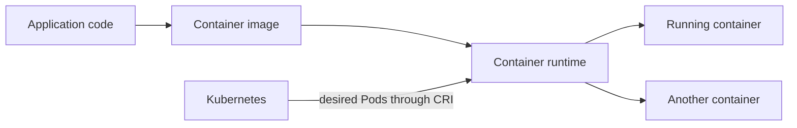
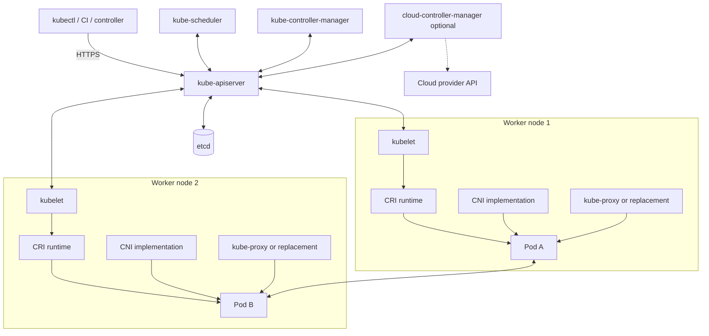
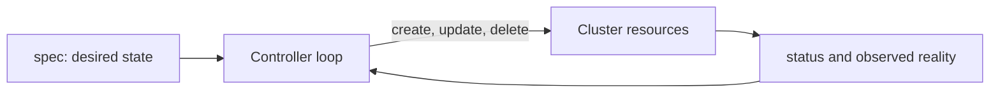
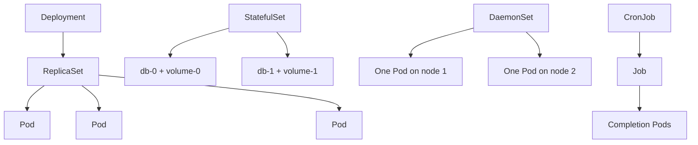
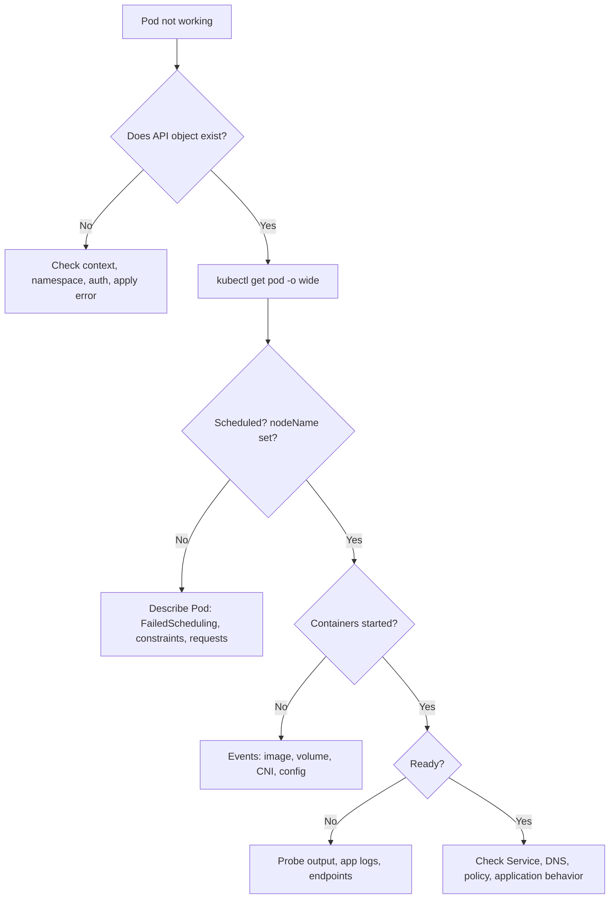

# Day 1 — Kubernetes Fundamentals, Architecture, and Workloads

## Learning objectives

Today you will learn:

- what Kubernetes is and is not;
- how containers, runtimes, and Kubernetes relate;
- the responsibility and failure effect of every main cluster component;
- how desired state, API objects, labels, and namespaces work;
- when to use Pods, Deployments, StatefulSets, DaemonSets, Jobs, and CronJobs;
- how Pod lifecycle, probes, resources, and configuration injection work;
- how to create, inspect, scale, troubleshoot, and delete a small workload.

**Why this matters:** troubleshooting is mostly ownership. If you know which component owns a decision, you know where to look for evidence.

**Prerequisites:** a shell, `kubectl`, and a disposable cluster. Use the [official learning environment guide](https://kubernetes.io/docs/setup/learning-environment/) if you need one.

**Estimated time:** 5–7 hours.

**Recommended order:** foundations → architecture → objects → workloads → Pod health/resources → lab → review.

Official reading:

- [What is Kubernetes?](https://kubernetes.io/docs/concepts/overview/)
- [Cluster architecture](https://kubernetes.io/docs/concepts/architecture/)
- [Kubernetes objects](https://kubernetes.io/docs/concepts/overview/working-with-objects/)
- [Pods](https://kubernetes.io/docs/concepts/workloads/pods/)
- [Workload management](https://kubernetes.io/docs/concepts/workloads/controllers/)

---

## 1. Kubernetes in simple words

**Kubernetes** is an open-source system that manages containerized applications across machines. You describe the result you want—for example, “run three copies of this application”—and Kubernetes continuously works toward that result.

### Why it exists

Running one container manually is easy. Operating hundreds introduces harder problems:

- Which machine has capacity?
- What replaces a crashed process?
- How do clients find changing replicas?
- How do we roll out a new version safely?
- How do we mount configuration and storage?
- How do teams share machines without unrestricted access?

Kubernetes provides APIs and control loops for these problems.

### Containerization

A **container image** is a packaged application plus its user-space dependencies. A **container** is a running instance of that image. Containers share the host kernel but use Linux namespaces and cgroups for isolation and resource control.



### Docker, runtime, and Kubernetes are different

| Term | Job | Example |
|---|---|---|
| Image builder/tooling | Builds and distributes images | Docker CLI, BuildKit |
| Container runtime | Pulls images and runs containers | containerd, CRI-O |
| CRI | Standard API between kubelet and runtime | Kubernetes interface, not a runtime |
| Kubernetes | Schedules and manages Pods across nodes | API server, controllers, scheduler, kubelets |

Kubernetes removed direct dockershim integration years ago. A Docker-built OCI image can still run through a CRI-compatible runtime; “Kubernetes no longer supports Docker” is therefore misleading.

### Kubernetes compared with alternatives

| Model | Strength | Limitation |
|---|---|---|
| Traditional server deployment | Simple for a few stable applications | Manual placement, recovery, and configuration drift |
| Virtual machines | Stronger isolation; each VM has a guest OS | Heavier and slower to start than containers |
| Docker Compose | Excellent local multi-container development | Not a multi-node reconciliation platform |
| Kubernetes | Scheduling, self-healing, rollout, discovery, policy, extensibility | Operational complexity; needs networking, storage, security, and observability design |

Kubernetes does not build your application, guarantee correct application logic, provide a database backup automatically, or make a poorly designed application highly available.

### Advantages

- Declarative, repeatable deployments.
- Self-healing through controllers.
- Portable APIs across many infrastructures.
- Service discovery and load distribution.
- Extensible APIs and controllers.
- Strong ecosystem.

### Costs and limitations

- Many interacting layers and failure modes.
- Default settings are not automatically production-safe.
- Stateful applications still require application-aware backup and recovery.
- Multi-tenancy boundaries require careful hardening.
- Provider and plugin implementations differ.
- A small application may not justify the operational cost.

---

## 2. Cluster architecture

### Terminology

- **Cluster:** control-plane and worker machines managed as one system.
- **Node:** a physical or virtual machine registered in the cluster.
- **Control plane:** components that expose the API and make cluster-wide decisions.
- **Worker node:** a node that runs application Pods.
- **High availability (HA):** using redundant instances so one failure does not stop service.
- **Interface:** a contract between components, such as CRI, CNI, or CSI.



The [official architecture guide](https://kubernetes.io/docs/concepts/architecture/) defines the core responsibilities. Implementations can run components as processes, static Pods, managed services, or replacements.

### kube-apiserver

**Definition:** the server exposing the Kubernetes HTTP API.

**Purpose:** one protected entry point for reading and changing cluster state.

It authenticates callers, authorizes actions, decodes and validates objects, runs admission, persists accepted data, returns responses, and serves list/watch traffic. It does **not** choose nodes or directly start containers.

If one API server fails in an HA cluster, a load balancer can send traffic to another. If all are unavailable, existing containers may continue running, but new API operations, scheduling, controller progress, and many status updates stop.

### etcd

**Definition:** a consistent distributed key-value database.

**Purpose:** durable source of truth for Kubernetes API data.

The API server is the normal etcd client. Controllers, schedulers, users, and kubelets use the API server instead of writing directly to etcd. If etcd loses quorum, consistent writes cannot be committed; the API server cannot safely persist changes. Application files and database rows in Pods are not stored in etcd merely because they run on Kubernetes.

### kube-scheduler

**Definition:** the component that assigns unscheduled Pods to suitable nodes.

It watches for Pods without `.spec.nodeName`, filters nodes that cannot satisfy hard constraints, scores feasible nodes, and records a binding through the API. It does not start the Pod. If it fails, running workloads continue, but new unscheduled Pods remain Pending.

### kube-controller-manager

**Definition:** one process that runs many built-in controllers.

A **controller** repeatedly compares desired state with observed state and acts to reduce the difference. Deployment, ReplicaSet, Node, Job, ServiceAccount, EndpointSlice, and garbage-collection controllers are examples. If controllers stop, current Pods can run, but replacement, rollout, and cleanup actions pause.

### cloud-controller-manager

**Definition:** optional control-plane component containing cloud-specific controllers.

It can manage cloud node metadata, routes, and external load balancers. Bare-metal clusters might not run it. Managed services provide their own implementation. If it fails, core scheduling may continue while cloud load balancer or node integration changes stall.

### kubelet

**Definition:** the primary agent on each node.

It watches Pods assigned to its node, prepares volumes, calls the runtime through CRI, cooperates with networking and storage plugins, executes probes, restarts containers according to policy, and reports Pod/Node status. It does not schedule Pods.

If kubelet fails, existing containers may continue for a time, but health management and status reporting stop. The control plane eventually marks the node unhealthy and may replace controller-managed workloads elsewhere.

### kube-proxy

**Definition:** the default Service data-plane implementation.

It watches Services and EndpointSlices and programs node networking rules. It is **optional**: some CNI implementations replace its functionality. If Service proxying fails on a node, direct Pod IP networking may still work while Service virtual IP traffic fails.

### Container runtime and CRI

The runtime pulls images and creates, starts, stops, and reports containers and Pod sandboxes. Kubelet calls it through the **Container Runtime Interface (CRI)**. `containerd` and CRI-O are common implementations.

### CNI

The **Container Network Interface (CNI)** is a plugin specification. A CNI implementation configures Pod interfaces, IP addresses, and routes; some also enforce NetworkPolicy or replace kube-proxy. Kubernetes defines the integration point, not one universal network implementation.

### CSI

The **Container Storage Interface (CSI)** lets storage vendors integrate volume provisioning, attachment, mounting, resizing, and snapshots where supported. A CSI driver is not the same as a PersistentVolume; the driver performs operations requested by storage controllers and kubelet.

### Add-ons and extensions

- **CoreDNS:** common cluster DNS add-on.
- **Metrics Server:** optional implementation of the resource Metrics API.
- **Ingress/Gateway controller:** optional implementation that turns routing objects into a working proxy/load balancer.
- **Dashboard:** optional UI.
- **CRDs and operators:** extensions installed by users or vendors.

### Component responsibility table

| Question | Owner |
|---|---|
| May this API caller do this? | API server authentication/authorization |
| Is this submitted object acceptable? | API validation and admission |
| Where should this Pod run? | Scheduler |
| Should another replica exist? | Workload controller |
| How does the container start on this node? | Kubelet + CRI runtime |
| How does the Pod get an IP? | CNI implementation |
| How does a Service reach endpoints? | kube-proxy or replacement |
| Where is API state stored? | API server storage layer + etcd |
| Where is application data stored? | Application and its volume/database design |

---

## 3. API objects and declarative state

An **API object** is a structured record in the Kubernetes API. A YAML **manifest** is a human-readable representation submitted to that API.

```yaml
apiVersion: apps/v1
kind: Deployment
metadata:
  name: web
  namespace: learning
spec:
  replicas: 3
  selector:
    matchLabels:
      app: web
  template:
    metadata:
      labels:
        app: web
    spec:
      containers:
        - name: web
          image: nginx:1.27-alpine
```

Important fields:

- `apiVersion`: API group and version.
- `kind`: resource type.
- `metadata`: name, namespace, labels, annotations, UID, and bookkeeping.
- `spec`: desired state provided by the user.
- `status`: observed state written by Kubernetes components.



**Declarative** means “describe the result,” rather than scripting every action. `kubectl apply` sends configuration to the API; it does not wait for the application to become healthy unless a separate wait/rollout command is used.

### Labels and selectors

A **label** is a key/value identifier attached to an object. A **selector** finds objects whose labels match.

Example:

```yaml
metadata:
  labels:
    app: payments
    tier: backend
```

A Deployment selector must match its Pod-template labels. A Service selector independently selects eligible Pods. Labels are for selection; annotations hold non-identifying metadata. The [labels guide](https://kubernetes.io/docs/concepts/overview/working-with-objects/labels/) calls selectors Kubernetes' core grouping primitive.

### Namespaces

A **namespace** scopes names and policy for many—but not all—resources.

Namespaced examples: Pods, Deployments, Services, Roles, Secrets. Cluster-scoped examples: Nodes, PersistentVolumes, StorageClasses, ClusterRoles.

Namespaces are not nested and are not, by themselves, strong security isolation. Combine them with RBAC, quotas, Pod security, and network policy.

---

## 4. Pod: the execution unit

A **Pod** is the smallest deployable Kubernetes compute object. It holds one or more containers that share:

- one network namespace and Pod IP;
- `localhost` connectivity;
- volumes declared in the Pod;
- one scheduling decision and lifecycle.

Use multiple containers in one Pod only when they are one operational unit and must be colocated. Kubernetes schedules Pods, not individual containers, because shared resources and lifecycle form the boundary.

### Pod lifecycle

Common phases:

- `Pending`: accepted, but not all containers are running; scheduling, image pull, or setup may still be happening.
- `Running`: bound to a node and at least one container is running or starting/restarting.
- `Succeeded`: all containers completed successfully and will not restart.
- `Failed`: all containers stopped and at least one failed or was terminated.
- `Unknown`: state cannot be obtained, commonly due to node communication failure.

`Running` does not mean `Ready`. Readiness is a separate condition.

### Container states and restart policy

Container states are `Waiting`, `Running`, or `Terminated`. Pod-level `restartPolicy` is `Always`, `OnFailure`, or `Never`. Controllers may replace an entire failed Pod even when kubelet restart behavior differs.

### Init containers

Init containers run to completion, usually in order, before regular application containers start. Use them for finite setup such as waiting for a dependency or creating files. A failing init container keeps the Pod unready and is retried according to Pod policy.

### Sidecar containers

A sidecar provides a supporting process, such as a proxy or log helper. Kubernetes supports sidecar-style init containers by setting `restartPolicy: Always` on an init container, allowing ordered startup and lifecycle behavior. Verify version support before relying on this in older clusters.

### Ephemeral containers

Ephemeral containers are added to a running Pod for debugging. They are not ordinary application containers: they do not define ports or probes and are not automatically restarted. Use `kubectl debug` carefully; it requires permission to update the `ephemeralcontainers` subresource.

### Static Pods

The kubelet can read Pod manifests directly from a configured node directory. These **static Pods** do not depend on the API server for creation. Kubelet usually creates mirror Pods in the API for visibility. The API cannot manage the static Pod itself. kubeadm commonly uses static Pods for control-plane components.

---

## 5. Workload controllers

Do not normally create bare Pods. A controller can replace them.



### ReplicaSet

Keeps a specified number of matching Pods. Usually a Deployment manages ReplicaSets, so you rarely create one directly.

### Deployment

Best for stateless, interchangeable replicas. It manages rollouts and rollback through ReplicaSets.

Use for web APIs, frontends, and stateless workers. Do not expect local container files to survive replacement.

### StatefulSet

Provides stable Pod identity, ordered behavior, and association with persistent storage. Pods are not interchangeable: names such as `db-0` remain meaningful. It is useful for stateful systems, but it does not configure database replication or backup for you. The [StatefulSet guide](https://kubernetes.io/docs/concepts/workloads/controllers/statefulset/) notes that associated volumes are retained by default for data safety.

### DaemonSet

Ensures a Pod runs on every eligible node or a selected subset. Use for node-level log agents, CNI components, monitoring agents, or device plugins.

### Job

Runs one or more Pods until the required successful completions occur. Use for migrations, batch processing, and finite tasks. Configure retry and cleanup deliberately; a repeatedly failing Job can create noise and cost.

### CronJob

Creates Jobs on a schedule. Scheduling is approximate; jobs should be idempotent because delays or duplicate execution are operational possibilities. Configure concurrency policy and history limits.

### Choosing a workload

| Need | Use | Why |
|---|---|---|
| Stateless long-running replicas | Deployment | rolling update and interchangeable Pods |
| Stable identity/storage association | StatefulSet | ordinal identity and volume templates |
| One Pod per eligible node | DaemonSet | node-local responsibility |
| Finite task | Job | completion tracking and retries |
| Scheduled finite task | CronJob | creates Jobs on a schedule |
| Cluster bootstrap process outside API | Static Pod | kubelet-local manifest; advanced use |

---

## 6. Probes and availability

A **probe** is a kubelet check against a container.

| Probe | Question | Failure effect |
|---|---|---|
| Startup | Has this slow application finished starting? | Other probes wait; repeated failure restarts container |
| Readiness | Can it receive traffic now? | Pod becomes unready and is removed from ready Service endpoints; container is not restarted merely for readiness failure |
| Liveness | Is it stuck and should be restarted? | Kubelet restarts the container after threshold |

Probe methods include HTTP, TCP, gRPC, and command execution. A badly designed liveness probe can create an outage by restarting a healthy-but-busy application.

```yaml
readinessProbe:
  httpGet:
    path: /ready
    port: 8080
  initialDelaySeconds: 2
  periodSeconds: 5
livenessProbe:
  httpGet:
    path: /health
    port: 8080
  initialDelaySeconds: 15
  periodSeconds: 10
startupProbe:
  httpGet:
    path: /health
    port: 8080
  failureThreshold: 30
  periodSeconds: 2
```

Success path: startup succeeds → readiness adds the endpoint → liveness continues checking deadlock symptoms.

Failure path: readiness can stop traffic without restarting; liveness can restart; startup prevents premature liveness failures.

---

## 7. Requests, limits, and configuration

### Resource requests and limits

- **Request:** amount used by the scheduler for placement and by Kubernetes for resource guarantees/calculations.
- **Limit:** maximum enforced at runtime where supported.

```yaml
resources:
  requests:
    cpu: 100m
    memory: 128Mi
  limits:
    cpu: 500m
    memory: 256Mi
```

`100m` CPU means one tenth of a CPU core. CPU excess is throttled at a limit. Memory excess can cause an OOM kill. A Pod can remain Pending when no node has enough unallocated requested capacity even if current usage looks low.

### Environment and configuration injection

Options include:

- literal `env` values;
- ConfigMap keys or mounted files for non-secret configuration;
- Secret keys or mounted files for sensitive values;
- Downward API for Pod metadata and resource information;
- projected volumes combining sources.

Environment variables usually do not update inside an already-running process when the source changes. Mounted ConfigMap/Secret projections may update eventually, but applications must reread them. Never assume base64 in a Secret is encryption.

---

## 8. Practical lab

### 8.1 Check your environment

Run on your workstation:

```bash
kubectl config current-context
kubectl cluster-info
kubectl get nodes -o wide
kubectl version
```

These are read-only. You need kubeconfig access. Expected: a context name, API endpoint, at least one `Ready` node, and client/server versions. `connection refused` points to endpoint or cluster availability; `Unauthorized` points to credentials; `Forbidden` means authenticated but not permitted.

Create a learning namespace:

```bash
kubectl create namespace learning
kubectl config set-context --current --namespace=learning
```

These change cluster and local kubeconfig state. Namespace creation requires `create` on namespaces, which is cluster-scoped.

### 8.2 Create a Pod

Save as `pod.yaml`:

```yaml
apiVersion: v1
kind: Pod
metadata:
  name: web-pod
  labels:
    app: web
spec:
  containers:
    - name: nginx
      image: nginx:1.27-alpine
      ports:
        - containerPort: 80
      resources:
        requests:
          cpu: 50m
          memory: 32Mi
        limits:
          cpu: 200m
          memory: 128Mi
      readinessProbe:
        httpGet:
          path: /
          port: 80
        periodSeconds: 5
```

```bash
kubectl apply -f pod.yaml
kubectl get pod web-pod -w
```

`apply` changes cluster state and requires create/patch permission. `-w` opens a read-only watch. Stop it with Ctrl-C after `1/1 Running` appears.

Inspect evidence:

```bash
kubectl get pod web-pod -o wide
kubectl describe pod web-pod
kubectl logs web-pod -c nginx
kubectl get events --for pod/web-pod
```

- `get` shows summarized API state.
- `describe` combines fields and related Events.
- `logs` retrieves container stdout/stderr through the API/kubelet path.
- `events --for` shows lifecycle observations; Events are useful but retained for a limited time.

### 8.3 Replace the bare Pod with a Deployment

```bash
kubectl create deployment web --image=nginx:1.27-alpine --replicas=2 --dry-run=client -o yaml > deployment.yaml
kubectl apply -f deployment.yaml
kubectl get deployment,replicaset,pods -l app=web
kubectl rollout status deployment/web
```

The first command only generates local YAML; shell redirection writes a local file. `apply` changes cluster state. `rollout status` watches until the Deployment progresses or fails.

Scale it:

```bash
kubectl scale deployment/web --replicas=3
kubectl get pods -l app=web -w
```

`scale` changes `.spec.replicas`. The Deployment/ReplicaSet controllers create another Pod; `kubectl` does not directly create the replica.

Delete one managed Pod:

```bash
kubectl delete pod -l app=web --field-selector=status.phase=Running --wait=false
kubectl get pods -l app=web -w
```

This is deliberately state-changing and may delete all matching running Pods, so use it only in the disposable namespace. The ReplicaSet controller creates replacements because desired replicas remain three.

### 8.4 Create safe failures

#### Image pull failure

```bash
kubectl create deployment bad-image --image=example.invalid/not-found:v1
kubectl get pods -l app=bad-image
kubectl describe pod -l app=bad-image
```

Expected: `ErrImagePull`, then `ImagePullBackOff`; Events show registry/DNS/authentication details. The API request succeeded—the runtime operation did not.

#### Crash loop

```bash
kubectl run crash --image=busybox:1.36 --restart=Always -- sh -c 'echo starting; exit 1'
kubectl get pod crash
kubectl logs crash
kubectl logs crash --previous
kubectl describe pod crash
```

Expected: repeated restarts and eventually `CrashLoopBackOff`. `--previous` reads logs from the previous terminated container instance.

#### Unschedulable request

```yaml
apiVersion: v1
kind: Pod
metadata:
  name: too-large
spec:
  containers:
    - name: pause
      image: registry.k8s.io/pause:3.10
      resources:
        requests:
          cpu: "1000"
```

Apply only in a disposable cluster. The object should be accepted but remain Pending with a `FailedScheduling` Event because no node offers 1000 CPU cores.

### 8.5 Cleanup

```bash
kubectl delete namespace learning
kubectl config set-context --current --namespace=default
```

Namespace deletion is destructive and recursively deletes its namespaced contents. It does not delete cluster-scoped objects. Confirm the context and namespace first.

---

## 9. Troubleshooting decision path



Senior-engineer method:

1. State the symptom precisely.
2. Separate API acceptance, scheduling, node setup, container execution, readiness, and traffic.
3. Read status and Events before changing anything.
4. Form one hypothesis.
5. Collect evidence that could disprove it.
6. Make the smallest reversible change.
7. Verify the original symptom, not merely the command exit code.

---

## 10. Common misconceptions

- **“The API server starts containers.”** It stores/serves desired state; kubelet and runtime start containers.
- **“A Running Pod is healthy.”** Running is a lifecycle phase; Ready indicates traffic eligibility.
- **“A Deployment contains containers.”** Its Pod template causes ReplicaSets to create Pods, which contain containers.
- **“Deleting a managed Pod scales down.”** The controller replaces it while desired replicas remain unchanged.
- **“Limits help scheduling.”** The scheduler primarily uses requests; limits affect runtime enforcement and may default requests in some conditions.
- **“Namespaces are complete tenant isolation.”** They are a scope; security requires additional controls.
- **“Kube-proxy is always present.”** It can be replaced by another Service data plane.
- **“StatefulSet makes a database safe.”** It helps identity/storage attachment, not replication correctness or backup.

---

## Key takeaways

- Kubernetes is an API-driven reconciliation system for containerized workloads.
- The API server protects and persists desired state; etcd stores API data.
- Scheduler chooses nodes; controllers create/replace objects; kubelet and runtime execute Pods.
- CNI, CRI, and CSI are interfaces with replaceable implementations.
- Use controllers rather than bare Pods for recovery.
- API success does not imply scheduling, container startup, readiness, or application success.

## Concise revision notes

```text
Cluster = control plane + nodes
API server = front door
etcd = API source of truth
Scheduler = Pod → Node decision
Controller = desired vs actual correction
Kubelet = node reconciler
CRI = kubelet ↔ runtime
CNI = Pod networking
CSI = storage integration
Deployment = stateless replicas
StatefulSet = stable identity/storage association
DaemonSet = node-local Pods
Job/CronJob = finite/scheduled work
Ready ≠ Running
```

## Practical exercises

1. Create a Deployment with two replicas and prove the ownership chain using:

   ```bash
   kubectl get deployment,replicaset,pod -o custom-columns=KIND:.kind,NAME:.metadata.name,OWNER:.metadata.ownerReferences[0].kind
   ```

   Expected: Deployment → ReplicaSet → Pod ownership.

2. Add a readiness probe pointing to a nonexistent path. Expected: containers remain Running but Pods show `0/1 Ready` and are not ready endpoints.

3. Compare `kubectl get pod -o yaml` fields under `spec` and `status`. Explain which party owns each.

4. Scale a Deployment and watch Events. Expected: desired replicas change, controllers create objects, scheduler binds, kubelet starts them.

## Troubleshooting exercises

1. A Pod is Pending with no node name. Start with `describe`; do not inspect container logs because no container exists yet.
2. A Pod shows `CreateContainerConfigError`. Check referenced ConfigMaps/Secrets and namespace spelling.
3. A Pod shows `CrashLoopBackOff`. Use current and `--previous` logs, exit code, command/args, and probe Events.
4. A Pod is Running but receives no Service traffic. Check Ready condition and labels before blaming CNI.

## Interview questions and answers

**Q: What is the difference between a Pod and a Deployment?**  
A Pod is the execution unit. A Deployment declares and rolls out interchangeable replicas through ReplicaSets and replaces failed Pods.

**Q: Does the scheduler start containers?**  
No. It records a Pod-to-node binding. The node's kubelet asks the runtime to start containers.

**Q: What happens if etcd is down?**  
Running containers may continue, but the API server cannot reliably persist cluster state; control-plane progress is severely impaired. Loss of quorum prevents consistent commits.

**Q: What is reconciliation?**  
A repeated loop that compares desired state with observed state and makes changes to reduce the difference.

**Q: Why use a readiness probe?**  
To keep an unready application out of Service-ready endpoints without necessarily restarting it.

**Q: What is the difference between CRI, CNI, and CSI?**  
CRI integrates runtimes, CNI integrates Pod networking, and CSI integrates storage systems.

## Self-assessment checklist

- [ ] I can draw the cluster components from memory.
- [ ] I can name the component responsible for scheduling, execution, storage, and Service routing.
- [ ] I can explain `spec` versus `status`.
- [ ] I can choose among Deployment, StatefulSet, DaemonSet, Job, and CronJob.
- [ ] I can explain Running versus Ready.
- [ ] I can diagnose Pending, image-pull, and crash-loop symptoms using evidence.
- [ ] I understand why accepted API state may never become a healthy workload.

## Day 2 preview

Day 2 follows a request into the API server: TLS, API discovery, serialization, authentication, authorization, RBAC, watches, rate control, audit, and the exact difference between `Unauthorized` and `Forbidden`.

