# Day 2 — The Kubernetes API, Authentication, Authorization, and RBAC in Simple Words

Day 1 explained how Kubernetes runs and repairs applications.

Day 2 explains the **front door** of Kubernetes:

> How does a request enter the cluster, how does Kubernetes know who sent it, and how does Kubernetes decide whether to allow it?

We will start from zero. Words such as **API**, **TLS**, **authentication**, **authorization**, **token**, and **RBAC** will be explained before we use them.

## What you will learn

By the end of Day 2, you should understand:

- what problem the Kubernetes API solves;
- how `kubectl` finds and contacts a cluster;
- what a kubeconfig file contains;
- why Kubernetes uses HTTPS and TLS;
- the difference between a request and a Kubernetes object;
- API groups, versions, kinds, resources, names, and namespaces;
- the complete journey of a request through the API server;
- authentication: **Who are you?**
- authorization: **What are you allowed to do?**
- the purpose and working of Role, ClusterRole, RoleBinding, and ClusterRoleBinding;
- ServiceAccounts and short-lived tokens;
- the difference between `401 Unauthorized` and `403 Forbidden`;
- how list, watch, `resourceVersion`, dry run, audit, and API flow control work;
- how to troubleshoot a rejected request without guessing.

**Estimated study time:** 6–8 hours. Read one part at a time and perform the lab after understanding the main request flow.

**Prerequisites:** Day 1, `kubectl`, a working kubeconfig, and a disposable learning cluster where you may create a Namespace and namespaced RBAC objects.

## Official Kubernetes documentation used for this lesson

- [The Kubernetes API](https://kubernetes.io/docs/concepts/overview/kubernetes-api/)
- [Kubernetes API concepts](https://kubernetes.io/docs/reference/using-api/api-concepts/)
- [API access control overview](https://kubernetes.io/docs/reference/access-authn-authz/controlling-access/)
- [Authenticating](https://kubernetes.io/docs/reference/access-authn-authz/authentication/)
- [Authorization](https://kubernetes.io/docs/reference/access-authn-authz/authorization/)
- [Using RBAC authorization](https://kubernetes.io/docs/reference/access-authn-authz/rbac/)
- [ServiceAccounts](https://kubernetes.io/docs/concepts/security/service-accounts/)
- [Organizing cluster access with kubeconfig](https://kubernetes.io/docs/concepts/configuration/organize-cluster-access-kubeconfig/)
- [Admission control](https://kubernetes.io/docs/reference/access-authn-authz/admission-controllers/)
- [Auditing](https://kubernetes.io/docs/tasks/debug/debug-cluster/audit/)
- [API Priority and Fairness](https://kubernetes.io/docs/concepts/cluster-administration/flow-control/)

---

# Part 1 — First understand the problem

## 1. Why does Kubernetes need one API?

Remember the important components from Day 1:

```text
kubectl
API server
etcd
Scheduler
controllers
kubelets
```

All these components need to read or change cluster information.

Without one controlled API, they might try to change the cluster database directly:

```text
kubectl ---------\
Scheduler --------> etcd directly
controllers ------>
kubelets --------/
```

That would create serious problems:

- every component would need database credentials;
- every component would need to understand etcd's storage details;
- there would be no single place to check identity and permissions;
- invalid data could be written;
- changes would be difficult to audit;
- different components could follow different rules.

Kubernetes solves this by putting the API server in front:

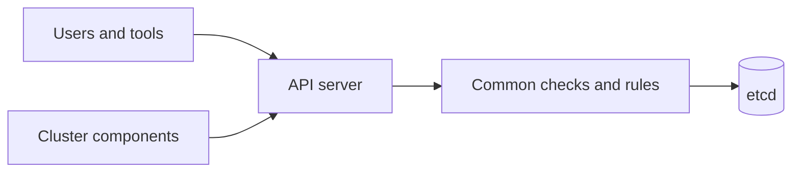

The simple rule is:

> Normal Kubernetes clients communicate with the API server. They do not directly edit etcd.

## 2. What problem does access control solve?

Imagine an online-shop cluster.

It contains:

- public frontend Pods;
- backend Pods;
- database credentials in Secrets;
- production Deployments;
- Nodes that run every application.

Different people and programs need different access:

```text
Developer Alice     → may read Pods in development
Deployment system   → may update one application
Monitoring program  → may read metrics
Application Pod     → may read one ConfigMap
Cluster admin       → may manage the complete cluster
```

If every identity received full access, one mistake or stolen credential could damage the whole cluster.

Kubernetes therefore asks two separate questions:

1. **Authentication:** Who are you?
2. **Authorization:** Are you allowed to perform this exact action?

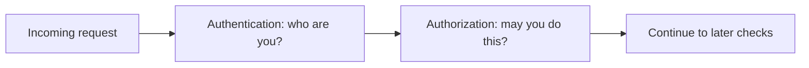

These words sound similar, but they solve different problems.

## 3. Kubernetes API requests versus application requests

Do not confuse these two kinds of traffic.

### Kubernetes API request

Example:

```bash
kubectl get pods
```

This request goes to the Kubernetes API server. It asks about cluster objects.

### Application request

Example:

```text
A customer opens https://shop.example.com/products
```

This normally goes through a load balancer, Gateway or Ingress, Service, and application Pod. It does **not** normally go through `kube-apiserver`.

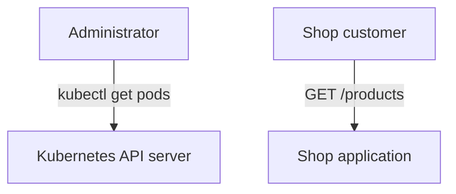

Day 2 is about the first path: requests to the Kubernetes API.

---

# Part 2 — Basic words before the complete flow

## 4. What is an API?

An **API** is a defined way for programs to communicate.

It defines things such as:

- where to send a request;
- which action to request;
- what data to send;
- what response to expect;
- how errors are reported.

Kubernetes provides an HTTP API.

Programs that use it include:

- `kubectl`;
- the Scheduler;
- controllers;
- kubelets;
- operators;
- CI/CD automation;
- your own programs using Kubernetes client libraries.

## 5. What is a client and a server?

A **client** sends a request.

A **server** receives the request and sends a response.

For example:

```text
Client: kubectl
Server: kube-apiserver
Request: list Pods in namespace demo
Response: Pod list or an error
```

`kubectl` is not the cluster. It is one client of the Kubernetes API.

## 6. What are HTTP and HTTPS?

**HTTP** is a common request-and-response communication method.

**HTTPS** is HTTP protected by TLS.

The Kubernetes API normally uses HTTPS:

```text
https://api.example.com:6443
```

The exact address and port depend on the cluster.

## 7. What is a URL or API path?

A URL tells a client where a resource can be reached.

Example Kubernetes API path:

```text
/api/v1/namespaces/demo/pods/web
```

Read it from left to right:

```text
/api/v1              → core API, version v1
/namespaces/demo     → namespace named demo
/pods                → Pod resource collection
/web                 → Pod named web
```

## 8. What is a request?

A request contains information such as:

- HTTP method, for example `GET` or `POST`;
- API path;
- identity credential;
- headers;
- sometimes an object body;

Example idea:

```text
Method: POST
Path:   /api/v1/namespaces/demo/pods
Body:   information for a new Pod
```

## 9. What is a response?

The server replies with:

- a status code;
- response headers;
- returned object data or an error message.

Examples:

```text
200 OK             → read succeeded
201 Created        → new object was created
401 Unauthorized   → acceptable identity was not established
403 Forbidden      → identity is known, but action is not allowed
404 Not Found      → requested path or object was not found
409 Conflict       → update conflicts with a newer change
422 Unprocessable Entity → object data is invalid
429 Too Many Requests    → client is sending work too quickly or server is overloaded
```

## 10. Does a request become an object?

The simple answer is:

> A write request carries object information to the API server. After successful checks, the API server stores that information as a Kubernetes API object.

The request itself does not literally transform into an object.

Example:

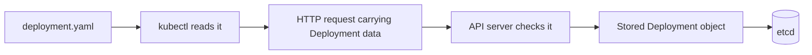

For a read request such as `kubectl get pods`, no new Pod object is created. The API server returns existing objects.

---

# Part 3 — Kubernetes API objects and paths

## 11. API object

A Kubernetes API object is a saved record of desired or observed cluster state.

Examples:

- Pod;
- Deployment;
- Service;
- ConfigMap;
- Secret;
- Role;
- RoleBinding.

A simple object:

```yaml
apiVersion: v1
kind: ConfigMap
metadata:
  name: shop-settings
  namespace: demo
data:
  LOG_LEVEL: info
```

## 12. Group, version, kind, and resource

These four words are related but not identical.

### API group

An **API group** organizes related Kubernetes APIs.

Examples:

```text
Core group                 → Pods, Services, ConfigMaps, Secrets
apps group                 → Deployments, StatefulSets, DaemonSets
batch group                → Jobs, CronJobs
rbac.authorization.k8s.io → Roles and bindings
```

The core group is written simply as `v1` in YAML.

Named groups include the group and version:

```yaml
apiVersion: apps/v1
```

### Version

A **version** is one served form of an API.

Examples:

```text
v1       → stable version
v1beta1  → beta version
v1alpha1 → alpha version
```

Always check the documentation for the Kubernetes version you use. An old API version can be removed after its deprecation period.

### Kind

The **kind** is the singular object type written in YAML.

```yaml
kind: Deployment
```

### Resource

The **resource** is the API collection name, normally plural and lowercase.

```text
Kind: Deployment
Resource: deployments
```

This resource name is used in API paths and RBAC rules.

### Put them together

```text
YAML:
apiVersion: apps/v1
kind: Deployment

API group: apps
Version:   v1
Kind:      Deployment
Resource:  deployments
```

## 13. Core-group and named-group paths

Core-group resources use `/api`:

```text
/api/v1/namespaces/demo/pods
```

Named-group resources use `/apis`:

```text
/apis/apps/v1/namespaces/demo/deployments
```

Notice the small but important difference:

```text
Core group:  /api/...
Named group: /apis/...
```

## 14. Namespaced and cluster-scoped resources

A **namespaced resource** belongs to one Namespace.

Examples:

- Pods;
- Deployments;
- Services;
- Roles;
- RoleBindings.

Example path:

```text
/api/v1/namespaces/demo/pods/web
```

A **cluster-scoped resource** belongs to the cluster, not one Namespace.

Examples:

- Nodes;
- Namespaces;
- PersistentVolumes;
- ClusterRoles;
- ClusterRoleBindings.

Example path:

```text
/api/v1/nodes/worker-1
```

This scope becomes very important when we study RBAC.

## 15. Name and UID

An object has a name such as `web`.

It also receives a **UID**, which is a unique identity assigned by Kubernetes.

If you delete Pod `web` and create another Pod named `web`, the new Pod has the same name but a different UID.

```text
Old Pod: name=web, UID=111
New Pod: name=web, UID=222
```

The UID tells Kubernetes they are different object lifetimes.

## 16. API discovery

How does `kubectl` know which resources the cluster supports?

It asks the cluster's **Discovery API**.

Discovery reports information such as:

- API groups;
- versions;
- resource names;
- whether a resource is namespaced;
- supported operations.

Useful commands:

```bash
kubectl api-resources
kubectl api-versions
kubectl explain deployment
kubectl explain deployment.spec.strategy
```

Simple meanings:

- `api-resources` shows object types supported by this cluster;
- `api-versions` shows served group/version combinations;
- `explain` reads the schema and explains fields.

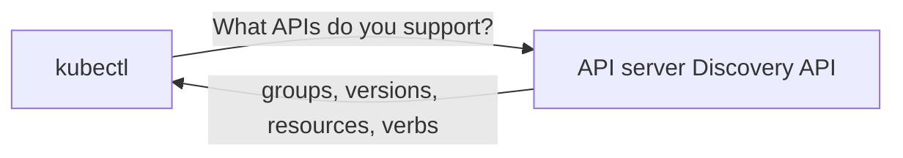

Discovery solves an important problem: Kubernetes can be extended with custom resources, so a client cannot safely assume that every cluster supports exactly the same APIs.

## 17. HTTP methods and Kubernetes verbs

Kubernetes authorization uses verbs such as `get`, `list`, and `create`.

| What you want | HTTP method | Kubernetes/RBAC verb |
|---|---|---|
| Read one object | `GET` | `get` |
| Read a collection | `GET` | `list` |
| Follow changes | `GET` with watch | `watch` |
| Create a new object | `POST` | `create` |
| Replace an object | `PUT` | `update` |
| Change part of an object | `PATCH` | `patch` |
| Delete one object | `DELETE` | `delete` |
| Delete a collection | `DELETE` | `deletecollection` |

`get` and `list` are different permissions:

```text
get  → read one named Pod
list → read the collection of Pods
```

## 18. Subresources

Some resources have smaller API endpoints called **subresources**.

Examples:

```text
pods/log          → read Pod logs
pods/exec         → run a command in a container
pods/status       → work with Pod status
deployments/scale → read or change replica scale data
```

They can have separate permissions.

For example, permission to `get` Pods does not automatically mean permission to `get` `pods/log`.

---

# Part 4 — How kubectl finds the cluster

## 19. What is kubeconfig?

A **kubeconfig** file tells a Kubernetes client how to connect to one or more clusters.

It normally contains four important sections:

```text
clusters        → Where is the API server, and which CA should I trust?
users           → Which credential should I use?
contexts        → Which cluster + user + default namespace belong together?
current-context → Which context is selected now?
```

The word `users` in kubeconfig means client credential configurations. It does not mean Kubernetes stores normal human User objects.

## 20. Simple kubeconfig example

```yaml
apiVersion: v1
kind: Config
clusters:
  - name: learning-cluster
    cluster:
      server: https://api.example.com:6443
      certificate-authority: /safe/path/cluster-ca.crt
users:
  - name: alice
    user:
      client-certificate: /safe/path/alice.crt
      client-key: /safe/path/alice.key
contexts:
  - name: alice-learning
    context:
      cluster: learning-cluster
      user: alice
      namespace: demo
current-context: alice-learning
```

This is an example structure. Do not copy fake paths into your real configuration.

## 21. What is a context?

A context joins three choices:

```text
Context = cluster + user credential + optional default namespace
```

Example:

```text
Context name: alice-development
Cluster:      development-cluster
User:         alice
Namespace:    shop-development
```

Useful safe commands:

```bash
kubectl config current-context
kubectl config get-contexts
kubectl config view --minify
```

Always check the current context before making a destructive change.

## 22. Kubeconfig working flow

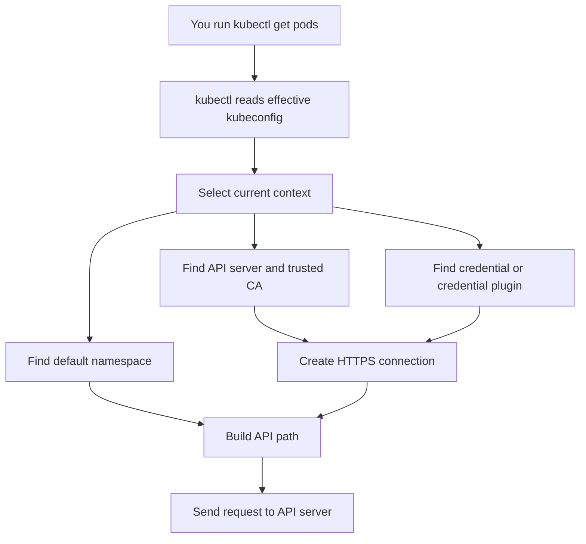

## 23. What problem kubeconfig solves

Without kubeconfig, you would repeatedly need to provide:

- API server address;
- trusted certificate authority;
- identity credential;
- Namespace.

Kubeconfig organizes those values and makes it possible to switch between clusters safely.

## 24. Kubeconfig safety

A kubeconfig can contain or invoke powerful credentials.

Important rules:

- accept kubeconfig files only from trusted sources;
- do not commit them to Git;
- do not paste client keys or tokens into tickets;
- be careful with `kubectl config view --raw`, because it can reveal credential data;
- check the selected context before deleting or changing resources;
- protect kubeconfig file permissions.

An untrusted kubeconfig can contain an executable credential plugin. Treat it with the same care as an untrusted script.

---

# Part 5 — TLS: creating a protected connection

## 25. What is TLS?

TLS stands for **Transport Layer Security**.

It protects the HTTPS connection between the client and API server.

TLS mainly helps provide:

1. **Encryption** — another party should not easily read the traffic.
2. **Server identity** — the client can verify it reached the intended API server.
3. **Integrity** — changed network data can be detected.
4. **Optional client identity** — a client certificate can also authenticate the caller.

## 26. Certificate, CA, public key, and private key

### Certificate

A certificate is a signed digital statement about an identity and public key.

### Certificate Authority

A **Certificate Authority**, or **CA**, signs certificates that other systems are configured to trust.

### Public key

A public key may be shared. It helps verify signatures or establish protected communication.

### Private key

A private key must remain secret. Possessing it can prove control of the related certificate identity.

Never commit a private key to Git or send it in chat.

## 27. Simplified TLS connection

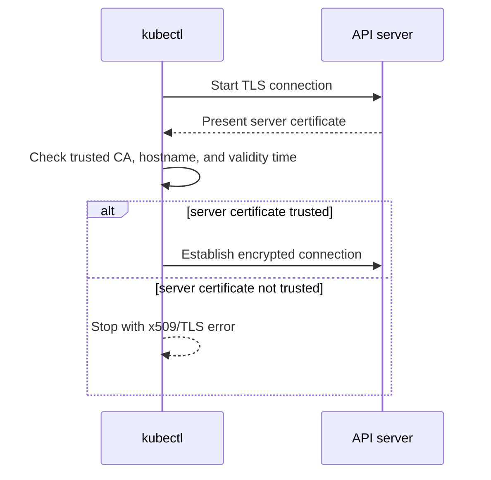

TLS happens before Kubernetes can normally process the API request body.

## 28. Common TLS errors

### `certificate signed by unknown authority`

The client cannot connect the API server certificate to a trusted CA.

Check:

- correct cluster context;
- correct CA information;
- whether a network proxy is replacing certificates;
- whether the API endpoint is correct.

### Certificate expired or not yet valid

Check:

- certificate validity dates;
- local and server clocks;
- certificate rotation process.

### Hostname mismatch

The address used by the client is not included in the server certificate's valid names.

Fix the endpoint or certificate. Do not make `--insecure-skip-tls-verify` your normal solution, because it removes an important server-identity check.

---

# Part 6 — The complete API request journey

## 29. One complete diagram

The following is a learning model of the request path. Some internal validation, conversion, and defaulting details can overlap in implementation, but the security order to remember is authentication → authorization → admission.

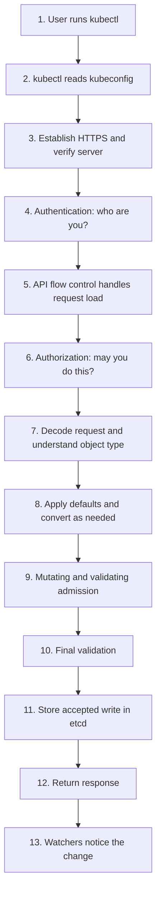

Audit processing can record selected information at multiple request stages.

Now we will explain every step.

## 30. Step 1 — You run a command

Example:

```bash
kubectl apply -f deployment.yaml
```

`kubectl` reads the file. It is acting as an API client.

## 31. Step 2 — kubectl reads kubeconfig

It finds:

- the selected cluster;
- API server address;
- trusted CA data;
- selected credential method;
- default Namespace.

If the context is wrong, you may contact the wrong cluster even though the command itself is correct.

## 32. Step 3 — TLS connection

`kubectl` connects through HTTPS and verifies the API server certificate.

If TLS trust fails, the request does not reach Kubernetes authentication or RBAC.

## 33. Step 4 — Authentication

The API server checks the supplied credential using configured authentication methods.

Successful authentication produces information such as:

```text
Username: alice@example.com
Groups:   developers, system:authenticated
Extra:    optional identity information
```

If no acceptable identity is established, the normal result is `401 Unauthorized`.

## 34. Step 5 — API request load handling

After an identity is available for request classification, the API server can use mechanisms such as API Priority and Fairness to stop noisy traffic from starving important cluster traffic.

A request can wait briefly or receive `429 Too Many Requests` during overload.

## 35. Step 6 — Authorization

The API server asks whether that identity may perform this exact action.

Example question:

```text
May user alice@example.com
create resource deployments
in API group apps
inside namespace demo?
```

If the decision is no, the result is `403 Forbidden`.

## 36. Step 7 — Decode and understand the request

For a write request, the API server reads the request data and identifies:

- group;
- version;
- kind;
- fields;
- requested operation.

Human-written YAML is normally converted by the client into JSON-compatible API data before transmission.

## 37. Step 8 — Defaulting and conversion

Kubernetes can fill some omitted default values and convert between supported API representations.

Example idea:

```text
Client sends a supported external API version.
API server converts it to the form needed for internal processing/storage.
Responses can be converted to the version requested by a client.
```

Conversion does not mean every historical version is accepted forever. The requested version must still be served by the cluster.

## 38. Step 9 — Admission

Admission happens after authentication and authorization for applicable requests.

Admission can:

- add or change allowed fields;
- apply defaults or policy-related mutation;
- reject an object because its content violates policy.

Example:

```text
RBAC says Alice may create Pods.
Admission policy says privileged Pods are not allowed.
Result: this particular privileged Pod is rejected.
```

Day 3 explains admission deeply.

## 39. Step 10 — Validation

The API server ensures the final object follows required API rules.

Examples of invalid data:

- missing required field;
- impossible field value;
- selector that does not match a Deployment template;
- wrong data type.

Permission to create an object does not make an invalid object valid.

## 40. Step 11 — Persistence in etcd

For an accepted write, the API server's storage path persists the API object in etcd.

Normal clients do not write directly to etcd.

For a dry-run request, Kubernetes performs normal applicable checks but does not persist the object.

## 41. Step 12 — Response

The API server sends a status code and response data back to `kubectl`.

Examples:

```text
deployment.apps/web created
deployment.apps/web configured
Error from server (Forbidden): ...
```

A successful API write means the object was accepted and stored. It does not prove that the application is already running or healthy.

## 42. Step 13 — Other components react

Controllers, the Scheduler, and kubelets watch API objects.

After a Deployment is stored:

```text
Deployment controller notices Deployment
→ ReplicaSet is created
→ Pods are created
→ Scheduler chooses nodes
→ kubelets and runtimes start containers
```

The API request finishes before all application work necessarily finishes.

## 43. Full sequence diagram

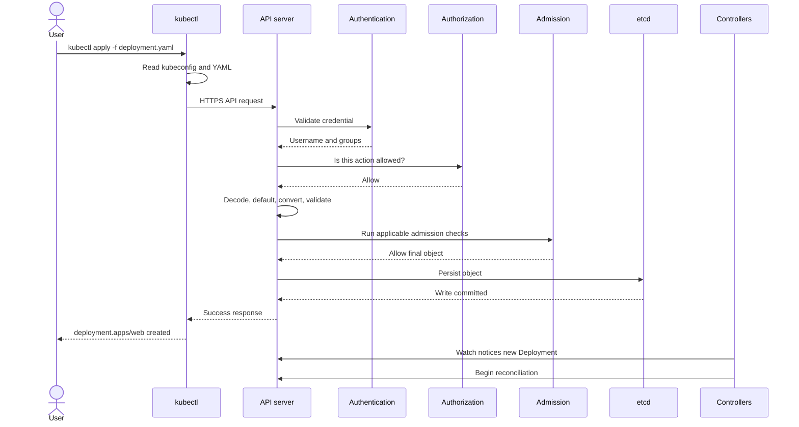

## 44. The important stop points

```text
TLS failure           → no trusted protected connection
Authentication fails  → 401, identity not accepted
Authorization fails   → 403, identity known but action denied
Admission rejects     → allowed identity/action, but object content rejected
Validation fails      → object does not follow API rules
Persistence fails     → object was not safely stored
Later runtime fails   → object exists, but workload did not become healthy
```

This stage-by-stage thinking is the foundation of good troubleshooting.

---

# Part 7 — Authentication: “Who are you?”

## 45. What is authentication?

**Authentication** is the process of checking evidence of identity.

Simple example:

```text
Claim:      “I am Alice.”
Credential: a valid token or client certificate
Result:     Kubernetes accepts username alice@example.com
```

Authentication does **not** decide what Alice may do. It only establishes the identity used by the next stage.

## 46. Identity, credential, user, group, and authenticator

### Identity

The name Kubernetes uses for the caller.

Examples:

```text
alice@example.com
system:serviceaccount:demo:app-reader
system:node:worker-1
```

### Credential

Evidence used to prove an identity.

Examples:

- client certificate plus private key;
- bearer token;
- token obtained through an exec credential plugin.

### User

Usually a human or external identity name.

Kubernetes does not provide a normal built-in `User` API object. Human accounts usually come from an external identity system, certificates, cloud integration, a webhook, or a trusted proxy.

### Group

A collection of identities used to grant shared permissions.

Examples:

```text
developers
platform-team
system:authenticated
```

### Authenticator

A configured API-server mechanism that examines a credential and tries to establish an identity.

## 47. Authentication result

Successful authentication returns identity information to the API server:

```text
username
groups
optional extra attributes
```

It does not return a list of allowed actions. Authorization handles that separately.

When supported by your client and cluster, you can ask the API which identity it sees:

```bash
kubectl auth whoami
```

This is useful when a username or group mapping is not what you expected.

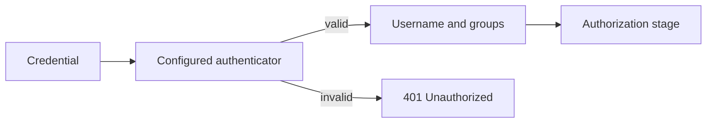

## 48. Main authentication methods

Kubernetes can be configured to use different methods.

| Method | Common use | Simple idea |
|---|---|---|
| Client X.509 certificate | components, administrators, some automation | prove possession of a private key for a trusted certificate |
| ServiceAccount token | programs running in Pods | short-lived signed token represents a namespaced ServiceAccount |
| OIDC token | human login through an identity provider | signed identity token from an external login system |
| Authentication webhook | custom or central token system | API server asks an external service to validate a token |
| Authenticating proxy | organizations with a trusted proxy | proxy authenticates user and sends trusted identity headers |
| Bootstrap token | new-node bootstrap | limited temporary token for initial node setup |
| Static token file | legacy/simple testing | fixed token configured on API server disk |
| Anonymous authentication | selected unauthenticated access | request has anonymous identity when configured |

A cluster administrator decides which methods are enabled. Merely knowing that a method exists does not mean your cluster uses it.

## 49. Client certificate authentication

### What problem does it solve?

It lets a client prove identity using public-key cryptography rather than sending a reusable password.

### What is needed?

- a client certificate signed by a CA trusted by the API server;
- the matching private key;
- valid certificate time and client-authentication usage.

The API server commonly maps:

```text
Certificate Common Name (CN) → username
Organization (O) values      → groups
```

### Simplified working

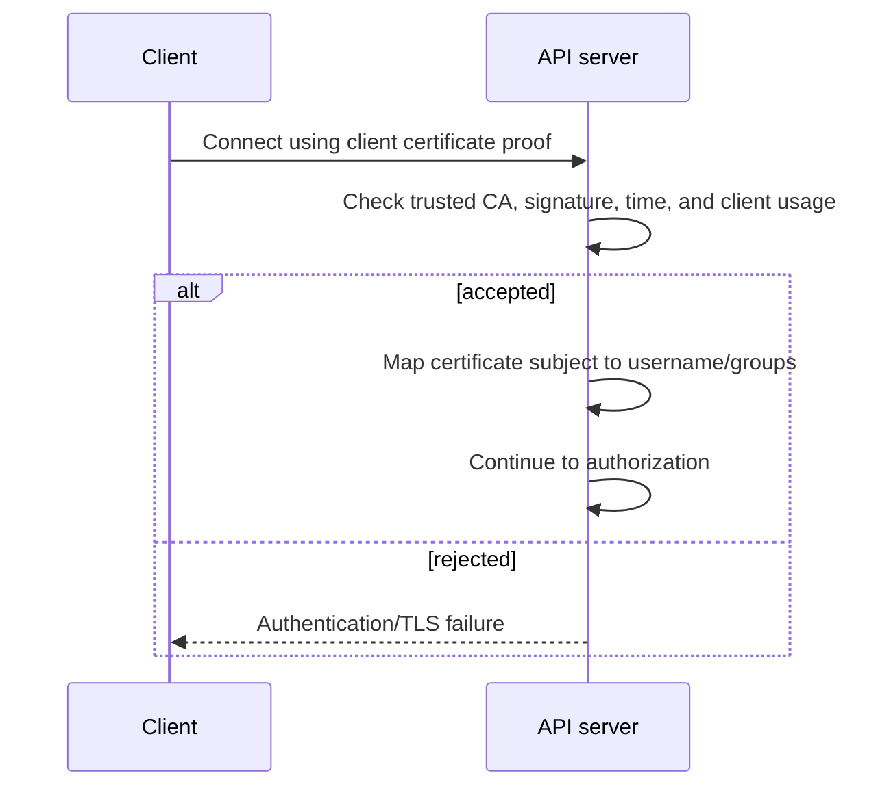

### Important safety rules

- Keep the private key secret.
- Prefer short certificate lifetimes and a planned rotation process.
- Do not use broad groups such as `system:masters` for ordinary work.
- Kubernetes client-certificate revocation is limited; an issued certificate commonly remains usable until it expires unless trust/configuration changes.

Correct certificate authentication can still produce `403 Forbidden` when RBAC does not allow the requested action.

## 50. Bearer token

A bearer token is a secret string sent in an HTTP header:

```text
Authorization: Bearer <token>
```

“Bearer” means whoever possesses the token may try to use it.

Therefore:

- always use TLS;
- do not print tokens in logs;
- do not commit tokens to Git;
- prefer short-lived tokens;
- use the correct audience;
- rotate or invalidate exposed credentials.

## 51. What is a JWT?

JWT means **JSON Web Token**.

A signed JWT contains claims about an identity. Common claims include:

```text
iss → issuer: who created the token
sub → subject: who the token represents
aud → audience: which service should accept it
exp → expiry: when it stops being valid
nbf → not before: when it begins being valid
```

A JWT commonly has three dot-separated parts:

```text
header.payload.signature
```

Important:

> Signed does not mean secret or encrypted. Do not place sensitive data in a JWT payload merely because the token is signed.

The signature helps the receiver detect changes and verify the issuer.

## 52. OIDC authentication

OIDC stands for **OpenID Connect**. It lets Kubernetes use identity information from an external identity provider.

Examples of identity providers include an organization's login platform or a cloud identity service.

### Problem it solves

Organizations already have employees, groups, login rules, and multi-factor authentication. They do not want to manually issue permanent Kubernetes certificates to every person.

### Simplified working

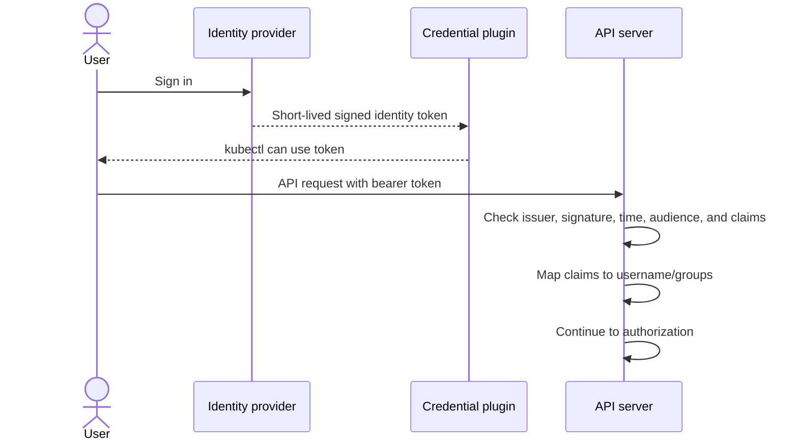

Kubernetes validates the identity token. It does not provide the identity provider's login page.

### Exec credential plugins and managed-cloud login

A kubeconfig can tell `kubectl` to run a trusted **exec credential plugin**. That program performs the provider-specific login or refresh work and returns a temporary credential to the Kubernetes client.

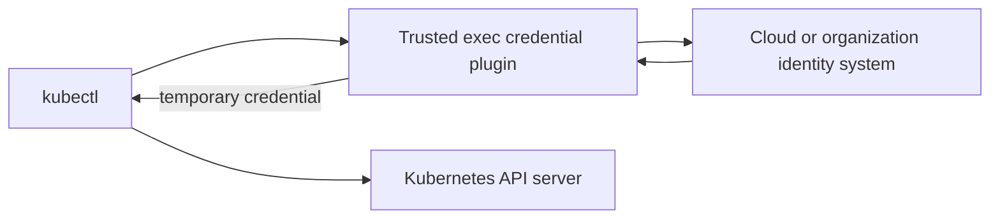

This solves credential refresh for managed clusters, but it is also why an untrusted kubeconfig can be dangerous: it may instruct your computer to execute a program.

## 53. Authentication webhook

An authentication webhook lets the API server ask an external HTTPS service to validate a bearer token.

The API server sends a `TokenReview`-style request. The external service replies with whether the token is authenticated and, if so, the username and groups.

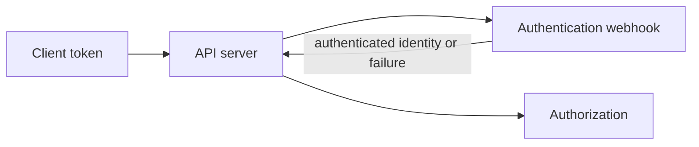

### Problem it solves

It connects Kubernetes to an identity system whose tokens need custom online validation.

### Cost

The webhook is now part of the API login path. Slow networking, TLS errors, or webhook failure can delay or prevent authentication, depending on configuration.

An authentication webhook is not an admission webhook:

```text
Authentication webhook → proves identity
Admission webhook      → checks or changes an authorized object request
```

## 54. Authenticating proxy

A trusted reverse proxy authenticates the user first. It then sends trusted identity headers to the API server.

The proxy itself must prove its identity to the API server with a specially trusted client certificate. Otherwise, an attacker might send fake identity headers.

Only the intended proxy should possess that client credential.

## 55. Bootstrap tokens

Bootstrap tokens are special temporary credentials commonly used with kubeadm while a new node establishes stronger credentials.

They are not normal employee login tokens.

They should be:

- short-lived;
- limited to bootstrap uses;
- removed or allowed to expire after use.

## 56. Static token files

The API server can be configured with a file containing fixed bearer tokens.

This method is simple but risky:

- tokens do not automatically expire;
- distribution and rotation are difficult;
- the file must be present on API server hosts;
- leaked tokens remain useful until configuration changes.

Use modern short-lived methods for production systems.

## 57. Anonymous authentication

When configured, a request without an accepted credential can receive the identity:

```text
username: system:anonymous
group:    system:unauthenticated
```

Anonymous authentication does not mean full access. Authorization still decides what that identity may do.

Anonymous access may be limited to carefully selected public endpoints such as some health information. Never broadly grant sensitive permissions to `system:unauthenticated`.

## 58. Multiple authenticators

An API server can have multiple authentication methods enabled.

Conceptually:

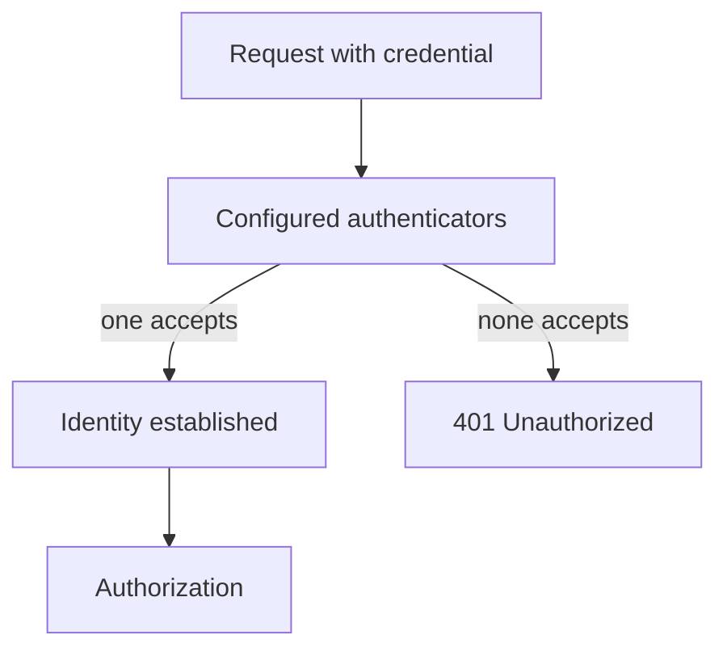

Do not design ambiguous credentials that depend on a guessed authenticator order. Configure identity systems so the accepted identity is predictable.

---

# Part 8 — ServiceAccounts: identity for workloads

## 59. What is a ServiceAccount?

A **ServiceAccount** is a Kubernetes API object that gives a namespaced identity to workloads and automation.

Example identity:

```text
system:serviceaccount:demo:app-reader
```

Read it as:

```text
system:serviceaccount:<namespace>:<name>
```

## 60. What problem does a ServiceAccount solve?

Suppose an application Pod needs to read one ConfigMap from the Kubernetes API.

Bad design:

```text
Put an administrator's personal kubeconfig inside the Pod.
```

Problems:

- application receives too much permission;
- credential may live too long;
- actions look like the administrator;
- rotation is difficult.

Better design:

```text
Create a ServiceAccount for the application.
Grant only the required permission.
Use a short-lived, Pod-bound token.
```

## 61. Default ServiceAccount

Every Namespace normally has a ServiceAccount named `default`.

If a Pod does not specify another ServiceAccount, it normally uses that Namespace's `default` ServiceAccount.

Do not grant broad permissions to `default`, because many unrelated Pods may use it.

## 62. Selecting a ServiceAccount in a Pod

```yaml
apiVersion: v1
kind: Pod
metadata:
  name: report-reader
  namespace: demo
spec:
  serviceAccountName: app-reader
  containers:
    - name: app
      image: busybox:1.36
      command: ["sh", "-c", "sleep 3600"]
```

This chooses identity. It does not itself grant permission. RBAC bindings grant permission.

## 63. Modern ServiceAccount token flow

The recommended Pod token flow uses the TokenRequest API and projected, short-lived tokens.

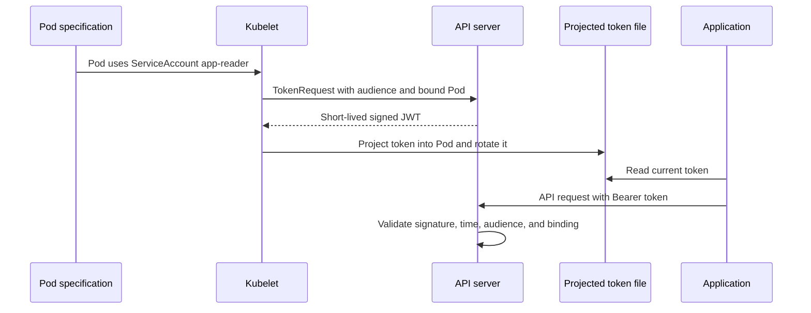

The kubelet refreshes the projected token before it expires. Applications should read the token file in a way that supports rotation rather than assuming one value forever.

## 64. Bound token

A **bound token** is connected to an object such as a Pod and normally includes expiry and audience limits.

Benefits:

- shorter lifetime;
- intended receiver is identified by audience;
- token can become invalid when the bound object is deleted;
- less damage if briefly exposed.

## 65. Audience

The audience says which service the token is meant for.

Example idea:

```text
Token audience: Kubernetes API
Accepted by:     Kubernetes API
Should not be accepted by: unrelated payment service
```

A service validating a token must check that the token audience matches that service.

## 66. TokenReview

A service can ask the Kubernetes API to validate a token using the `TokenReview` API.

This can correctly account for Kubernetes-bound token validity. The service must itself be authorized to create TokenReview requests and must check the returned audience and identity information carefully.

## 67. Disable automatic token mounting when unnecessary

If a workload does not call the Kubernetes API, disable automatic token mounting:

```yaml
spec:
  automountServiceAccountToken: false
```

You can set this on the Pod or ServiceAccount according to your design.

This reduces unnecessary credential exposure.

## 68. Temporary manual token

For a controlled diagnostic case:

```bash
kubectl create token app-reader -n demo --duration=10m
```

This asks for a short-lived token. The command prints a bearer credential, so treat the terminal output and history as sensitive.

Do not paste the token into this tutorial, Git, chat, or a ticket.

## 69. ServiceAccount does not automatically mean cloud identity

Keep these identities separate in your mind:

```text
Kubernetes ServiceAccount identity → calls Kubernetes API
Cloud workload identity            → calls cloud APIs
Human identity                     → person calls Kubernetes API
```

Some cloud platforms connect them through an explicit workload-identity system, but they are not automatically the same thing.

---

# Part 9 — Authorization: “May this identity do this?”

## 70. What is authorization?

**Authorization** decides whether an authenticated identity may perform a specific action.

Authentication result:

```text
You are alice@example.com.
```

Authorization question:

```text
May alice@example.com list Pods in namespace demo?
```

## 71. What problem does authorization solve?

Not every authenticated identity should have the same power.

Examples:

```text
Developer       → read development Pods
Release system  → update one application's Deployment
Monitoring      → read selected metrics
Application     → read one ConfigMap
Administrator   → manage cluster-wide resources
```

Authorization makes **least privilege** possible.

**Least privilege** means giving only the permissions needed for the job, at the smallest useful scope and for the appropriate time.

## 72. Information used for an authorization decision

The API server can evaluate attributes such as:

- username;
- groups;
- extra identity information;
- Kubernetes verb;
- API group;
- resource;
- subresource;
- object name when relevant;
- Namespace;
- non-resource URL path.

Example request attributes:

```text
User:       alice@example.com
Groups:     developers
Verb:       create
API group:  apps
Resource:   deployments
Namespace:  demo
```

## 73. Default-deny idea

An action must be allowed by a configured authorization mechanism. If every authorizer returns “no opinion,” the request is denied.

This is safer than treating missing policy as permission.

## 74. Authorization modes

The API server can use one or more authorization modes.

### RBAC

Uses Kubernetes objects such as Roles and RoleBindings. This is the main mode most learners and cluster users work with.

### Node authorizer

Gives kubelets carefully limited access based on their node and Pods assigned to them.

### Webhook authorizer

Asks an external service for an authorization decision.

The API server sends request attributes to the configured authorization webhook. The webhook answers with an allow, deny, or no-opinion decision according to the supported review API.

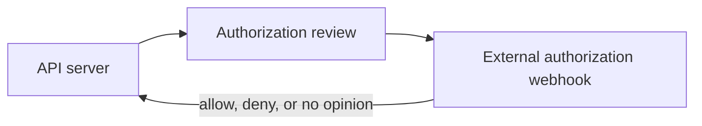

This supports a central policy system, but the webhook's availability, latency, TLS, cache settings, and failure behavior become part of API reliability.

### ABAC

Uses a static attribute-policy file. It is older and operationally difficult compared with dynamic RBAC objects.

### AlwaysAllow

Allows every request. This is unsafe for a real shared cluster.

### AlwaysDeny

Denies every request. Mainly useful for special testing or lockdown cases.

## 75. Multiple authorizers

Configured authorizers are evaluated in their configured order.

Each can return:

```text
allow
deny
no opinion
```

The first definite allow or deny ends the authorization decision. If all return no opinion, access is denied.

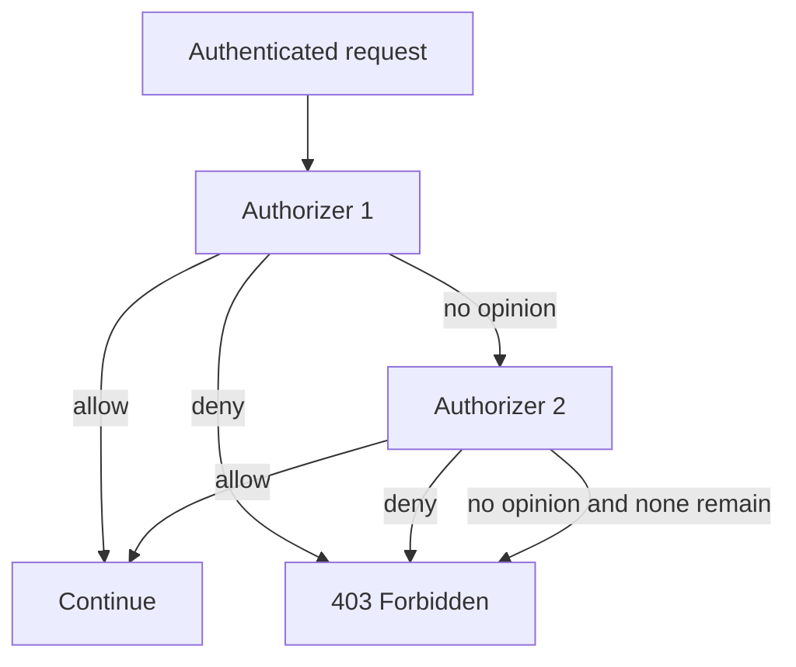

## 76. Node authorizer versus NodeRestriction

These names are often confused.

```text
Node authorizer  → authorization stage; decides what a kubelet may access
NodeRestriction  → admission stage; limits fields/objects a kubelet may modify
```

They work together but solve different parts of node security.

---

# Part 10 — RBAC from zero

## 77. What is RBAC?

RBAC means **Role-Based Access Control**.

RBAC connects three ideas:

```text
WHO     → user, group, or ServiceAccount
WHAT    → allowed verbs and resources
WHERE   → one namespace or cluster-wide
```

RBAC uses ordinary Kubernetes API objects, so authorized administrators can create and update access rules through the API.

## 78. The four RBAC objects

There are four main objects:

| Object | Contains or grants | Scope |
|---|---|---|
| Role | permission rules | one Namespace |
| ClusterRole | permission rules | cluster-scoped definition |
| RoleBinding | grants a Role or ClusterRole | one Namespace |
| ClusterRoleBinding | grants a ClusterRole | entire cluster |

The easiest memory rule is:

```text
Role / ClusterRole       = WHAT actions are allowed
RoleBinding / ClusterRoleBinding = WHO receives those permissions
```

## 79. Role

A **Role** contains permission rules inside one Namespace.

Example:

```yaml
apiVersion: rbac.authorization.k8s.io/v1
kind: Role
metadata:
  name: pod-reader
  namespace: demo
rules:
  - apiGroups: [""]
    resources: ["pods"]
    verbs: ["get", "list", "watch"]
```

Explain every part:

```text
apiGroups: [""]          → the core API group
resources: ["pods"]      → Pod collection
verbs: get, list, watch  → allowed read actions
namespace: demo          → rules exist in demo only
```

The empty string `""` means the core API group. Do not write `"core"`.

## 80. ClusterRole

A **ClusterRole** is a cluster-scoped permission-rule object.

It can describe permissions for:

- cluster-scoped resources such as Nodes;
- namespaced resources across the cluster when bound cluster-wide;
- namespaced resources in one Namespace when used through a RoleBinding;
- non-resource API paths.

Example:

```yaml
apiVersion: rbac.authorization.k8s.io/v1
kind: ClusterRole
metadata:
  name: node-reader
rules:
  - apiGroups: [""]
    resources: ["nodes"]
    verbs: ["get", "list", "watch"]
```

A ClusterRole being cluster-scoped does not by itself give anyone permission. A binding must grant it.

## 81. RoleBinding

A **RoleBinding** grants permissions inside one Namespace.

It can reference:

- a Role in the same Namespace; or
- a ClusterRole, while limiting the grant to the RoleBinding's Namespace.

Example:

```yaml
apiVersion: rbac.authorization.k8s.io/v1
kind: RoleBinding
metadata:
  name: alice-can-read-pods
  namespace: demo
subjects:
  - kind: User
    name: alice@example.com
    apiGroup: rbac.authorization.k8s.io
roleRef:
  apiGroup: rbac.authorization.k8s.io
  kind: Role
  name: pod-reader
```

Read it as:

```text
Give user alice@example.com
the permissions in Role pod-reader
inside namespace demo.
```

## 82. ClusterRoleBinding

A **ClusterRoleBinding** grants a ClusterRole across the cluster.

Example:

```yaml
apiVersion: rbac.authorization.k8s.io/v1
kind: ClusterRoleBinding
metadata:
  name: platform-team-node-read
subjects:
  - kind: Group
    name: platform-team
    apiGroup: rbac.authorization.k8s.io
roleRef:
  apiGroup: rbac.authorization.k8s.io
  kind: ClusterRole
  name: node-reader
```

This is much wider than a namespaced RoleBinding. Use it only when cluster-wide access is truly required.

## 83. RBAC relationship diagram

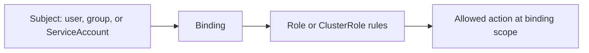

Example:

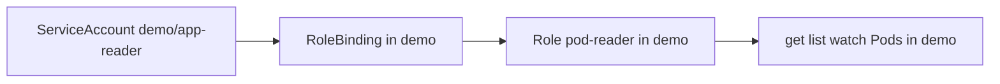

## 84. RoleBinding to a ClusterRole

This is important and often misunderstood.

Suppose a reusable ClusterRole says:

```text
May read Pods.
```

Bind it with a RoleBinding in `development`:

```text
Result: subject may read Pods only in development.
```

Bind the same ClusterRole with a RoleBinding in `testing`:

```text
Result: subject may read Pods only in testing.
```

Bind it with a ClusterRoleBinding:

```text
Result: subject may read Pods in every namespace.
```

```mermaid
flowchart TB
    CR[ClusterRole: read Pods]
    CR --> RB1[RoleBinding in development]
    CR --> RB2[RoleBinding in testing]
    CR --> CRB[ClusterRoleBinding]
    RB1 --> D[Read Pods only in development]
    RB2 --> T[Read Pods only in testing]
    CRB --> ALL[Read Pods across all namespaces]
```

## 85. Subjects

A binding can name these common subject types:

### User

An externally established username:

```yaml
- kind: User
  name: alice@example.com
  apiGroup: rbac.authorization.k8s.io
```

### Group

A group supplied by authentication:

```yaml
- kind: Group
  name: developers
  apiGroup: rbac.authorization.k8s.io
```

### ServiceAccount

A namespaced workload identity:

```yaml
- kind: ServiceAccount
  name: app-reader
  namespace: demo
```

The Namespace in a ServiceAccount subject identifies the ServiceAccount itself. It is not automatically inherited from the binding.

## 86. Rules are additive

Kubernetes RBAC has allow rules. It does not have an RBAC deny rule.

If one binding grants permission, another RBAC object cannot cancel it with a deny.

Example:

```text
Binding A allows get Pods.
Binding B allows delete Pods.
Final RBAC permissions include both get and delete.
```

To remove permission, find and remove or narrow the grant that supplies it.

## 87. Wildcards

An asterisk means “all matching values.”

Dangerous example:

```yaml
rules:
  - apiGroups: ["*"]
    resources: ["*"]
    verbs: ["*"]
```

This is extremely broad. It can also silently include new APIs added later.

Prefer explicit resources and verbs.

## 88. Resource names

Some RBAC rules can restrict actions to named resources using `resourceNames`.

Example:

```yaml
rules:
  - apiGroups: [""]
    resources: ["configmaps"]
    resourceNames: ["shop-settings"]
    verbs: ["get"]
```

This allows reading the named ConfigMap through a matching `get` request.

Do not treat `resourceNames` as general row-level security. Collection operations such as `list` and `watch` have important limitations and may require a client-supplied field selector.

## 89. Non-resource URLs

Some API endpoints are paths rather than Kubernetes objects.

Examples:

```text
/healthz
/readyz
/version
```

A ClusterRole can grant access to non-resource URLs:

```yaml
rules:
  - nonResourceURLs: ["/healthz", "/readyz"]
    verbs: ["get"]
```

Non-resource URL permissions are cluster-scoped.

## 90. `roleRef` cannot be changed

After creating a RoleBinding or ClusterRoleBinding, its `roleRef` is immutable.

You may change subjects when authorized, but to point the binding to a different role, replace the binding.

This protects against quietly changing the meaning of an existing grant without reconsidering all its subjects.

## 91. A Role without a binding grants nothing

This is a common beginner mistake:

```text
Role exists       → permission rules are defined
No binding exists → no subject receives those rules
```

Likewise, a binding that refers to the wrong role name or wrong subject does not give the intended identity access.

## 92. Permission to create Pods can be powerful

A person who can create a Pod may be able to:

- choose a powerful ServiceAccount;
- mount accessible Secrets or volumes;
- request host-related features if policy permits them;
- run arbitrary images and commands.

Therefore “can create Pods” is not a small permission. Combine RBAC with admission policy, Pod security controls, Namespace design, and careful ServiceAccount permissions.

## 93. Permission escalation protection

Kubernetes checks attempts to create or update Roles and bindings so an ordinary user cannot simply grant permissions they do not possess.

Special `escalate` and `bind` permissions can bypass parts of those protections and are highly sensitive.

Do not grant RBAC-management permissions casually.

---

# Part 11 — Build one least-privilege example slowly

## 94. Requirement

Our application needs to:

- run in Namespace `demo`;
- use ServiceAccount `app-reader`;
- read Pod information and Pod logs in `demo`;
- not create, update, or delete Pods;
- not read Pods in other Namespaces.

## 95. Complete manifest

```yaml
apiVersion: v1
kind: Namespace
metadata:
  name: demo
---
apiVersion: v1
kind: ServiceAccount
metadata:
  name: app-reader
  namespace: demo
automountServiceAccountToken: false
---
apiVersion: rbac.authorization.k8s.io/v1
kind: Role
metadata:
  name: pod-reader
  namespace: demo
rules:
  - apiGroups: [""]
    resources: ["pods"]
    verbs: ["get", "list", "watch"]
  - apiGroups: [""]
    resources: ["pods/log"]
    verbs: ["get"]
---
apiVersion: rbac.authorization.k8s.io/v1
kind: RoleBinding
metadata:
  name: app-reader-pods
  namespace: demo
subjects:
  - kind: ServiceAccount
    name: app-reader
    namespace: demo
roleRef:
  apiGroup: rbac.authorization.k8s.io
  kind: Role
  name: pod-reader
```

## 96. Explain every object

### Namespace

Creates the `demo` scope for our lab.

### ServiceAccount

Creates the workload identity:

```text
system:serviceaccount:demo:app-reader
```

Automatic token mounting is disabled because the lab uses authorization checks without putting the token inside a Pod.

### Role

Defines read permissions for Pods and Pod logs in `demo`.

It does not include:

```text
create
update
patch
delete
```

### RoleBinding

Gives the Role's permissions to the `app-reader` ServiceAccount inside `demo`.

## 97. Expected permissions

```text
list Pods in demo          → yes
get Pod logs in demo       → yes
delete Pods in demo        → no
list Pods in another NS    → no
read Secrets in demo       → no
```

## 98. Test authorization safely

An administrator with impersonation permission can ask:

```bash
kubectl auth can-i list pods \
  -n demo \
  --as=system:serviceaccount:demo:app-reader

kubectl auth can-i get pods/log \
  -n demo \
  --as=system:serviceaccount:demo:app-reader

kubectl auth can-i delete pods \
  -n demo \
  --as=system:serviceaccount:demo:app-reader
```

Expected results:

```text
yes
yes
no
```

`--as` asks the API server to evaluate a request as another identity. The caller must itself be authorized to impersonate that identity.

## 99. What `kubectl auth can-i` does

It submits an authorization-review request asking whether an action would be allowed.

It does not run the requested workload action.

Examples:

```bash
kubectl auth can-i create deployments.apps -n demo
kubectl auth can-i list secrets -n demo
kubectl auth can-i --list -n demo
```

The result reflects the cluster's active authorization configuration. It does not prove a later request will pass admission, validation, or runtime stages.

---

# Part 12 — What `kubectl apply` really does

## 100. `kubectl apply` is not direct file copying

When you run:

```bash
kubectl apply -f deployment.yaml
```

`kubectl` does not copy that YAML file into a worker node.

It uses the file to make one or more Kubernetes API operations.

Depending on the situation and apply mode, it can perform discovery, read existing state, and send a create or patch operation.

## 101. Create versus update

If the object does not exist:

```text
apply → create object
```

If it already exists:

```text
apply → calculate and send the required changes
```

The exact request is not always one simple `POST`.

## 102. Client-side apply

Traditional client-side apply calculates a patch mainly in `kubectl` using:

- the YAML you are applying;
- the live object;
- previously applied configuration stored in an annotation.

It then sends a patch to the API server.

This older approach can make field ownership difficult when several tools modify the same object.

## 103. Server-Side Apply

Server-Side Apply sends an apply-style patch and lets the API server track field ownership in `managedFields`.

Example:

```bash
kubectl apply --server-side -f deployment.yaml
```

A **field manager** identifies the actor managing fields.

If two managers try to control the same field with different values, the API server can report a conflict rather than silently choosing one.

Do not use `--force-conflicts` automatically. First understand which manager owns the field and which value should be authoritative.

## 104. Apply flow in simple form

```mermaid
flowchart TD
    FILE[YAML file] --> K[kubectl]
    K --> DISC[Discover API and schema]
    DISC --> CHECK{Does object exist?}
    CHECK -->|No| CREATE[Send create request]
    CHECK -->|Yes| PATCH[Send calculated/apply patch]
    CREATE --> API[API server pipeline]
    PATCH --> API
    API --> RESULT[Created, configured, unchanged, conflict, or error]
```

## 105. Declarative does not mean “no API calls”

Declarative means you describe the desired object state.

The client and server still use concrete API requests to create or change that state.

```text
Declarative input: “Deployment web should have 3 replicas.”
API operation:      create or patch the Deployment object.
Controllers:        act later to make 3 Pods exist.
```

## 106. Why “created” is not “running”

After this message:

```text
deployment.apps/web created
```

you know the Deployment API object was accepted and persisted.

You do not yet know that:

- a ReplicaSet was created;
- Pods were scheduled;
- images were pulled;
- containers started;
- readiness checks passed.

Use rollout and Pod commands to check later stages:

```bash
kubectl rollout status deployment/web -n demo
kubectl get pods -n demo
kubectl describe deployment web -n demo
```

---

# Part 13 — Encoding, defaulting, validation, and versions

## 107. YAML, JSON, and serialization

Humans commonly write YAML because it is readable.

The Kubernetes HTTP API commonly receives JSON-compatible object data. Kubernetes components can also use protobuf for supported built-in types to improve efficiency.

**Serialization** means converting an in-memory object into bytes that can be sent or stored.

**Deserialization** means converting those bytes back into a structured object.

```mermaid
flowchart LR
    YAML[Human YAML] --> K[kubectl parses it]
    K --> JSON[JSON-compatible request data]
    JSON --> API[API server decodes typed object]
```

## 108. Schema

A **schema** describes which fields and data types an API object supports.

Example idea:

```text
replicas must be an integer
containers must be a list
image must be a string
```

The OpenAPI schema helps tools validate fields and power commands such as `kubectl explain`.

## 109. Structural validation versus policy

These are different questions:

```text
Schema/validation: Is this a correctly formed Deployment?
Admission policy: Is this correctly formed Deployment allowed by our rules?
RBAC:             Is this identity allowed to request Deployment creation?
```

All three may be required.

## 110. Defaulting

Some fields have default values when omitted.

Do not assume every missing field receives a useful default. Read the object documentation and inspect the server-returned object.

A server dry run can show many server-side defaults without storing the object.

## 111. Conversion and storage version

Kubernetes may serve more than one version of an API.

Conceptually:

```mermaid
flowchart LR
    CLIENT[Client uses served version] --> API[API server]
    API --> INTERNAL[Internal processing form]
    INTERNAL --> STORAGE[Configured storage version]
    STORAGE --> ETCD[(etcd)]
```

When reading, the API server can convert the stored form into a version the client requested, provided that version is still served.

Do not read or modify raw etcd data to perform API conversion.

## 112. Unknown and duplicate fields

A misspelled field can cause rejection or a warning depending on the request and field-validation setting.

Example mistake:

```yaml
spec:
  replica: 3   # Deployment expects replicas
```

Use server-side validation and `kubectl explain` instead of assuming an accepted-looking YAML shape is correct.

## 113. Client dry run

```bash
kubectl apply --dry-run=client -f deployment.yaml -o yaml
```

The client checks and generates output locally. It does not run the complete API-server pipeline.

Use it for quick local inspection, but do not treat it as proof that the real cluster will accept the object.

## 114. Server dry run

```bash
kubectl apply --dry-run=server -f deployment.yaml -o yaml
```

This sends a dry-run request through the API server.

It performs applicable authentication, authorization, validation, and dry-run-compatible admission processing, but Kubernetes guarantees that the request is not persisted.

This can still fail because you lack permission or a policy rejects the object.

## 115. `kubectl diff`

```bash
kubectl diff -f deployment.yaml
```

This asks the server to help calculate how the intended object differs from live state.

It does not persist the intended change, but it still contacts the API server and requires relevant permissions. Treat sensitive diff output carefully.

---

# Part 14 — Resource versions and safe concurrent changes

## 116. The problem of two writers

Imagine Alice and Bob read the same Deployment.

```text
Time 1: Deployment replicas = 2
Alice reads version A.
Bob reads version A.
Bob changes replicas to 4.
Alice sends an update based on old version A.
```

If Alice's stale update silently overwrote Bob's newer change, information could be lost.

## 117. `resourceVersion`

Kubernetes objects include:

```yaml
metadata:
  resourceVersion: "12345"
```

`resourceVersion` is an opaque value used for concurrency and watch behavior.

Opaque means:

- do not treat it like a human timestamp;
- do not perform arithmetic on it;
- do not assume that a larger-looking string has a meaning you can safely compare yourself.

## 118. Optimistic concurrency

Kubernetes commonly uses optimistic concurrency:

1. Client reads an object and its `resourceVersion`.
2. Client prepares an update based on that version.
3. Server checks whether the live object still has the expected version.
4. If another writer changed it, the server returns `409 Conflict`.
5. Client re-reads, recalculates, and retries carefully.

```mermaid
sequenceDiagram
    participant A as Alice
    participant API as API server
    participant B as Bob
    A->>API: Read object version 10
    B->>API: Update version 10
    API-->>B: Success, object is now version 11
    A->>API: Replace based on old version 10
    API-->>A: 409 Conflict
    A->>API: Re-read version 11 and reconsider change
```

## 119. Why conflict is useful

A conflict is protection, not random failure.

It says:

> Your view is old. Read the current object before deciding what to change.

Do not automatically force every conflict. You might overwrite another controller's or person's intentional update.

---

# Part 15 — List and watch: how components notice changes

## 120. The inefficient approach

A controller could ask every second:

```text
Give me every Pod.
Give me every Pod.
Give me every Pod.
```

With many controllers and objects, constant full listing would waste API-server, network, and client resources.

## 121. List

A `list` request returns a collection and a collection `resourceVersion`.

Example:

```bash
kubectl get pods -n demo
```

Conceptually:

```text
Current Pods: pod-a, pod-b
Collection resourceVersion: R
```

## 122. Watch

A `watch` request streams later changes.

Common event types include:

```text
ADDED
MODIFIED
DELETED
```

## 123. List-then-watch flow

```mermaid
sequenceDiagram
    participant C as Controller
    participant A as API server
    participant L as Local cache
    C->>A: LIST Pods
    A-->>C: Current Pods plus resourceVersion R
    C->>L: Save current state
    C->>A: WATCH Pods starting from R
    loop changes occur
        A-->>C: ADDED, MODIFIED, or DELETED event
        C->>L: Update cache
        C->>C: Reconcile affected object
    end
```

This lets a controller build current state and then follow changes without repeatedly downloading everything.

## 124. Informer

In Kubernetes client code, an **informer** commonly handles list, watch, local caching, event delivery, and reconnection behavior.

A controller often reads its local informer cache and places object keys into a work queue for reconciliation.

You do not need to implement an informer to use Kubernetes as a beginner, but understanding it explains how controllers efficiently notice API changes.

## 125. Watches can disconnect

A watch is not guaranteed to remain connected forever.

Clients must handle:

- network disconnection;
- API-server restart;
- timeouts;
- an old resource version no longer being available;
- `410 Gone` in some expired-history cases;
- `429 Too Many Requests` during overload.

Well-designed clients reconnect with backoff and relist when required.

## 126. Watch bookmarks

A bookmark is a special watch event that can tell a client it has received changes through a certain resource version.

Clients may request bookmarks, but must not depend on receiving them at an exact interval.

## 127. Pagination

A very large list can be returned in smaller pages.

The client requests a limit, and the server can return a `continue` token for the next page.

Example:

```bash
kubectl get pods -A --chunk-size=200
```

This can reduce the size of one response, though listing an enormous cluster still creates work.

---

# Part 16 — API reliability and visibility

## 128. Timeouts

There can be several different timeouts:

- client command timeout;
- API-server request timeout;
- authentication or authorization webhook timeout;
- admission webhook timeout;
- downstream storage or network delays.

Important:

> A client timeout does not prove that the server made no change.

The server may have committed a write but the response may have been lost. Re-read current state before blindly repeating a non-idempotent operation.

## 129. API Priority and Fairness

### Problem it solves

A broken script could send thousands of API requests and prevent important traffic, such as node health or leader election, from being processed.

### How it works simply

API Priority and Fairness classifies requests into priority levels and manages limited concurrency.

```mermaid
flowchart LR
    REQUESTS[Incoming API requests] --> CLASS[Classify by FlowSchema]
    CLASS --> HIGH[Important system traffic]
    CLASS --> NORMAL[Normal user/workload traffic]
    HIGH --> QUEUE[Fair queues and concurrency limits]
    NORMAL --> QUEUE
    QUEUE --> RUN[API server executes requests]
    QUEUE -->|queue full or reject policy| E429[429 Too Many Requests]
```

Good clients reduce request rate and retry with backoff rather than immediately creating another flood.

This API flow-control priority is different from Pod scheduling priority.

## 130. Audit logging

### Problem it solves

Administrators need answers to questions such as:

- who made this request?
- what action did they request?
- which resource and Namespace were involved?
- when did it happen?
- what response was produced?

### What it is

Kubernetes auditing creates a security-relevant chronological record of API activity according to an audit policy.

### Audit stages

Common audit stages include:

```text
RequestReceived  → API server received the request
ResponseStarted  → response headers started, mainly for long-running requests
ResponseComplete → response body completed
Panic            → request handling panicked
```

### Audit levels

An audit policy can record different detail levels:

```text
None
Metadata
Request
RequestResponse
```

More detail can expose sensitive data and consume more storage and memory. Configure retention and access carefully.

Audit records are not the same as:

- application container logs;
- Kubernetes Event objects;
- ordinary API-server operational logs.

## 131. High-availability API servers

A production control plane may run several API-server instances behind one stable endpoint.

```mermaid
flowchart LR
    CLIENTS[Clients] --> LB[Stable load-balancer address]
    LB --> A1[API server 1]
    LB --> A2[API server 2]
    LB --> A3[API server 3]
    A1 --> ETCD[(etcd cluster)]
    A2 --> ETCD
    A3 --> ETCD
```

API servers should use consistent security and encryption configuration.

Several API servers improve API availability, but they do not replace a healthy etcd quorum.

## 132. Idempotency

An operation is **idempotent** when repeating it has the same intended end result rather than repeating an extra effect.

Example idea:

```text
Set replicas to 3 → repeating still means replicas should be 3.
Create a new external payment → repeating might charge twice.
```

Named Kubernetes object creation and declarative updates are designed to support reliable state management, but clients must still handle timeouts and retries carefully.

---

# Part 17 — Understand errors by stage

## 133. Error map

| What you see | Likely stage | Simple meaning |
|---|---|---|
| connection refused / timeout | network or API availability | client could not reach a working API endpoint |
| `x509: certificate signed by unknown authority` | TLS | client does not trust the server certificate chain |
| certificate expired / not yet valid | TLS or certificate authentication | certificate time check failed |
| `401 Unauthorized` | authentication | acceptable caller identity was not established |
| `403 Forbidden` | authorization | identity is known but action is not allowed |
| policy or webhook rejection | admission | identity/action passed, but object content was rejected |
| `404 Not Found` | path, name, Namespace, or API version | requested endpoint/object was not found |
| `409 Conflict` | concurrency or field ownership | another change conflicts with this write |
| `422 Unprocessable Entity` | validation | object structure or values violate API rules |
| `429 Too Many Requests` | API flow control/overload | request rate or server pressure exceeded current capacity |
| success but Pod later fails | controller/scheduling/node/runtime | API write succeeded; a later workload stage failed |

## 134. `401 Unauthorized`

The HTTP name is confusing. In Kubernetes troubleshooting, remember:

> `401` normally means authentication did not establish an acceptable identity.

Possible causes:

- expired token;
- wrong token audience;
- untrusted token issuer;
- expired client certificate;
- credential plugin failed;
- wrong kubeconfig user;
- authentication webhook unavailable;
- invalid credential was supplied.

First checks:

```bash
kubectl config current-context
kubectl config view --minify
kubectl get --raw=/version
```

Do not begin by creating a RoleBinding. RBAC cannot fix a credential that never authenticated.

## 135. `403 Forbidden`

`403` means Kubernetes knows the identity but the action is not allowed.

A useful error commonly includes:

```text
User "alice@example.com" cannot create resource "deployments"
in API group "apps" in the namespace "demo"
```

Read every part:

```text
Identity:  alice@example.com
Verb:      create
Resource:  deployments
API group: apps
Namespace: demo
```

Then ask the exact question:

```bash
kubectl auth can-i create deployments.apps -n demo
```

Inspect the narrow scope first:

```bash
kubectl get roles,rolebindings -n demo
```

Do not solve a small missing permission by granting `cluster-admin`.

## 136. Admission rejection

Authentication and authorization can both succeed, but admission can still reject the object.

Example:

```text
Alice is allowed to create Pods.
The requested Pod asks for a forbidden host setting.
Admission policy rejects this Pod.
```

Check:

- complete API error text;
- policy name if reported;
- admission webhook health and logs if you administer it;
- object fields that violate policy;
- audit records where configured.

Do not add more RBAC when the request is already authorized.

## 137. Wrong context or Namespace

Symptoms:

- expected object appears missing;
- permission unexpectedly denied;
- change happens in the wrong environment.

Check:

```bash
kubectl config current-context
kubectl config get-contexts
kubectl config view --minify
kubectl get pods -n <expected-namespace>
```

Never assume the current context from the terminal prompt alone.

## 138. Wrong API group or resource in RBAC

Example mistake:

```yaml
apiGroups: [""]
resources: ["deployments"]
```

Deployments are in API group `apps`, not the core group.

Correct:

```yaml
apiGroups: ["apps"]
resources: ["deployments"]
```

Use:

```bash
kubectl api-resources
```

to check the resource name, group, and scope.

## 139. Wrong ServiceAccount

A Pod may use a different ServiceAccount than expected.

Check:

```bash
kubectl get pod <pod-name> -n <namespace> \
  -o jsonpath='{.spec.serviceAccountName}{"\n"}'
```

Remember:

```text
system:serviceaccount:team-a:reader
```

and

```text
system:serviceaccount:team-b:reader
```

are different identities even though both ServiceAccounts are named `reader`.

## 140. Webhook failures

Authentication, authorization, and admission webhooks are different extension points.

When diagnosing a webhook, identify which stage it belongs to first.

Check, when you administer the control plane:

- API-server error and audit information;
- webhook endpoint and DNS/routing from the API server;
- TLS trust in both directions;
- response format and supported API version;
- latency and timeout settings;
- cache or failure behavior appropriate to that webhook type.

## 141. A senior-engineer troubleshooting order

Use evidence in this order:

```text
1. Am I contacting the expected cluster and Namespace?
2. Can the client reach the API endpoint?
3. Does TLS trust succeed?
4. Which identity did authentication establish?
5. Is that identity authorized for the exact attributes?
6. Did admission reject the object content?
7. Did schema or semantic validation fail?
8. Was the object persisted?
9. Did later controllers, Scheduler, or node components fail?
```

```mermaid
flowchart TD
    START[Request failed] --> CTX{Correct context and Namespace?}
    CTX -->|No| FIXCTX[Select the intended target]
    CTX -->|Yes| REACH{API reachable and TLS trusted?}
    REACH -->|No| CONNECT[Fix endpoint, network, CA, certificate, or time]
    REACH -->|Yes| CODE{Response type?}
    CODE -->|401| AUTHN[Fix credential/authentication]
    CODE -->|403| AUTHZ[Check exact permission and binding scope]
    CODE -->|policy rejection| ADM[Fix object or policy/webhook issue]
    CODE -->|validation| YAML[Fix API fields or values]
    CODE -->|success| LATER[Check controllers, scheduling, and runtime]
```

---

# Part 18 — Hands-on lab

Use a local or disposable learning cluster. Some exercises create objects. Do not run cleanup commands in an important Namespace.

## 142. Confirm the target cluster

```bash
kubectl config current-context
kubectl cluster-info
kubectl get nodes
```

These are read operations.

Before continuing, make sure the context is your learning cluster.

## 143. Discover the API

```bash
kubectl api-resources
kubectl api-versions
kubectl explain role.rules
kubectl explain rolebinding.subjects
```

Find these resources in the output:

```text
pods
deployments
serviceaccounts
roles
rolebindings
clusterroles
clusterrolebindings
```

Questions to answer:

1. Which API group contains Deployments?
2. Which API group contains Roles?
3. Are Nodes namespaced?
4. Are ServiceAccounts namespaced?

## 144. Create the lab Namespace and RBAC

Create the Namespace first:

```bash
kubectl create namespace day2-learning
```

Now save the following namespaced objects as `day2-rbac.yaml`:

```yaml
apiVersion: v1
kind: ServiceAccount
metadata:
  name: app-reader
  namespace: day2-learning
automountServiceAccountToken: false
---
apiVersion: rbac.authorization.k8s.io/v1
kind: Role
metadata:
  name: pod-reader
  namespace: day2-learning
rules:
  - apiGroups: [""]
    resources: ["pods"]
    verbs: ["get", "list", "watch"]
  - apiGroups: [""]
    resources: ["pods/log"]
    verbs: ["get"]
---
apiVersion: rbac.authorization.k8s.io/v1
kind: RoleBinding
metadata:
  name: app-reader-pods
  namespace: day2-learning
subjects:
  - kind: ServiceAccount
    name: app-reader
    namespace: day2-learning
roleRef:
  apiGroup: rbac.authorization.k8s.io
  kind: Role
  name: pod-reader
```

First ask the server to check it without storing it:

```bash
kubectl apply --dry-run=server -f day2-rbac.yaml
```

Then apply it:

```bash
kubectl apply -f day2-rbac.yaml
kubectl get serviceaccount,role,rolebinding -n day2-learning
```

## 145. Read the created objects

```bash
kubectl get role pod-reader -n day2-learning -o yaml
kubectl describe role pod-reader -n day2-learning
kubectl describe rolebinding app-reader-pods -n day2-learning
```

Find:

- allowed resources;
- allowed verbs;
- binding subject;
- referenced Role;
- Namespace.

## 146. Prove allowed and denied actions

Run these as a cluster administrator who has impersonation permission:

```bash
kubectl auth can-i list pods \
  -n day2-learning \
  --as=system:serviceaccount:day2-learning:app-reader

kubectl auth can-i get pods/log \
  -n day2-learning \
  --as=system:serviceaccount:day2-learning:app-reader

kubectl auth can-i delete pods \
  -n day2-learning \
  --as=system:serviceaccount:day2-learning:app-reader

kubectl auth can-i list secrets \
  -n day2-learning \
  --as=system:serviceaccount:day2-learning:app-reader
```

Expected:

```text
yes
yes
no
no
```

If `--as` itself is forbidden, your current identity lacks impersonation permission. That is a permission issue for the tester, not proof that the ServiceAccount Role is wrong.

## 147. Prove Namespace scope

```bash
kubectl auth can-i list pods \
  -n default \
  --as=system:serviceaccount:day2-learning:app-reader
```

Expected: `no`.

The RoleBinding grants access only in `day2-learning`.

## 148. Observe raw API paths

```bash
kubectl get --raw /api/v1
kubectl get --raw /apis/apps/v1
kubectl get --raw '/api/v1/namespaces/day2-learning/pods?limit=10'
```

These calls show JSON API data.

They still use:

- kubeconfig;
- TLS;
- authentication;
- authorization.

“Raw” means less presentation by `kubectl`; it does not bypass security.

## 149. Observe a request carefully

```bash
kubectl -v=8 get pods -n day2-learning
```

Look for:

- HTTP method;
- API URL path;
- response status;
- request duration.

Verbose output can reveal endpoints and other environment details. Sanitize it before sharing.

## 150. Compare client and server dry run

```bash
kubectl create configmap example-settings \
  -n day2-learning \
  --from-literal=LOG_LEVEL=info \
  --dry-run=client \
  -o yaml

kubectl create configmap example-settings \
  -n day2-learning \
  --from-literal=LOG_LEVEL=info \
  --dry-run=server \
  -o yaml
```

Neither command should persist the ConfigMap.

Confirm:

```bash
kubectl get configmap example-settings -n day2-learning
```

Expected: `NotFound`.

The client dry run mainly uses local behavior. The server dry run passes through relevant server checks without persistence.

## 151. See API object metadata

Create the ConfigMap for real:

```bash
kubectl create configmap example-settings \
  -n day2-learning \
  --from-literal=LOG_LEVEL=info

kubectl get configmap example-settings \
  -n day2-learning \
  -o yaml
```

Find:

- `apiVersion`;
- `kind`;
- `metadata.name`;
- `metadata.namespace`;
- `metadata.uid`;
- `metadata.resourceVersion`;
- `data`.

## 152. Optional conflict demonstration

Only use the lab ConfigMap.

In terminal A, save its current version:

```bash
kubectl get configmap example-settings \
  -n day2-learning \
  -o yaml > /tmp/day2-configmap-old.yaml
```

In terminal B, change the live object:

```bash
kubectl label configmap example-settings \
  -n day2-learning \
  changed-by=terminal-b
```

Edit `/tmp/day2-configmap-old.yaml` and add a different label without refreshing its old `resourceVersion`. Then try:

```bash
kubectl replace -f /tmp/day2-configmap-old.yaml
```

Expected: `409 Conflict` because the saved copy is older than the live object.

Do not force replacement. Re-read current state and deliberately merge the intended change.

## 153. Clean up

Confirm context:

```bash
kubectl config current-context
```

Then remove the lab Namespace and everything namespaced inside it:

```bash
kubectl delete namespace day2-learning
```

This is destructive for objects in `day2-learning`. It does not delete Nodes or other cluster-scoped objects.

---

# Part 19 — Common misunderstandings corrected

## 154. “kubectl directly changes etcd”

Wrong.

```text
kubectl → API server → storage path → etcd
```

The API server performs the cluster's checks.

## 155. “The YAML request itself becomes an object”

Not literally.

`kubectl` parses the YAML and sends API data. The API server validates and persists accepted data as an API object.

## 156. “Authentication success means I have access”

Wrong.

Authentication only establishes identity. Authorization still evaluates the requested action.

## 157. “401 means RBAC is missing”

Usually wrong.

`401` points to authentication. RBAC cannot authorize an identity that was not established.

## 158. “403 means my token is invalid”

Usually wrong.

`403` normally means the identity was established, but the exact action was not authorized.

## 159. “A Role grants permission as soon as it exists”

Wrong.

A Role defines rules. A RoleBinding must give those rules to a subject.

## 160. “ClusterRole always means access in every Namespace”

Wrong.

A ClusterRole is a cluster-scoped rule definition. A RoleBinding can grant its namespaced permissions only inside one Namespace. A ClusterRoleBinding grants at cluster scope.

## 161. “A ServiceAccount is a human user”

Wrong.

A ServiceAccount is a namespaced Kubernetes identity intended mainly for workloads and automation.

## 162. “A token is safe because it is base64 or JWT”

Wrong.

Encoding is not encryption, and JWT payload data may be readable. A bearer token must be protected as a credential.

## 163. “RBAC can reject a Pod because its image is unsafe”

Wrong.

RBAC mainly decides whether an identity may perform an API action. Admission policy evaluates object content such as image or security settings.

## 164. “Successful API creation means the application is healthy”

Wrong.

It means the API object was accepted and stored. Controllers, scheduling, networking, storage, image pull, container startup, and health checks happen later.

## 165. “`kubectl get --raw` bypasses security”

Wrong.

It still contacts the API server using TLS, authentication, and authorization. It mainly bypasses normal output formatting.

## 166. “All kubeconfig files are safe configuration text”

Wrong.

A kubeconfig can contain secrets or invoke an executable credential plugin. Use only trusted kubeconfigs.

---

# Part 20 — Complete revision notes

## 167. Whole request flow in short form

```text
1. You run kubectl.
2. kubectl reads YAML and kubeconfig.
3. It selects cluster, credential, and Namespace.
4. TLS protects the connection and verifies the API server.
5. Authentication establishes username and groups.
6. API flow control handles request load.
7. Authorization checks verb, group, resource, name, and scope.
8. API server decodes, defaults, converts, and validates data.
9. Admission may change or reject applicable requests.
10. An accepted write is stored through the API server in etcd.
11. The API server returns a response.
12. Controllers and other watchers notice stored changes.
13. Workload components perform later application work.
```

## 168. Memory table

| Term | Remember this simple meaning |
|---|---|
| API | agreed way for programs to communicate |
| Client | sends a request |
| API server | protected front door of Kubernetes |
| kubeconfig | cluster address, trust, credential, and context choices |
| Context | cluster + user configuration + optional Namespace |
| TLS | protects connection and verifies server identity |
| Credential | evidence used to prove identity |
| Authentication | who are you? |
| Authorization | may you perform this exact action? |
| Admission | may this authorized object content enter, and should it be changed? |
| API group | family of related APIs |
| Version | served representation of an API |
| Kind | singular YAML object type |
| Resource | API collection name used in paths/RBAC |
| Verb | action such as get, list, create, patch, or delete |
| Subresource | separate endpoint such as `pods/log` |
| ServiceAccount | namespaced workload identity |
| TokenRequest | API for short-lived ServiceAccount tokens |
| Role | permission rules in one Namespace |
| ClusterRole | cluster-scoped rule definition |
| RoleBinding | grants rules in one Namespace |
| ClusterRoleBinding | grants a ClusterRole cluster-wide |
| Subject | user, group, or ServiceAccount receiving a binding |
| Least privilege | only necessary permission at necessary scope |
| `resourceVersion` | opaque concurrency/watch value |
| List | fetch current object collection |
| Watch | stream later object changes |
| Audit | security record of API activity |
| `401` | authentication did not establish acceptable identity |
| `403` | identity known; exact action denied |

## 169. Three questions for every access problem

```text
WHO is making the request?
WHAT exact verb/resource is requested?
WHERE is it requested: which Namespace or cluster scope?
```

Then determine which pipeline stage rejected it.

---

# Practical exercises

1. Draw the request path from `kubectl` to etcd without looking at the diagram.
2. Explain why TLS failure happens before an RBAC decision.
3. Use `kubectl api-resources` to find the group and scope of Pods, Deployments, Roles, Nodes, and ClusterRoles.
4. Create a Role that allows `get` but not `list` for ConfigMaps. Verify both with `kubectl auth can-i`.
5. Bind a reusable ClusterRole through a RoleBinding and prove its namespaced grant does not reach another Namespace.
6. Compare client dry run and server dry run in your own words.
7. Explain why a `409 Conflict` protects another writer's update.
8. Explain how list followed by watch helps a controller.

# Troubleshooting exercises

## Exercise 1 — Unknown certificate authority

Likely stage: TLS.

Check context, endpoint, CA data, and network interception. Do not edit RBAC.

## Exercise 2 — Expired OIDC token

Likely stage: authentication.

Refresh through the configured credential/login plugin. Do not grant `cluster-admin`.

## Exercise 3 — Valid identity cannot create Deployments

Likely stage: authorization.

Read the identity, verb, API group, resource, and Namespace from the `Forbidden` error. Test the same attributes with `kubectl auth can-i`.

## Exercise 4 — User can create ordinary Pods but one Pod is rejected by policy

Likely stage: admission.

Read the policy error and inspect the rejected Pod fields. Extra RBAC is not the fix.

## Exercise 5 — Deployment was created but Pods show `ImagePullBackOff`

The API request succeeded. The later runtime image-pull stage failed. Inspect Pod Events and image details.

## Exercise 6 — ServiceAccount works in one Namespace but not another

Check RoleBinding scope and exact ServiceAccount identity. Same ServiceAccount name in another Namespace is a different identity.

---

# Interview questions and simple answers

## What is the Kubernetes API server?

It is the main protected entry point for Kubernetes API requests. It performs or coordinates request checks and persists accepted API state through the storage layer.

## What is kubeconfig?

It organizes cluster endpoint and trust information, credential configuration, contexts, and an optional default Namespace for Kubernetes clients.

## Authentication versus authorization?

Authentication establishes identity. Authorization decides whether that identity may perform the exact requested action.

## What is the difference between `401` and `403`?

`401` normally means acceptable authentication was not established. `403` means an identity was established, but authorization denied the action.

## What is RBAC?

RBAC is Kubernetes role-based access control. Roles define allowed actions, and bindings grant those rules to users, groups, or ServiceAccounts.

## Role versus ClusterRole?

A Role contains permission rules inside one Namespace. A ClusterRole is a cluster-scoped rule definition that can describe cluster permissions or reusable namespaced permissions.

## RoleBinding versus ClusterRoleBinding?

A RoleBinding grants permissions inside one Namespace. A ClusterRoleBinding grants a ClusterRole at cluster scope.

## What is a ServiceAccount?

It is a namespaced Kubernetes identity used mainly by workloads and automation.

## Why are projected bound ServiceAccount tokens safer?

They are short-lived, can be audience-limited and bound to an object, and are rotated, reducing the useful lifetime and scope of a leaked token.

## Why does Kubernetes use list and watch?

List gives a client current state. Watch then streams later changes, helping controllers maintain a cache without repeatedly downloading everything.

## What is `resourceVersion`?

It is an opaque value used by the API for watch and concurrency behavior. Clients should not treat it as a human counter.

## Does successful `kubectl apply` mean the Pod is healthy?

No. It proves the requested API operation succeeded. Controllers, scheduling, runtime startup, and readiness happen afterward.

---

# Self-assessment checklist

Do not move to Day 3 until most answers are “yes.”

- [ ] I can explain why all clients use the API server instead of editing etcd.
- [ ] I can separate Kubernetes API requests from user traffic to an application.
- [ ] I understand client, server, request, response, and API path.
- [ ] I can explain group, version, kind, and resource.
- [ ] I can identify namespaced and cluster-scoped resources.
- [ ] I understand what kubeconfig and a context contain.
- [ ] I can explain the purpose of TLS.
- [ ] I can trace the complete request pipeline.
- [ ] I understand exactly where request data becomes stored API state.
- [ ] I can explain authentication and authorization separately.
- [ ] I understand the main authentication methods at a basic level.
- [ ] I can explain ServiceAccount and bound token behavior.
- [ ] I can explain Role, ClusterRole, RoleBinding, and ClusterRoleBinding.
- [ ] I can design and test a least-privilege namespaced grant.
- [ ] I can diagnose `401` versus `403`.
- [ ] I understand list, watch, and `resourceVersion`.
- [ ] I understand why dry run, audit, and API flow control exist.

# Day 3 preview

Day 3 begins where authorization ends. It explains:

- built-in admission controllers;
- mutating and validating admission webhooks;
- admission order and reinvocation;
- failure policies and timeouts;
- ValidatingAdmissionPolicy and CEL;
- Pod Security Admission;
- Gatekeeper and Kyverno;
- final persistence and policy troubleshooting.

The most important Day 2 sentence is:

> TLS protects the connection, authentication establishes identity, authorization checks permission, admission evaluates the object request, and the API server persists an accepted write before controllers act on it.
