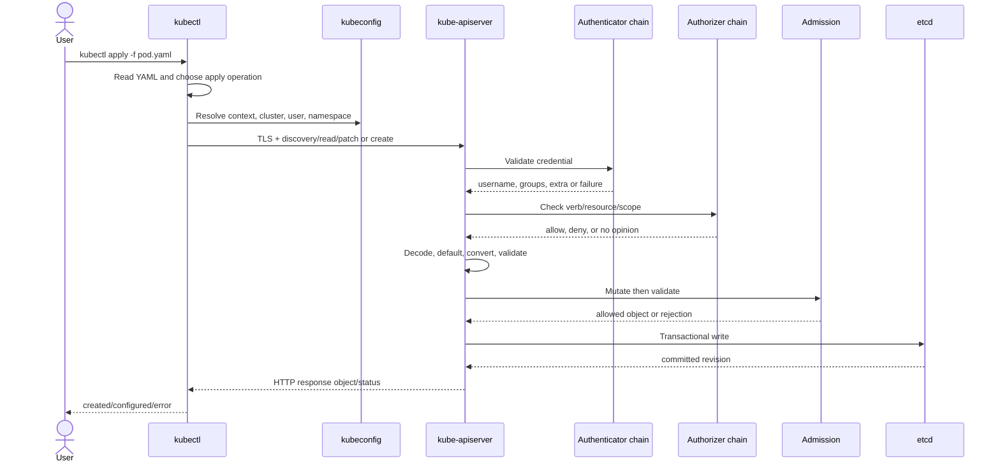
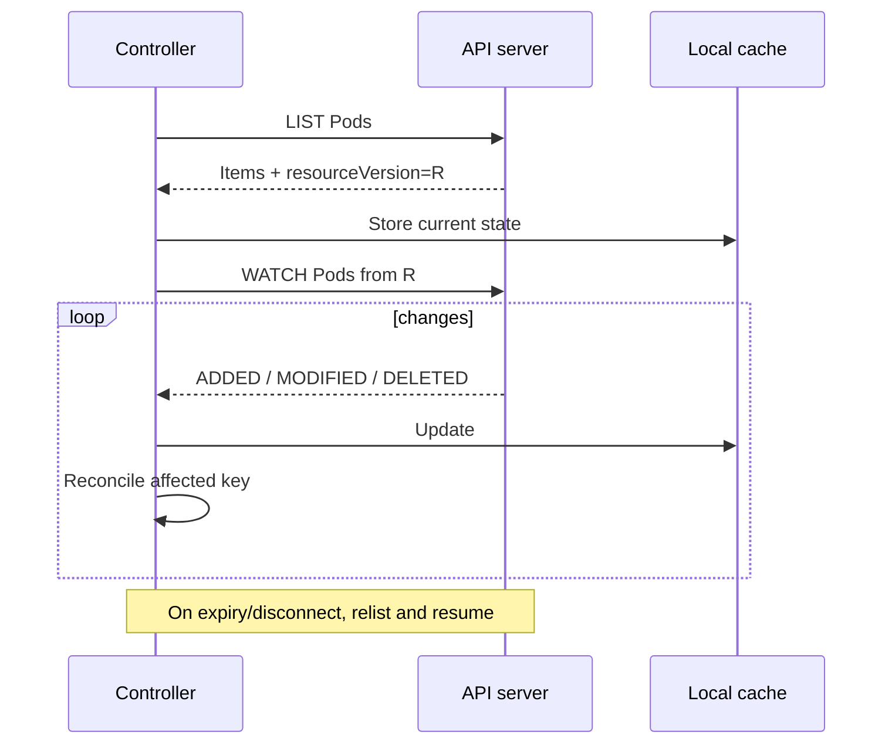
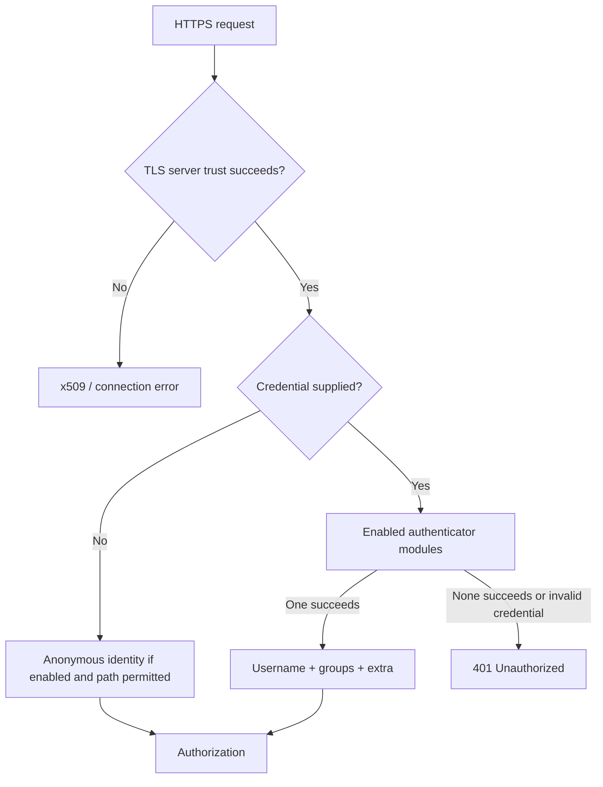
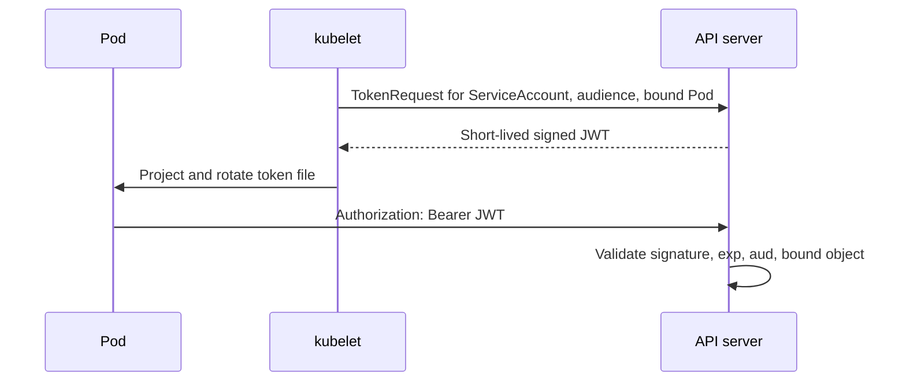
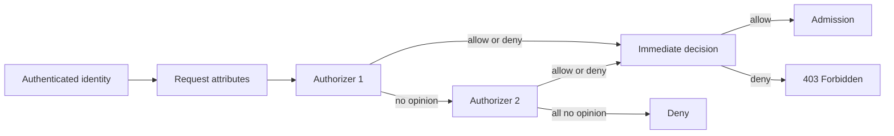

# Day 2 — API Server, Request Lifecycle, Authentication, and Authorization

## Learning objectives

Today you will learn:

- how REST, Kubernetes API groups, resources, verbs, discovery, and versions work;
- how `kubectl apply` becomes HTTPS requests;
- how schemas, serialization, `resourceVersion`, list/watch, pagination, timeouts, rate limits, audit, and HA work;
- how Kubernetes establishes a caller's identity;
- how RBAC and other authorizers decide what that identity may do;
- how to diagnose `Unauthorized`, `Forbidden`, credential, context, and webhook failures.

**Why this matters:** every Kubernetes control-plane interaction starts at the API. “The cluster rejected me” is not a useful diagnosis until you know whether TLS, authentication, authorization, admission, or persistence rejected the operation.

**Prerequisites:** Day 1, a working kubeconfig, and a disposable cluster where you may create namespaced RBAC objects.

**Estimated time:** 6–8 hours.

**Recommended order:** API foundations → request mechanics → authentication → authorization/RBAC → lab → failure matrix.

Official reading:

- [Kubernetes API concepts](https://kubernetes.io/docs/reference/using-api/api-concepts/)
- [API access control overview](https://kubernetes.io/docs/reference/access-authn-authz/controlling-access/)
- [Authentication](https://kubernetes.io/docs/reference/access-authn-authz/authentication/)
- [Authorization](https://kubernetes.io/docs/reference/access-authn-authz/authorization/)
- [RBAC](https://kubernetes.io/docs/reference/access-authn-authz/rbac/)
- [Auditing](https://kubernetes.io/docs/tasks/debug/debug-cluster/audit/)

---

## 1. API foundations

### API and REST

An **API** is a defined way for software to communicate. A **REST-style API** exposes resources at URLs and uses HTTP methods to act on them.

Examples:

| Intent | HTTP | Kubernetes RBAC verb | Example path |
|---|---|---|---|
| Read one Pod | `GET` | `get` | `/api/v1/namespaces/demo/pods/web` |
| Read many Pods | `GET` | `list` | `/api/v1/namespaces/demo/pods` |
| Follow changes | `GET?...watch=1` | `watch` | same collection path |
| Create | `POST` | `create` | collection path |
| Replace | `PUT` | `update` | named resource path |
| Partially change | `PATCH` | `patch` | named resource path |
| Delete | `DELETE` | `delete` | named resource path |

Kubernetes also has subresources with separate permissions, such as `pods/log`, `pods/exec`, `deployments/scale`, and `pods/status`.

### API groups, versions, kinds, and resources

- **Core group:** written as `apiVersion: v1`; includes Pods, Services, Secrets.
- **Named group:** for example `apps/v1`; includes Deployments and StatefulSets.
- **Version:** representation of an API, such as `v1`, `v1beta1`, or `v1alpha1`.
- **Kind:** singular object type in manifests, such as `Deployment`.
- **Resource:** REST collection name, usually plural lowercase, such as `deployments`.

```text
Manifest: apiVersion apps/v1, kind Deployment
REST:     /apis/apps/v1/namespaces/demo/deployments
RBAC:     apiGroups ["apps"], resources ["deployments"]
```

An API can serve multiple versions while storing a preferred internal/storage version. Conversion occurs at API boundaries. Do not infer stability only from familiarity; check the exact version's API reference.

### Names and scope

Namespaced path:

```text
/apis/apps/v1/namespaces/demo/deployments/web
```

Cluster-scoped path:

```text
/api/v1/nodes/worker-1
```

RBAC scope must match the resource scope. A RoleBinding cannot grant access outside its namespace, though it can bind a ClusterRole within that namespace.

### Discovery

**API discovery** lets a client ask what groups, versions, resources, and verbs the server supports.

```bash
kubectl api-resources
kubectl api-versions
kubectl explain deployment.spec.strategy
```

These are read-only. Discovery can be cached by clients. If an extension API is unhealthy, discovery can be partial or delayed.

---

## 2. What `kubectl apply -f pod.yaml` does

`kubectl` is an API client, not a direct cluster administrator daemon.



Important nuance: exact internal validation/defaulting steps are interleaved with admission phases. The reliable security order is authentication → authorization → admission → persistence. Day 3 goes deeper.

### kubeconfig

A kubeconfig contains:

- `clusters`: API endpoint and trusted CA information;
- `users`: credentials or an exec credential plugin;
- `contexts`: cluster + user + optional namespace;
- `current-context`: selected context.

```bash
kubectl config view --minify
kubectl config get-contexts
kubectl config current-context
```

These read local configuration, but output can reveal endpoints and credential-provider details. `--raw` can expose secrets and should not be pasted into tickets.

### TLS

**TLS** encrypts traffic and authenticates the server; mutual TLS can also authenticate a client certificate.

The client normally verifies that:

1. the server certificate chains to a trusted CA;
2. the certificate is within its validity period;
3. its DNS/IP identity matches the API endpoint.

`--insecure-skip-tls-verify` disables an essential trust check. Do not use it as a normal fix; correct the CA, endpoint, or certificate.

---

## 3. Decoding, schemas, and object versions

### Serialization and deserialization

**Serialization** converts an object into bytes such as JSON or protobuf. **Deserialization** converts bytes back into a typed object.

Although humans write YAML, `kubectl` commonly sends JSON-compatible API data. Kubernetes clients and internal components can use protobuf for efficiency for supported built-in types.

The API server identifies the group/version/kind, decodes the body, applies defaults, converts versions as required, and validates schema and semantic rules. Unknown or duplicate fields can be detected by server-side field validation.

Useful safe checks:

```bash
kubectl apply --dry-run=client -f pod.yaml -o yaml
kubectl apply --dry-run=server -f pod.yaml -o yaml
kubectl diff -f pod.yaml
```

- Client dry run checks locally and does not call all server behavior.
- Server dry run sends a non-persisting request through authorization and admission components that declare dry-run support.
- `diff` is read-like but requires relevant API permissions and executes server-side processing; it does not persist the intended change.

### Resource versions and optimistic concurrency

Each returned object has `metadata.resourceVersion`. It identifies a storage revision for API concurrency/watch purposes; it is opaque, not a human sequence number.

**Optimistic concurrency** means a client reads a version, submits an update based on it, and the server rejects the write with HTTP `409 Conflict` if another writer changed the object first. The client should re-read, recompute, and retry carefully.

Do not blindly remove `resourceVersion` from a replace/update workflow; that can turn a concurrency problem into accidental overwrite behavior.

### List and watch

- `list` returns a current collection.
- `watch` streams changes after a resource version.
- Informers commonly perform list → watch → local cache → reconciliation.



Watches are not permanent TCP guarantees. Clients handle disconnects, `410 Gone` for expired history, `429` overload responses, bookmarks where supported, and retries with backoff.

### Pagination

Large lists can request `limit` and use the returned `continue` token. This reduces one-response memory pressure.

```bash
kubectl get pods --chunk-size=200 -A
```

This is read-only but can still load the API server in a very large cluster. Avoid aggressive unbounded loops.

### Timeouts

Client timeout, API request timeout, admission webhook timeout, and downstream operation duration are different. A client timeout does not prove the server made no change: the write may have committed before the response was lost. Re-read the object before retrying a non-idempotent operation.

### API Priority and Fairness

**API Priority and Fairness (APF)** classifies requests and limits concurrency so noisy clients do not starve critical traffic. Overloaded requests can queue or receive `429 Too Many Requests` with `Retry-After`. Good clients back off rather than retrying immediately.

### Audit logging

Kubernetes auditing records a chronological security trail of API activity according to an audit policy. Levels include metadata-only and progressively more detailed request/response recording.

Audit logs are not the same as container logs or Events. They can contain sensitive data, are configured by cluster administrators, need protected storage/retention, and can impose cost at verbose levels.

### API server high availability

An HA control plane normally has multiple API server instances behind a stable endpoint. They share access to the cluster's etcd backing store and must use consistent security/configuration.

- API servers are designed to be horizontally replicated.
- A load balancer should use readiness, not merely a listening TCP port.
- Configuration or encryption-key drift between instances can create inconsistent behavior.
- HA API servers do not compensate for lost etcd quorum.

---

## 4. Authentication: “Who are you?”

### Identity vocabulary

- **Identity:** the name and groups Kubernetes assigns to a caller.
- **Credential:** evidence used to prove identity.
- **Certificate:** a signed statement binding a public key to attributes.
- **Private key:** secret cryptographic material used to prove possession; never share it.
- **Public key:** non-secret material used to verify signatures or establish encryption.
- **Token:** usually a bearer credential; whoever possesses it can use it until invalidated/expired.
- **Trust:** configured acceptance of an issuer, CA, proxy, or webhook.
- **Authentication:** validate credential and produce username/groups/extra attributes.

Kubernetes does not provide a built-in API object for normal human users. ServiceAccounts are Kubernetes-managed identities. Human identity typically comes from certificates, OIDC/JWT integration, an authenticating proxy, webhook, or managed-provider integration.



Multiple authenticators may be enabled. Upstream documentation warns that their evaluation order is not guaranteed; do not design ambiguous credentials expecting a specific order.

### 4.1 Client X.509 certificates

**Issuer:** a CA trusted by the API server's client CA configuration.

**Validation:** signature chain, validity, key usage and TLS proof of private-key possession. Kubernetes commonly maps certificate subject Common Name to username and Organization fields to groups.

**Use:** cluster components, automation, or human users in simpler/self-managed environments.

**Advantages:** no bearer token sent; strong cryptographic authentication.

**Disadvantages:** revocation is operationally difficult; rotation and private-key protection matter; broad groups such as `system:masters` are dangerous.

**Failure:** expired certificate → TLS/authentication failure. Wrong trusted CA → unknown authority. Correct certificate but no RBAC → `Forbidden`.

Never email a client key or commit kubeconfig client-key data.

### 4.2 Bearer tokens

The client sends:

```http
Authorization: Bearer <token>
```

“Bearer” means possession is enough. TLS, short lifetime, narrow audience, safe storage, and careful logging are essential. ServiceAccount, OIDC/JWT, static file, bootstrap, and webhook-validated tokens are all token cases with different issuers and validation.

### 4.3 ServiceAccount tokens

**Issuer:** Kubernetes control plane signing key through ServiceAccount token mechanisms.

**Use:** workloads and automation acting as namespaced ServiceAccounts.

Modern recommended flow:

1. Pod names a ServiceAccount.
2. Kubelet requests a bounded, time-limited JWT using TokenRequest.
3. A projected volume exposes it to the Pod.
4. Kubelet rotates it before expiry.
5. API server validates signature, time, audience, and bound object claims.



The [ServiceAccount guide](https://kubernetes.io/docs/concepts/security/service-accounts/) recommends TokenRequest/projected tokens. Manually created Secret-backed tokens are long-lived and not recommended.

Set `automountServiceAccountToken: false` when a workload does not need the Kubernetes API.

### 4.4 Bound tokens and TokenRequest

A **bound token** is linked to an object such as a Pod and includes expiry/audience constraints. Deleting the bound object invalidates it through API validation. A token's audience specifies the intended recipient; a token minted for one service should not be accepted by another.

For a short-lived diagnostic token:

```bash
kubectl create token app-reader --namespace demo --duration=10m
```

This exposes a bearer credential to your terminal history/output. It changes no persistent Secret but requires permission to create the `serviceaccounts/token` subresource. Treat output as sensitive.

### 4.5 Static token files

The API server can read a static CSV token file configured on disk. Tokens do not expire automatically and API server configuration changes require operational control-plane work.

Use: legacy/simple test environments only.

Risks: difficult rotation/revocation, plaintext operational secret, distribution to all API servers, long lifetime. Do not recommend for modern production clusters.

### 4.6 Bootstrap tokens

Bootstrap tokens are special Secrets commonly used by kubeadm to let new nodes perform initial TLS bootstrap. They are not general human login tokens. They should be short-lived and scoped to bootstrap-related groups/usages.

### 4.7 OIDC and JWT authentication

**OpenID Connect (OIDC)** is an identity layer using signed JWTs from an external identity provider.

Flow:

1. Human authenticates to an identity provider.
2. Client obtains an ID token for the Kubernetes audience.
3. Client presents it to the API server.
4. API server validates issuer, signature, expiry, audience, and configured claims.
5. Claims map to Kubernetes username/groups.
6. RBAC grants permissions to those names/groups.

Good for centralized human identity and short-lived credentials. Kubernetes validates tokens; it does not provide the login UI. Revocation before expiry can be limited with offline JWT validation, so keep tokens short-lived.

Older kubeconfig `auth-provider` integration is not the general modern recommendation; exec credential plugins are commonly used to obtain refreshed credentials.

### 4.8 External identity providers and cloud integrations

Managed Kubernetes may integrate cloud IAM by issuing/validating short-lived tokens or mapping cloud principals. That integration authenticates to the Kubernetes API; Kubernetes authorization such as RBAC still applies unless the provider adds its own layer.

Do not confuse:

- human/cloud identity used to call the Kubernetes API;
- Pod ServiceAccount identity used to call Kubernetes;
- cloud workload identity used by a Pod to call cloud services.

### 4.9 Authentication webhook

The API server can send a `TokenReview` to an external HTTPS webhook. The webhook validates the submitted token and returns authenticated identity data.

Advantages: custom/centralized identity systems. Costs: latency and availability in the login path, TLS/key management, cache behavior, and sensitive token handling. A webhook outage or invalid response can cause authentication failure according to configuration.

This is not an admission webhook: authentication establishes identity before authorization; admission evaluates a resource operation after authorization.

### 4.10 Authenticating proxy

A trusted reverse proxy authenticates the user and sends identity headers to the API server over a connection authenticated with a trusted client certificate. If trust is misconfigured, spoofed headers can become identities. Only the intended proxy must possess the proxy client credential.

### 4.11 Anonymous authentication

Requests without accepted credentials may become `system:anonymous` in group `system:unauthenticated` when anonymous authentication is enabled. Kubernetes v1.34 made configurable anonymous endpoint conditions stable, allowing narrowly permitted paths such as health endpoints when configured.

Anonymous authentication does not imply anonymous authorization. RBAC/authorizers still decide access. Review bindings to `system:unauthenticated` carefully.

---

## 5. Authorization: “May this identity do this?”

Authorization sees request attributes such as:

- username and groups;
- verb (`get`, `list`, `create`, `patch`, and so on);
- API group, resource, subresource, and optional resource name;
- namespace;
- non-resource URL path.



Per the [official authorization documentation](https://kubernetes.io/docs/reference/access-authn-authz/authorization/), configured authorizers are checked in order; an allow or deny decision stops evaluation, and all “no opinion” results become deny. Exact possibilities differ between legacy flag-based configuration and the newer authorization configuration file.

### Authorization modes

- **RBAC:** dynamic API objects grant verbs on resources.
- **Node:** specialized permissions for kubelets based on scheduled Pods and related objects.
- **Webhook:** external service evaluates `SubjectAccessReview`-style requests.
- **ABAC:** static attribute policy file; legacy and operationally awkward.
- **AlwaysAllow:** insecure outside constrained testing.
- **AlwaysDeny:** testing/lockdown use.

Managed distributions choose and configure modes; a user generally cannot assume all modes are active.

### Node authorizer versus NodeRestriction

- **Node authorizer:** authorization; decides which API actions a kubelet identity may perform.
- **NodeRestriction:** admission plugin; limits which Node/Pod fields authenticated kubelets may modify, including protected label prefixes.

They complement one another but run at different stages.

---

## 6. RBAC objects

### Role and ClusterRole

- **Role:** rules defined inside one namespace.
- **ClusterRole:** cluster-scoped rule definition; can cover cluster resources or reusable namespaced permissions.

RBAC rules are additive; there is no RBAC deny rule. Avoid wildcards because newly added resource types or subresources may silently become accessible.

### RoleBinding and ClusterRoleBinding

- **RoleBinding:** grants a Role or ClusterRole to subjects in one namespace.
- **ClusterRoleBinding:** grants a ClusterRole cluster-wide.

### Subjects

- User: external normal-user string.
- Group: collection supplied by authentication.
- ServiceAccount: namespaced Kubernetes identity.

### Practical least-privilege example

```yaml
apiVersion: v1
kind: Namespace
metadata:
  name: demo
---
apiVersion: v1
kind: ServiceAccount
metadata:
  name: app-reader
  namespace: demo
automountServiceAccountToken: false
---
apiVersion: rbac.authorization.k8s.io/v1
kind: Role
metadata:
  name: pod-reader
  namespace: demo
rules:
  - apiGroups: [""]
    resources: ["pods"]
    verbs: ["get", "list", "watch"]
  - apiGroups: [""]
    resources: ["pods/log"]
    verbs: ["get"]
---
apiVersion: rbac.authorization.k8s.io/v1
kind: RoleBinding
metadata:
  name: app-reader-pods
  namespace: demo
subjects:
  - kind: ServiceAccount
    name: app-reader
    namespace: demo
roleRef:
  apiGroup: rbac.authorization.k8s.io
  kind: Role
  name: pod-reader
```

Important points:

- Core API group is `""`, not `core`.
- `pods/log` is a subresource and needs its own permission.
- No `create`, `patch`, `update`, or `delete` is granted.
- The RoleBinding grant applies only in `demo`.
- `roleRef` is immutable; replace the binding if it must change.
- The ServiceAccount disables automatic token mounting; a Pod that needs the API would enable/mount a projected token deliberately.

### Resource names and non-resource URLs

`resourceNames` can restrict some rules to named objects, but it does not make every collection action name-aware; `list`/`watch` typically need field selectors supplied by the client and have limitations. Do not treat it as universal row-level security.

ClusterRoles can grant non-resource paths:

```yaml
rules:
  - nonResourceURLs: ["/healthz", "/readyz"]
    verbs: ["get"]
```

Non-resource URLs are cluster-scoped authorization.

### Permission verification

```bash
kubectl auth can-i list pods -n demo --as=system:serviceaccount:demo:app-reader
kubectl auth can-i get pods/log -n demo --as=system:serviceaccount:demo:app-reader
kubectl auth can-i delete pods -n demo --as=system:serviceaccount:demo:app-reader
kubectl auth can-i --list -n demo --as=system:serviceaccount:demo:app-reader
```

These submit authorization review requests and do not modify workload state. Impersonation flags require permission to impersonate the target identity. Expected: yes, yes, no; then a permission list.

### Excessive and incorrect permissions

- Binding `cluster-admin` to an application gives full control and is rarely justified.
- `*` resources/verbs can grow in meaning as APIs are added.
- Permission to create Pods can often expose mounted credentials, host resources, or powerful ServiceAccounts unless admission/security controls restrict the Pod spec.
- A correct Role with no RoleBinding grants nothing.
- A RoleBinding in namespace A does not grant access in B.
- A ClusterRoleBinding makes namespaced rules apply in every namespace.
- Ability to create/modify Roles and RoleBindings can enable privilege escalation; Kubernetes performs escalation checks, but privileged bind/escalate rights remain dangerous.

---

## 7. Authentication and authorization failure matrix

| Observation | Stage | Meaning | First checks |
|---|---|---|---|
| `x509: certificate signed by unknown authority` | TLS | client does not trust API server chain | endpoint, CA data, interception proxy |
| certificate expired/not yet valid | TLS/authn | time or certificate validity failure | system clock, certificate dates, rotation |
| HTTP `401 Unauthorized` | authentication | no acceptable identity established | token/cert validity, issuer, audience, exec plugin |
| HTTP `403 Forbidden` | authorization | identity known but action not allowed | username in error, `auth can-i`, binding scope |
| timeout contacting authentication webhook | authentication | external authenticator unavailable/slow | API logs, webhook endpoint/TLS/network |
| timeout contacting authorization webhook | authorization | external decision point unavailable/slow | authorizer configuration, endpoint, failure policy |
| request allowed then rejected by policy | admission | authn and authz passed; object violated admission rule | server error text, audit, webhook/policy logs |

### `Unauthorized`

Do not create RBAC first. RBAC cannot help a request that has no valid identity.

Check:

```bash
kubectl config current-context
kubectl config view --minify
kubectl get --raw=/version
```

Then inspect credential plugin errors, token expiry/audience, certificate validity, and API server/authentication-webhook logs if you administer the control plane.

### `Forbidden`

Read the full error; it states the username, verb, and resource.

```bash
kubectl auth can-i create deployments.apps -n demo
kubectl auth can-i create deployments.apps -n demo --as=<user>
kubectl get rolebindings,roles -n demo
kubectl get clusterrolebindings,clusterroles
```

Start namespaced. Avoid dumping all cluster bindings if you lack need/permission. Fix the narrow missing grant, not by attaching `cluster-admin`.

### Wrong context or namespace

Symptoms can look like missing objects or unexpected denial.

```bash
kubectl config get-contexts
kubectl config view --minify --output 'jsonpath={..namespace}{"\n"}'
kubectl get pod -A --field-selector metadata.name=my-pod
```

The last command may require cluster-wide list permission. Prefer `-n expected-namespace` first.

### Invalid ServiceAccount permission

Check the exact identity:

```bash
kubectl get pod <pod> -n demo -o jsonpath='{.spec.serviceAccountName}{"\n"}'
kubectl auth can-i get configmaps -n demo --as=system:serviceaccount:demo:<serviceaccount>
```

Do not assume a ServiceAccount named the same in another namespace is the same identity.

### Webhook problems

Authentication/authorization webhooks are API server configuration, not `MutatingWebhookConfiguration` objects. Diagnose:

- API server logs and metrics;
- configured kubeconfig endpoint;
- DNS/routing from the API server host;
- webhook server certificate and client trust;
- response API version/shape;
- timeout and cache configuration;
- webhook health and latency.

---

## 8. Practical lab: prove the stages

### Create RBAC objects

Save the four-document manifest from section 6 as `rbac.yaml` and run:

```bash
kubectl apply -f rbac.yaml
kubectl get serviceaccount,role,rolebinding -n demo
```

These change cluster state. Creating namespaces is cluster-scoped; the remaining resources need create/patch permission in `demo`.

### Test authorization without handling a token

```bash
kubectl auth can-i list pods -n demo --as=system:serviceaccount:demo:app-reader
kubectl auth can-i delete pods -n demo --as=system:serviceaccount:demo:app-reader
```

Expected: `yes`, then `no`. This isolates authorization behavior from token management.

### Observe raw API paths

```bash
kubectl get --raw /api/v1
kubectl get --raw /apis/apps/v1
kubectl get --raw /api/v1/namespaces/demo/pods?limit=10
```

Read-only. Output is JSON discovery/list data. These calls still require TLS, authentication, and authorization.

### View request verbosity carefully

```bash
kubectl -v=8 get pods -n demo
```

This is read-only but verbose logs can expose headers or environment details. Use only in a safe terminal and sanitize before sharing. Observe HTTP method, URL, response code, and timing.

### Demonstrate conflict safely

In two terminals:

```bash
kubectl get namespace demo -o yaml > /tmp/demo-ns-a.yaml
kubectl label namespace demo lab-version=two
```

Edit the saved file to add a different label while retaining its old `resourceVersion`, then:

```bash
kubectl replace -f /tmp/demo-ns-a.yaml
```

Expected: `409 Conflict`, because the live namespace changed after the read. Do not force replacement. Re-read and apply the intended change.

### Cleanup

```bash
kubectl delete namespace demo
```

Destructive: deletes namespaced lab resources. Verify context before running.

---

## 9. What does not happen

- Authentication success does not grant permission.
- Authorization success does not guarantee admission or persistence.
- API persistence does not guarantee a Pod can schedule or run.
- `kubectl` does not directly call etcd, kubelet, or the container runtime for ordinary object management.
- RBAC does not inspect arbitrary fields inside a Pod spec; admission policy handles that kind of content rule.
- A Role does nothing until a binding grants it.
- An authentication webhook is not an admission webhook.
- A lost client response does not prove a write failed.
- Kubernetes normal-user identities are not stored as `User` API objects.

---

## Key takeaways

- The Kubernetes API is an HTTPS, resource-oriented interface.
- kubeconfig selects endpoint, trust, credential, and default namespace.
- List/watch and resource versions power controllers and concurrency.
- Authentication produces an identity; authorization evaluates that identity's request.
- `401` usually means identity failure; `403` means known identity, denied action.
- RBAC is additive and scope-sensitive; least privilege beats wildcards.
- Admission and persistence occur only after authorization allows a write request.

## Concise revision notes

```text
TLS: protect channel + verify server
Authn: credential → username/groups
Authz: identity + verb + resource + scope → allow/deny
Admission: inspect/mutate valid authorized writes
Persistence: API storage layer → etcd
401: not authenticated
403: authenticated, not allowed
Role: rules in namespace
ClusterRole: cluster-scoped rule definition
RoleBinding: grant in one namespace
ClusterRoleBinding: grant cluster-wide
resourceVersion: opaque concurrency/watch token
list + watch: current state + change stream
```

## Practical exercises

1. Use `kubectl api-resources --namespaced=true` and identify the API group for Deployments, Jobs, Roles, and NetworkPolicies.
2. Create a Role allowing `get` but not `list` on ConfigMaps. Verify both verbs with `auth can-i` and explain why they differ.
3. Bind a ClusterRole through a RoleBinding and prove its permission is limited to one namespace.
4. Run a server dry run for a Pod and explain which stages still happen and which final write does not.

Expected outcome: you can identify the exact API attributes behind each decision rather than saying “RBAC is broken.”

## Troubleshooting exercises

1. A valid OIDC user gets `Forbidden`. Authentication succeeded; inspect group claim mapping and RBAC, not the identity provider password.
2. A ServiceAccount token works against the API but not a custom service. Check the audience expected by the custom service.
3. `kubectl` reaches the wrong cluster. Inspect current context, selected cluster, and exec plugin; do not edit RBAC in the wrong cluster.
4. An authorization webhook is slow. Confirm API metrics/logs, webhook latency, timeout/caching, and safe failure behavior before changing policy.

## Interview questions and answers

**Q: What happens after `kubectl apply`?**  
kubectl reads configuration and kubeconfig, establishes TLS, sends API reads and a create/patch, then the API server authenticates, authorizes, decodes/validates, runs admission, persists to etcd, and replies. Controllers act afterward.

**Q: What is the difference between 401 and 403?**  
401 means acceptable authentication was not established. 403 means an identity was established but authorization denied the action.

**Q: Role versus ClusterRole?**  
A Role contains namespaced rules in one namespace. A ClusterRole is cluster-scoped and can describe cluster-resource permissions or reusable namespaced permissions. Binding scope determines where the grant applies.

**Q: Why are bound ServiceAccount tokens safer?**  
They are short-lived, audience-scoped, can be bound to an object, and are rotated, reducing the value and lifetime of a leaked credential.

**Q: How do watches help controllers?**  
After listing current state at a resource version, a controller streams changes instead of repeatedly listing everything, then reconciles affected objects.

**Q: Can RBAC deny a permission granted by another RBAC rule?**  
No. Kubernetes RBAC permissions are additive; it has no explicit deny rule.

## Self-assessment checklist

- [ ] I can map an HTTP method to a Kubernetes/RBAC verb.
- [ ] I can explain API groups, resources, kinds, and versions.
- [ ] I can trace `kubectl apply` through the API boundary.
- [ ] I understand list/watch and optimistic concurrency.
- [ ] I can compare all major authentication methods and their intended users.
- [ ] I can design a least-privilege Role and correct binding.
- [ ] I can distinguish Node authorization from NodeRestriction admission.
- [ ] I can diagnose 401 versus 403 before changing anything.

## Day 3 preview

Day 3 continues after authorization: built-in admission, mutating and validating webhooks, native CEL policy, Pod Security Admission, Gatekeeper, Kyverno, and the etcd transaction that makes an accepted API object durable.

