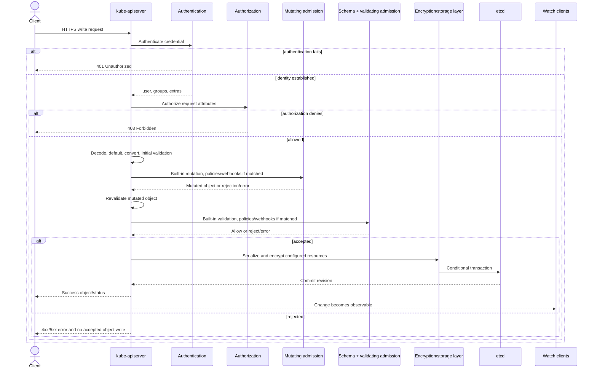
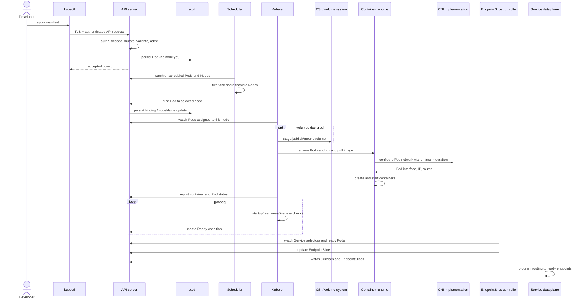
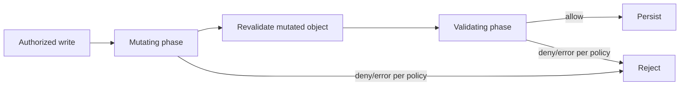
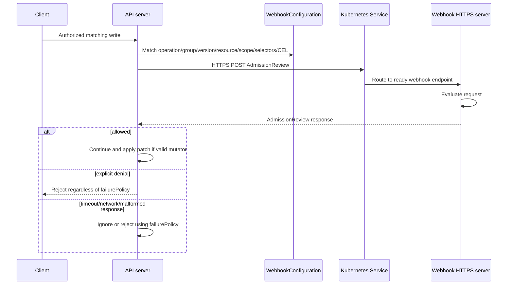
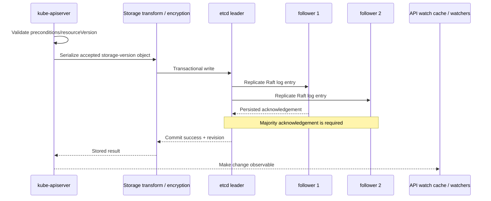

# Day 3 — Admission Control, Policy Enforcement, Webhooks, and etcd

## Learning objectives

Today you will learn:

- the complete Pod-creation path from local manifest to ready endpoint;
- where built-in admission, policies, and webhooks fit after authorization;
- how mutating and validating admission differ;
- how webhook matching, TLS, responses, timeouts, and failure policy work;
- how Pod Security Standards, Pod Security Admission, native admission policy, OPA, Gatekeeper, and Kyverno differ;
- how the API server stores objects in etcd and how quorum, snapshots, encryption, compaction, and recovery work.

**Why this matters:** an object can be rejected before storage, accepted but unschedulable, scheduled but unable to start, running but not ready, or ready yet failing at the application layer. These states demand different evidence.

**Prerequisites:** Days 1–2. Webhook and etcd administration sections are conceptual unless you own a disposable self-managed control plane.

**Estimated time:** 7–9 hours.

**Recommended order:** full lifecycle → admission → webhooks → policy choices → etcd → failure lab.

Official reading:

- [Admission controllers](https://kubernetes.io/docs/reference/access-authn-authz/admission-controllers/)
- [Dynamic admission control](https://kubernetes.io/docs/reference/access-authn-authz/extensible-admission-controllers/)
- [Admission webhook good practices](https://kubernetes.io/docs/concepts/cluster-administration/admission-webhooks-good-practices/)
- [Pod Security Admission](https://kubernetes.io/docs/concepts/security/pod-security-admission/)
- [ValidatingAdmissionPolicy](https://kubernetes.io/docs/reference/access-authn-authz/validating-admission-policy/)
- [Operating etcd for Kubernetes](https://kubernetes.io/docs/tasks/administer-cluster/configure-upgrade-etcd/)

---

## 1. One request, four different outcomes

| State | Meaning | Example |
|---|---|---|
| Rejected API request | Object was not accepted as requested | RBAC denied or validating webhook rejected it |
| Accepted but cannot progress | Object exists, desired state is unmet | Pod remains Pending due to no feasible node |
| Running but unhealthy | Containers execute, health gate fails | Readiness returns HTTP 500 |
| Kubernetes healthy, application failed | Platform delivered traffic, app behavior is wrong | API returns incorrect business response |

Never collapse these into “the deployment failed.” Identify the boundary.

---

## 2. Complete API write lifecycle



The diagram is deliberately conditional:

- Reads normally do not pass through admission; admission focuses on create/update/delete-like operations and certain connects.
- Only matching admission policies/webhooks run.
- Dry-run requests run applicable admission only when components support dry run and do not persist.
- Subresources can have distinct behavior and authorization.
- Audit stages surround the flow according to policy.
- An explicit webhook denial is not a webhook-call failure; `failurePolicy` does not override an explicit denial.

---

## 3. Complete Pod creation lifecycle

Assume a developer runs:

```bash
kubectl apply -f pod.yaml
```

### End-to-end sequence



### Stage-by-stage explanation

#### 1. Read local manifest

`kubectl` parses YAML/JSON, resolves file documents, and determines the object identity. A malformed local file can fail before any request reaches the cluster.

Evidence: local error, `--dry-run=client`, shell file path.

#### 2. Resolve endpoint and credentials

The current kubeconfig context selects API server, CA/trust, user/credential plugin, and default namespace. A wrong context can produce valid results from the wrong cluster.

#### 3. TLS and request

Client verifies the API server certificate and sends HTTPS. Network, DNS, proxy, CA, hostname, or certificate errors occur before Kubernetes authorization.

#### 4. Authentication

The API server validates the certificate/token/proxy/webhook evidence and assigns identity. Failure normally yields `401` or a TLS-level error.

#### 5. Authorization

Authorizers inspect the identity and action such as `create pods` in the target namespace. Denial yields `403`; admission does not run for that rejected request.

#### 6. Decode, default, convert, schema/semantic validation

The API server decodes the request, resolves group/version/kind, applies defaults/conversion, and checks recognized fields and invariants. Exact validation points interact with mutation; the server revalidates mutations.

#### 7. Mutating admission

Matching built-in mutators, MutatingAdmissionPolicies, and mutating webhooks may add defaults or patches. Mutating webhooks are called serially and may be reinvoked when configured and needed.

#### 8. Validating admission

Built-in validators, Pod Security Admission, ValidatingAdmissionPolicies, and matching validating webhooks can reject. Validating webhooks observe but cannot mutate. Rejection means no accepted Pod object is stored.

#### 9. Persistence

The storage layer serializes the accepted internal object, applies configured at-rest transformation, and makes a conditional etcd transaction. Success is reported after commit. A failed write must not be reported as successfully persisted.

#### 10. Watches and controllers

The stored Pod becomes visible to list/watch clients. A bare Pod does not need a Deployment controller to exist; a Pod produced by a Deployment was previously created by the ReplicaSet controller.

#### 11. Scheduling

The scheduler watches unscheduled Pods, filters and scores nodes, then binds the Pod through the API. No feasible node means the Pod remains accepted and Pending with `FailedScheduling` Events.

#### 12. Kubelet observation

The kubelet watches/list-caches Pods whose `.spec.nodeName` matches its node and reconciles the Pod spec. It can reject local admission due to node pressure or unsupported requirements.

#### 13. Volumes

If needed, storage controllers attach/provision and kubelet/CSI mounts. `FailedMount` or `FailedAttachVolume` occurs after API acceptance and often after scheduling.

#### 14. Image and runtime

Kubelet asks the CRI runtime to ensure the Pod sandbox, pull images according to policy, create containers, and start them. Registry DNS, credentials, image name, architecture, and runtime errors appear here.

#### 15. Networking

The runtime invokes the configured CNI path to create the Pod network interface, allocate an IP, and configure routes. CNI failure prevents normal sandbox/container setup. Exact ordering of pull and sandbox/network work can overlap or vary by runtime/kubelet behavior; do not depend on a single serialized animation.

#### 16. Init, sidecar, and application startup

Init containers must complete according to semantics; native sidecars can continue; application containers start. Commands, mounts, security context, and config references can fail.

#### 17. Probes and Ready

Kubelet executes probes. A startup probe gates liveness/readiness. Readiness controls the Pod Ready condition. Liveness may restart a container.

#### 18. EndpointSlice and traffic

For a selector-based Service, the EndpointSlice controller reflects matching Pods and readiness. The Service proxy/controller programs traffic. Traffic then reaches ready eligible endpoints, subject to network policy and application behavior.

### Failure-location table

| Symptom | Boundary | Likely owner/evidence |
|---|---|---|
| Apply returns schema error | API decode/validation | API error, `kubectl explain` |
| Rejected as privileged | admission | response, audit, PSA/webhook/policy message |
| Pod exists, `Pending`, no node | scheduling | Pod conditions and `FailedScheduling` Events |
| `ErrImagePull` | node/runtime | Pod Events, imagePullSecrets, runtime/node networking |
| `FailedMount` | kubelet/storage/CSI | Events, PVC/PV, CSI controller/node logs |
| `ContainerCreating` with sandbox error | CNI/runtime | Events and node plugin logs |
| `CrashLoopBackOff` | application process/probe | current/previous logs, exit code, Events |
| Running `0/1` | readiness | probe Events, endpoint readiness, app logs |
| Ready but wrong response | network/application | Service path, logs, trace, app dependency |

---

## 4. Admission control from first principles

**Admission** means checking or changing an authorized API write before it is accepted into storage.

Why it exists:

- apply defaults that depend on cluster policy;
- enforce quotas and security rules;
- reject unsafe or invalid combinations;
- integrate external policy or injection systems.

### Built-in admission plugins

Built-in plugins are compiled into kube-apiserver and configured by a cluster administrator. Examples:

- `NamespaceLifecycle`;
- `LimitRanger`;
- `ServiceAccount`;
- `ResourceQuota`;
- `PodSecurity`;
- `NodeRestriction`;
- `DefaultStorageClass`;
- webhook/policy extension plugins.

Some mutate, some validate, and some do both. The official [admission-controller list](https://kubernetes.io/docs/reference/access-authn-authz/admission-controllers/) documents defaults and version state.

### Two phases



- Mutation happens first because validators should inspect the final intended form.
- Validation cannot change the object.
- Any applicable explicit rejection stops the request.
- Side effects are risky because a later check can still reject the main object; webhook `sideEffects` declarations and idempotence matter.

### AdmissionReview

An admission webhook receives JSON like:

```json
{
  "apiVersion": "admission.k8s.io/v1",
  "kind": "AdmissionReview",
  "request": {
    "uid": "request-uid",
    "operation": "CREATE",
    "resource": {"group": "", "version": "v1", "resource": "pods"},
    "namespace": "demo",
    "object": {"apiVersion": "v1", "kind": "Pod", "metadata": {"name": "web"}}
  }
}
```

It must return the same UID:

```json
{
  "apiVersion": "admission.k8s.io/v1",
  "kind": "AdmissionReview",
  "response": {
    "uid": "request-uid",
    "allowed": false,
    "status": {"message": "containers must run as non-root"}
  }
}
```

A mutating webhook can instead return a base64-encoded JSON Patch with `patchType: JSONPatch`.

---

## 5. Admission webhooks

A **webhook** is an HTTPS callback: the API server sends a request to another server and uses its response.

Three objects are easily confused:

1. **Webhook server:** your HTTPS application that evaluates AdmissionReview.
2. **Kubernetes Service:** optional stable in-cluster address routing to webhook Pods.
3. **Webhook configuration:** cluster-scoped API object telling kube-apiserver when and where to call.



### Working-style validating configuration

The webhook server, Service, certificate Secret, Deployment, and CA issuance are prerequisites; this configuration alone does not create them.

```yaml
apiVersion: admissionregistration.k8s.io/v1
kind: ValidatingWebhookConfiguration
metadata:
  name: require-team-label.example.com
webhooks:
  - name: require-team-label.example.com
    admissionReviewVersions: ["v1"]
    sideEffects: None
    failurePolicy: Fail
    matchPolicy: Equivalent
    timeoutSeconds: 3
    clientConfig:
      service:
        namespace: policy-system
        name: team-label-webhook
        path: /validate
        port: 443
      caBundle: <BASE64_PEM_CA_CERTIFICATE>
    rules:
      - operations: ["CREATE", "UPDATE"]
        apiGroups: ["apps"]
        apiVersions: ["v1"]
        resources: ["deployments"]
        scope: Namespaced
    namespaceSelector:
      matchExpressions:
        - key: policy.example.com/ignore
          operator: DoesNotExist
    matchConditions:
      - name: exclude-policy-system
        expression: "request.namespace != 'policy-system'"
```

Important fields:

- `name`: globally unique DNS-style webhook name.
- `clientConfig.service`: API server connects to this Service; server certificate must cover `<service>.<namespace>.svc`.
- `caBundle`: CA used by kube-apiserver to verify webhook server TLS.
- `rules`: operation/API/resource/scope matching.
- `matchPolicy: Equivalent`: equivalent served versions can match and be converted.
- `namespaceSelector`: matches labels on the namespace, not arbitrary Pod labels.
- `objectSelector`: can match object labels, but users who control labels might evade poorly designed use.
- `matchConditions`: CEL filters; stable since v1.30.
- `timeoutSeconds`: fail quickly; slow admission delays every matching API request.
- `failurePolicy`: `Fail` rejects call errors; `Ignore` continues after call errors.
- `sideEffects`: must accurately describe side effects, especially for dry run.
- `admissionReviewVersions`: versions both sides support.

### Mutating webhook additions

A `MutatingWebhookConfiguration` uses the same major matching/TLS fields and may specify:

```yaml
reinvocationPolicy: IfNeeded
```

Mutating webhooks are invoked serially. There is no stable global ordering contract you should use as application logic between independently configured webhooks. Mutations should be idempotent: running twice produces the same result as running once.

### Allow, deny, modify, timeout, and invalid responses

| Result | API server behavior |
|---|---|
| `allowed: true` | continues |
| `allowed: false` | rejects; failurePolicy does not convert denial to allow |
| valid mutating JSON patch | applies patch, revalidates, continues |
| timeout/network/TLS failure | `Fail` rejects; `Ignore` continues |
| malformed response/non-2xx | treated as call failure; failurePolicy applies |
| unsupported AdmissionReview version | call/configuration failure; failurePolicy applies |
| invalid patch | mutating call failure; failurePolicy applies |

**Fail closed** protects enforcement but can block cluster operations when the webhook is unavailable. **Fail open** protects availability but permits requests without that check during errors. Decide per policy risk, add monitoring/audit, keep scope narrow, and avoid matching the webhook's own recovery resources.

### Security and reliability checklist

- Minimal matching rules; avoid `*` unless justified.
- Short timeout and horizontally available endpoints.
- Valid server certificate and planned rotation before expiry.
- Network reachability from every API server, not merely from ordinary Pods.
- No dependency cycle on resources the webhook itself blocks.
- Exclude system/recovery namespaces only with a documented threat model.
- Idempotent mutations and `sideEffects: None`/`NoneOnDryRun` accurately set.
- Do not log complete Secrets or bearer credentials from AdmissionReview.
- Monitor latency, rejection count, call failures, and certificate expiry.

### Debugging a webhook

Start read-only:

```bash
kubectl get validatingwebhookconfigurations,mutatingwebhookconfigurations
kubectl get validatingwebhookconfiguration <name> -o yaml
kubectl get service,endpointslice -n policy-system
kubectl get pods -n policy-system -o wide
kubectl logs -n policy-system deployment/<webhook-deployment>
kubectl apply --dry-run=server -f test-object.yaml
```

Interpretation:

- No ready EndpointSlice endpoints: Service has nothing healthy to route to.
- `x509` error: CA bundle, certificate SAN, expiry, or rotation problem.
- `context deadline exceeded`: routing, server latency, or deadlock.
- explicit policy message: webhook was reached and denied normally.
- “no matches for kind” is API discovery/CRD, not necessarily webhook.

API server logs/metrics require administrator access. Do not delete webhook configurations as a first response; that can disable security controls and exceed your authority.

---

## 6. Policy enforcement choices

### Pod Security Standards (PSS)

PSS defines three profiles:

- `Privileged`: intentionally unrestricted.
- `Baseline`: prevents known privilege escalations while remaining broadly compatible.
- `Restricted`: stronger hardening aligned with current best practices.

PSS is a standard, not an admission server by itself.

### Pod Security Admission (PSA)

PSA is the built-in stable admission controller that applies PSS at namespace level using labels.

```yaml
apiVersion: v1
kind: Namespace
metadata:
  name: secure-apps
  labels:
    pod-security.kubernetes.io/enforce: restricted
    pod-security.kubernetes.io/enforce-version: v1.37
    pod-security.kubernetes.io/audit: restricted
    pod-security.kubernetes.io/audit-version: v1.37
    pod-security.kubernetes.io/warn: restricted
    pod-security.kubernetes.io/warn-version: v1.37
```

- `enforce`: rejects violating Pods.
- `warn`: returns a user warning.
- `audit`: adds audit annotation.
- Pinning a version prevents a future minor release from silently changing requirements.

PSA checks Pod security fields; it is not a general rule engine for labels, registries, or resource limits.

### Native ValidatingAdmissionPolicy

This Kubernetes API uses CEL expressions for in-process declarative validation—no external HTTP call. A policy defines logic; a binding chooses scope, parameters, and validation actions.

Example requiring team label on Deployments:

```yaml
apiVersion: admissionregistration.k8s.io/v1
kind: ValidatingAdmissionPolicy
metadata:
  name: require-team-label
spec:
  failurePolicy: Fail
  matchConstraints:
    resourceRules:
      - apiGroups: ["apps"]
        apiVersions: ["v1"]
        operations: ["CREATE", "UPDATE"]
        resources: ["deployments"]
  validations:
    - expression: "has(object.metadata.labels) && 'team' in object.metadata.labels"
      message: "Deployment must have a team label"
---
apiVersion: admissionregistration.k8s.io/v1
kind: ValidatingAdmissionPolicyBinding
metadata:
  name: require-team-label
spec:
  policyName: require-team-label
  validationActions: [Deny, Audit]
  matchResources:
    namespaceSelector:
      matchLabels:
        policy.example.com/managed: "true"
```

Validate against your cluster's exact API version. Kubernetes v1.37 also contains newer mutation-policy capabilities; portability to older clusters requires checking feature state/API version rather than copying v1.37 manifests blindly.

### Open Policy Agent (OPA)

OPA is a general-purpose policy decision engine using Rego. It is not Kubernetes itself. Plain OPA can be placed behind an admission webhook, but you must design policy distribution, Kubernetes integration, audit, availability, and operations.

### Gatekeeper

Gatekeeper is a Kubernetes-focused OPA integration. It adds:

- `ConstraintTemplate`: reusable Rego policy plus parameter schema;
- `Constraint`: an instance choosing scope and parameter values;
- admission webhook enforcement;
- audit of existing resources.

It is useful when teams already use OPA/Rego or need its ecosystem and audit model. It adds controllers, CRDs, webhook availability, and Rego learning/operations.

### Kyverno

Kyverno is a third-party cloud-native policy engine oriented toward Kubernetes-style YAML and CEL capabilities. It can validate, mutate, generate, clean up resources, verify images, scan outside admission, and report policy results.

It is approachable for Kubernetes-focused teams and has broad policy functions, but still adds CRDs, controllers/webhooks, version lifecycle, and an additional security-critical control plane.

### Comparison

| Mechanism | Built in? | Language/model | Main strengths | Main limits/costs |
|---|---|---|---|---|
| PSS | Standard in Kubernetes docs | fixed profiles | portable Pod hardening vocabulary | not enforcement by itself; not arbitrary policy |
| PSA | Yes | namespace labels + PSS | simple, in-process, stable | only Pod security standards |
| ValidatingAdmissionPolicy | Yes | CEL policy + binding | no webhook network hop; custom validation | validation scope; CEL/version learning |
| MutatingAdmissionPolicy | v1.37 capability; check target version | CEL/apply/patch model | in-process mutation | newer/version-sensitive |
| Plain OPA | No | Rego | general policy engine | integration and operations are yours |
| Gatekeeper | No | Rego + templates/constraints | Kubernetes OPA integration and audit | extra CRDs/controllers/webhook |
| Kyverno | No | Kubernetes resources, YAML/CEL | validate/mutate/generate/image rules | extra security-critical system |

Choose the smallest mechanism that expresses the rule safely. Use PSA for baseline Pod hardening, native CEL for suitable validation, and external engines when you need their broader lifecycle, language, inventory, reporting, or ecosystem features.

### Example policy coverage

| Requirement | Suitable choices |
|---|---|
| Reject privileged containers | PSA Baseline/Restricted; native/custom policy also possible |
| Require non-root | PSA Restricted; native/custom policy |
| Restrict host networking/hostPath | PSS/PSA where profile fits; custom for organization-specific detail |
| Require labels | ValidatingAdmissionPolicy, Gatekeeper, Kyverno, webhook |
| Require requests/limits | native CEL, Gatekeeper, Kyverno, webhook |
| Restrict image registry | native CEL or external policy; supply-chain verification may need specialized engine |
| Mutate defaults | built-in defaults, MutatingAdmissionPolicy where supported, or mutating webhook/engine |

Passing admission does not mean runtime behavior is safe forever. Updates, node compromise, application authorization, image supply chain, and runtime detection remain separate layers.

---

## 7. etcd and API persistence

### Key-value and distributed-system basics

A **key-value store** maps a key to a value, similar to a dictionary. A **distributed system** runs across multiple machines that can fail or lose communication independently.

etcd uses the Raft consensus algorithm so members agree on an ordered log of changes.

- **Leader:** coordinates writes for the current term.
- **Follower:** receives and persists replicated log entries.
- **Quorum:** majority needed to make progress safely.
- **Membership:** set of etcd voting members.

For three members, quorum is two and one member failure is tolerated. For five, quorum is three and two failures are tolerated. An even member count does not provide the expected additional failure tolerance and can complicate quorum decisions.

### Persistence flow



The API server storage layer owns resource paths, conversion, conditional updates, serialization, and configured encryption transforms. etcd provides consistent key-value persistence and watches; it does not understand “Deployment” business logic.

### What etcd stores

Kubernetes API data, including objects such as Pods, Deployments, ConfigMaps, Secrets, RBAC, CRDs, and custom resources served/stored through the main API server.

It does not normally store:

- container image layers;
- files in container writable layers;
- application database rows;
- PersistentVolume contents;
- centralized log archives or Prometheus history.

### Resource versions and watches

etcd revisions contribute to API `resourceVersion` semantics. API server watch caches serve many watch/read patterns without every client directly hitting etcd. Clients treat resource versions as opaque.

### Consistency and unavailable etcd

With quorum, etcd can commit agreed writes. If a minority member fails, the cluster continues. If quorum is lost:

- new writes cannot safely commit;
- many reads/API operations fail or become unavailable depending on path/cache/state;
- running containers can continue on nodes;
- controllers and scheduling cannot reliably progress;
- do not “fix” this by starting unrelated members with empty state.

The correct recovery depends on whether quorum can be restored or a documented snapshot restore is required.

### Security

Access to etcd is effectively cluster-root-level access. Protect it with:

- TLS for peer and client traffic;
- client certificates accepted only for API servers/authorized operators;
- network isolation;
- restrictive host/file permissions;
- encrypted, access-controlled backups;
- Kubernetes encryption at rest for sensitive API resources;
- auditing and secret-management hygiene.

Kubernetes Secret data is base64-encoded, not automatically encrypted in etcd. The [encryption-at-rest guide](https://kubernetes.io/docs/tasks/administer-cluster/encrypt-data/) states that the identity provider stores plaintext representations and is effectively the default without an encryption configuration.

### Encryption at rest

The API server can transform selected resources before storage. Providers are ordered:

- first matching provider encrypts new writes;
- providers are tried in order for reads;
- rotation requires maintaining old decrypt capability while rewriting data;
- inconsistent configs across HA API servers can make data unreadable.

KMS v2 provides envelope-encryption integration and is stable in current Kubernetes. Locally stored keys protect against an etcd-only compromise but not a compromised control-plane host that can read those keys.

### Snapshot and restore

A snapshot is a point-in-time copy of etcd state. It must be:

- taken with supported etcd tools and authenticated endpoints;
- verified, encrypted, copied off-cluster, and restore-tested;
- paired with control-plane certificates/configuration and operational documentation;
- treated as sensitive because it contains cluster API data.

Restoring etcd is a disaster-recovery operation, not a normal “undo.” It rewinds API state to the snapshot point. Workloads and cloud resources created afterward may still exist, producing divergence that controllers reconcile in surprising ways.

Conceptual commands for a kubeadm-style control plane:

```bash
etcdctl --endpoints=https://127.0.0.1:2379 \
  --cacert=/etc/kubernetes/pki/etcd/ca.crt \
  --cert=/etc/kubernetes/pki/etcd/healthcheck-client.crt \
  --key=/etc/kubernetes/pki/etcd/healthcheck-client.key \
  endpoint health --cluster

etcdctl ... snapshot save snapshot.db
etcdutl snapshot status snapshot.db
etcdutl --data-dir <new-data-directory> snapshot restore snapshot.db
```

These require control-plane host access, certificates, compatible etcd tools, and an environment-specific procedure. Snapshot restore creates/rebuilds data directories and is destructive if pointed at the wrong place. Do not run it from generic notes on a live cluster.

### Compaction and defragmentation

- **Compaction:** removes old version history before a revision, limiting historical MVCC data.
- **Defragmentation:** reclaims database space after compaction/deletion.

They are different. Both need planned maintenance and monitoring. A full backend can stop writes. Kubernetes docs now recommend purpose-built tooling such as `etcd-defrag` for coordinated production defragmentation; follow your distribution's procedure.

---

## 8. Failure scenarios: what happens and what does not

### Authentication succeeds; authorization fails

- Identity appears in `Forbidden` response.
- Admission and storage do not run.
- Fix narrow RBAC/authorizer policy, not credentials.

### Authentication fails

- No trusted identity is established.
- Authorization cannot grant that intended user anything.
- Fix credential/issuer/audience/certificate first.

### Authorization succeeds; admission rejects

- Caller was allowed to attempt the operation.
- Admission returns policy reason.
- No accepted object is persisted.

### Mutating webhook changes an object

- Patch is applied in the mutating phase.
- Mutated object is revalidated and later validators see it.
- Original client configuration may differ from stored object; inspect the returned/live object and managed fields.

### Validating webhook rejects

- Request fails even if other validators allow.
- `failurePolicy: Ignore` does not ignore an explicit `allowed: false`.

### Fail-closed webhook times out

- Matching writes are rejected.
- Existing stored objects and running workloads do not automatically disappear.
- Restore webhook availability/certificate/routing; use emergency bypass only under documented authority.

### Fail-open webhook call fails

- Request continues without that webhook decision.
- Audit/metrics should record the gap.
- This preserves API availability but weakens enforcement temporarily.

### API accepts Pod; scheduler unavailable

- Pod exists and remains unscheduled/Pending.
- API server does not choose a node as fallback.
- When scheduler returns, it can observe and bind the pending Pod.

### etcd loses quorum

- No safe write progress.
- Running node processes may continue, but control-plane reconciliation is impaired.
- Do not create a new empty cluster and call it recovery; restore quorum or follow tested disaster recovery.

---

## 9. Practical lab

### 9.1 Pod Security Admission

Create a test namespace first in a disposable cluster:

```bash
kubectl create namespace psa-lab
kubectl label namespace psa-lab \
  pod-security.kubernetes.io/enforce=restricted \
  pod-security.kubernetes.io/enforce-version=v1.37 \
  pod-security.kubernetes.io/warn=restricted \
  pod-security.kubernetes.io/warn-version=v1.37
```

State-changing; requires namespace create/update. On a pre-1.37 cluster pin to its supported minor version.

Try an unsafe Pod:

```yaml
apiVersion: v1
kind: Pod
metadata:
  name: unsafe
  namespace: psa-lab
spec:
  containers:
    - name: shell
      image: busybox:1.36
      command: ["sh", "-c", "sleep 3600"]
      securityContext:
        privileged: true
```

```bash
kubectl apply --dry-run=server -f unsafe.yaml
kubectl get pod unsafe -n psa-lab
```

Expected: server dry run is rejected by admission; no Pod exists.

Try a hardened Pod:

```yaml
apiVersion: v1
kind: Pod
metadata:
  name: safe
  namespace: psa-lab
spec:
  securityContext:
    runAsNonRoot: true
    seccompProfile:
      type: RuntimeDefault
  containers:
    - name: web
      image: nginxinc/nginx-unprivileged:1.27-alpine
      securityContext:
        allowPrivilegeEscalation: false
        capabilities:
          drop: ["ALL"]
      resources:
        requests:
          cpu: 25m
          memory: 32Mi
        limits:
          memory: 128Mi
```

```bash
kubectl apply -f safe.yaml
kubectl get pod safe -n psa-lab
kubectl describe pod safe -n psa-lab
```

Expected: admission accepts it, then scheduling/node execution begin. Acceptance is still not proof it will run on every platform/image architecture.

### 9.2 Trace accepted versus progressed

```bash
kubectl get pod safe -n psa-lab -o jsonpath='{.metadata.creationTimestamp}{" accepted; node="}{.spec.nodeName}{" phase="}{.status.phase}{" ready="}{.status.conditions[?(@.type=="Ready")].status}{"\n"}'
kubectl get events -n psa-lab --for pod/safe
```

Read-only. Observe that fields fill at different lifecycle stages.

### 9.3 Inspect admission configuration safely

```bash
kubectl get validatingadmissionpolicies,validatingadmissionpolicybindings
kubectl get validatingwebhookconfigurations,mutatingwebhookconfigurations
```

Read-only but cluster-scoped permissions are required. Absence means no objects of that extension type are configured; it does not mean built-in admission is disabled.

### 9.4 Cleanup

```bash
kubectl delete namespace psa-lab
```

Destructive for the lab namespace.

---

## Key takeaways

- Security order is TLS → authentication → authorization → admission → persistence.
- Admission runs before accepted storage and has mutating then validating phases.
- Webhook configuration, Service, and webhook server are distinct pieces.
- Explicit denial always denies; failure policy handles call errors.
- PSA, native CEL policies, Gatekeeper, and Kyverno solve overlapping but different scopes.
- etcd stores Kubernetes API state, not application/PV data.
- API acceptance and workload execution are separate asynchronous stages.

## Concise revision notes

```text
Admission = check/change authorized write before storage
Mutating = may patch; runs before validation
Validating = allow or reject final object
failurePolicy Fail = call error rejects
failurePolicy Ignore = call error continues
Explicit allowed:false = always reject
PSS = profiles
PSA = built-in namespace enforcement of PSS
VAP = built-in CEL validation
Gatekeeper = OPA + Kubernetes templates/constraints/audit
Kyverno = Kubernetes-focused external policy engine
etcd quorum = majority
Snapshot restore = cluster-state rewind, not ordinary rollback
```

## Practical exercises

1. Redraw the Pod sequence without notes and mark every conditional step.
2. Change PSA from `enforce` to only `warn`; confirm violating Pod creation is warned but not rejected, then clean up.
3. Inspect one live Pod's managed fields and identify different managers.
4. Write a ValidatingAdmissionPolicy that requires an `owner` label, apply it only in a labeled lab namespace, test with server dry run, then remove it.

## Troubleshooting exercises

1. Webhook reports `x509: certificate is valid for X, not service.namespace.svc`. Correct the server certificate SAN or Service reference; changing failure policy does not fix trust.
2. Pod is accepted but Pending with `FailedScheduling`. Admission is complete; inspect requests, constraints, taints, and nodes.
3. Pod is scheduled but `FailedMount`. Inspect PVC/PV/StorageClass/CSI state and Events, not RBAC for initial creation unless evidence points there.
4. etcd member is down but quorum remains. Replace/repair the failed member following the exact topology procedure; do not restore the whole cluster unnecessarily.

## Interview questions and answers

**Q: Does a successful `kubectl apply` mean a Pod is running?**  
No. It means the API change was accepted/persisted. Scheduling, volume/network setup, image pull, container startup, and readiness occur asynchronously.

**Q: Mutating versus validating webhook?**  
A mutating webhook can return a patch and runs in mutation; a validating webhook only allows or rejects and should see the final object state.

**Q: What does `failurePolicy: Ignore` do?**  
It lets a request continue when the webhook call errors, times out, or returns a malformed response. It does not override a valid explicit denial.

**Q: What is etcd quorum in a three-member cluster?**  
Two. The cluster can tolerate one unavailable member and still commit.

**Q: Does encrypting Secrets at rest encrypt PersistentVolumes?**  
No. API at-rest encryption transforms selected API objects stored in etcd. Volume encryption is a separate storage concern.

**Q: When would you prefer native ValidatingAdmissionPolicy over a webhook?**  
When CEL can express the validation and you want in-process enforcement without another network service. Use an external engine when broader features, policy ecosystem, inventory/audit, mutation, or external data are needed.

## Self-assessment checklist

- [ ] I can trace a Pod from file to ready endpoint.
- [ ] I can distinguish rejection from accepted-but-stalled.
- [ ] I can explain webhook selection, TLS, timeout, and failure policy.
- [ ] I know why mutators must be idempotent.
- [ ] I can compare PSS, PSA, native policy, OPA, Gatekeeper, and Kyverno.
- [ ] I can explain etcd leader, follower, quorum, snapshot, compaction, and defragmentation.
- [ ] I understand that Secrets are not encrypted at rest by base64 encoding.

## Day 4 preview

Day 4 follows persisted desired state through scheduler filtering/scoring, controller reconciliation, kubelet's sync loop, CRI, image execution, node pressure, replacement, and recovery scenarios.

