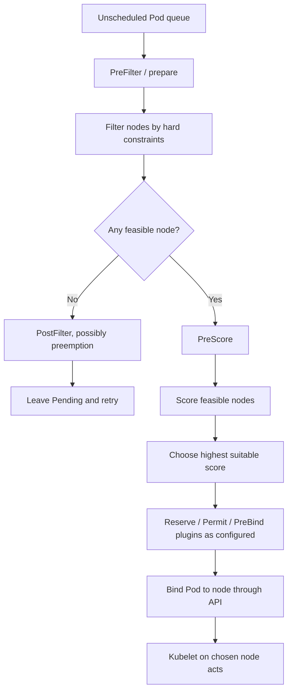
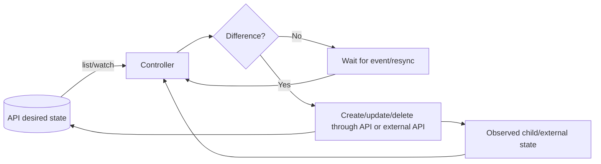
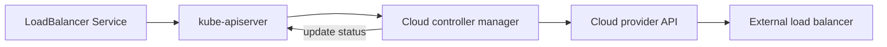
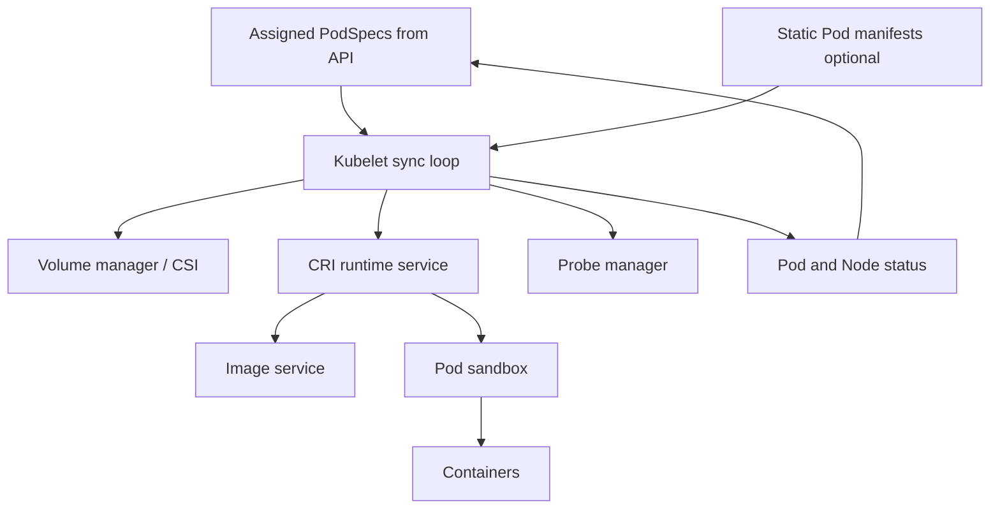

# Day 4 — Scheduling, Controllers, Kubelet, and Runtime Execution

## Learning objectives

Today you will learn:

- how the scheduler filters, scores, reserves, and binds Pods;
- how resources, affinity, taints, topology, priority, preemption, and storage affect placement;
- what individual controllers inside kube-controller-manager do;
- how reconciliation recovers from temporary failures;
- how kubelet, CRI, the runtime, cgroups, namespaces, images, probes, volumes, and status work;
- what happens when Pods, containers, nodes, controllers, the scheduler, or API server fail.

**Why this matters:** API storage only records intent. These components turn intent into running processes and continuously repair drift.

**Prerequisites:** Days 1–3 and a disposable cluster.

**Estimated time:** 6–8 hours.

**Recommended order:** scheduler → constraints → controllers → kubelet/runtime → reconciliation scenarios → lab.

Official reading:

- [Scheduling, preemption, and eviction](https://kubernetes.io/docs/concepts/scheduling-eviction/)
- [Scheduling framework](https://kubernetes.io/docs/concepts/scheduling-eviction/scheduling-framework/)
- [Controllers](https://kubernetes.io/docs/concepts/architecture/controller/)
- [Cloud controller manager](https://kubernetes.io/docs/concepts/architecture/cloud-controller/)
- [Kubelet sync loop](https://kubernetes.io/docs/reference/node/kubelet-sync-loop/)
- [Containers](https://kubernetes.io/docs/concepts/containers/)

---

## 1. Scheduler: deciding where a Pod may run

**Scheduling** means matching a Pod to a node. The scheduler schedules the whole Pod because all its containers share one node and Pod-level resources.

A newly accepted Pod with no `.spec.nodeName` is unscheduled and normally `Pending`.



The [scheduling framework](https://kubernetes.io/docs/concepts/scheduling-eviction/scheduling-framework/) is pluggable. Beginners should remember two main stages:

1. **Filter:** remove nodes that cannot satisfy hard requirements.
2. **Score:** rank the remaining feasible nodes using preferences.

### Node resources

The scheduler compares Pod **requests**, not momentary application usage, with node allocatable resources and already-requested capacity.

```text
Node allocatable CPU: 4 cores
Existing Pod requests: 3.5 cores
New Pod request:       1 core
Result: insufficient CPU, even if current CPU usage is low
```

Limits are mainly runtime ceilings. If a limit exists without a request and no admission default changes it, Kubernetes may copy the limit as the request for that resource.

### nodeSelector

Simple exact label match:

```yaml
spec:
  nodeSelector:
    workload.example.com/class: compute
```

If no node has that label, the Pod remains Pending. Protect labels used for isolation; the NodeRestriction plugin protects specified prefixes such as `node-restriction.kubernetes.io/` from kubelet modification.

### Node affinity

- `requiredDuringSchedulingIgnoredDuringExecution`: hard rule during placement.
- `preferredDuringSchedulingIgnoredDuringExecution`: weighted preference.

“Ignored during execution” means a later label change does not automatically evict the already-running Pod.

### Pod affinity and anti-affinity

Select placement near or away from other Pods across a topology key such as hostname or zone.

- Affinity can colocate tightly coupled workloads.
- Anti-affinity improves failure-domain spread.
- Hard inter-Pod rules can be computationally expensive and make workloads unschedulable.

### Taints and tolerations

A **taint** repels Pods from a node. A **toleration** lets a Pod tolerate that taint; it does not attract or guarantee placement.

Effects:

- `NoSchedule`: do not place new non-tolerating Pods.
- `PreferNoSchedule`: soft avoidance.
- `NoExecute`: do not place and may evict existing non-tolerating Pods.

```yaml
tolerations:
  - key: dedicated
    operator: Equal
    value: gpu
    effect: NoSchedule
```

Use a matching node label/affinity as well if the Pod must run only on dedicated nodes.

### Topology spread constraints

These spread matching Pods across domains such as zones or hosts to reduce correlated failure.

```yaml
topologySpreadConstraints:
  - maxSkew: 1
    topologyKey: topology.kubernetes.io/zone
    whenUnsatisfiable: DoNotSchedule
    labelSelector:
      matchLabels:
        app: api
```

The scheduler needs correct node topology labels. Strict constraints can block scaling when a zone lacks nodes/capacity.

### Priority and preemption

A `PriorityClass` gives Pods relative scheduling importance. When no node is feasible due to resources, preemption may nominate a node and evict lower-priority Pods to make room.

Preemption is disruptive and not immediate capacity creation. It does not bypass non-resource constraints such as incompatible node affinity. PodDisruptionBudgets influence but cannot promise protection from all preemption/eviction cases.

### Persistent-volume topology

Storage may exist only in one zone/node domain. The scheduler's volume binding plugins coordinate Pod placement with volume availability. `WaitForFirstConsumer` storage classes delay provisioning/binding so storage can be created in a topology compatible with the selected workload.

### Profiles, plugins, and custom schedulers

Scheduler configuration can enable/disable/weight framework plugins and expose multiple profiles. A Pod's `.spec.schedulerName` selects a scheduler. A custom scheduler must be deployed, secured, highly available as needed, and use a distinct name.

If a Pod names a scheduler that does not exist, it remains unscheduled; the default scheduler will not silently take it.

### Scheduling troubleshooting

```bash
kubectl get pod <pod> -n <namespace> -o wide
kubectl describe pod <pod> -n <namespace>
kubectl get events -n <namespace> --for pod/<pod>
kubectl get nodes -o wide
kubectl describe node <node>
kubectl get priorityclass
kubectl get pvc -n <namespace>
```

Read-only. Look at the scheduler Event message as a set of failed predicates, not just the final “0/N nodes available.” Common causes: requests, taints, affinity/selectors, volume topology, host ports, unschedulable nodes, or unbound PVCs.

---

## 2. Controllers and reconciliation

A **control loop** repeatedly observes state, compares actual with desired, and takes corrective action. **Reconciliation** is that comparison-and-correction process.



Controllers are generally level-based: they aim for current desired state rather than trusting that every event arrives exactly once. Actions should be repeatable and retry with backoff.

### kube-controller-manager versus controllers

`kube-controller-manager` is one binary/process that runs many independent controllers. Saying “the controller manager created everything” hides useful ownership.

### Deployment and ReplicaSet controllers

- Deployment controller creates/manages ReplicaSets for rollout strategy and revision history.
- ReplicaSet controller creates/deletes Pods to match its replica count.

If a Pod dies, ReplicaSet notices the count deficit and creates a new Pod. Deployment does not restart the old container.

### Job and CronJob controllers

- Job controller creates Pods, observes completions/failures, applies retry/completion policy.
- CronJob controller creates Jobs around schedule times and applies concurrency/history settings.

The CronJob does not directly run a container.

### Node controller

Monitors node heartbeats/status through the API, updates reachability-related conditions/taints, and participates in eviction/replacement behavior when nodes remain unreachable. It cannot repair a broken physical server.

### EndpointSlice controller

For Services with selectors, it creates/updates EndpointSlices representing matching endpoints and readiness. Service proxies watch those objects. A Service selector mismatch yields no endpoints even while Pods are healthy.

### Namespace controller

When a namespace is terminating, it coordinates deletion of namespaced content and removal of its finalizer after discovery/cleanup. Broken API discovery or remaining finalizers can leave a namespace terminating.

### ServiceAccount/token controllers

Manage ServiceAccount-related state and signing/cleanup responsibilities depending on component configuration. Modern projected tokens are obtained through TokenRequest and kubelet projection, not automatically permanent Secrets.

### Persistent-volume controllers

Coordinate PV/PVC binding and dynamic provisioning workflows with external CSI provisioners and attach/detach controllers as applicable. Storage is a multi-controller/driver path, not one monolithic component.

### Garbage collection

Uses `ownerReferences` and deletion propagation to clean dependent objects. **Finalizers** delay actual deletion until a responsible controller completes cleanup. A stuck finalizer is evidence that cleanup has not completed; removing it manually may leak external resources.

### Controller availability

Controllers use leader election when replicated. If a leader stops:

- another instance may acquire leadership after lease timeout;
- existing containers can continue;
- desired-state corrections pause during the gap;
- queued drift is reconciled after recovery.

This eventual recovery is why controllers must be idempotent.

---

## 3. Cloud controller manager

The optional cloud-controller-manager separates provider-specific logic from core Kubernetes.

Common controller responsibilities:

- initialize/update Node cloud metadata;
- manage routes where the provider/network design uses them;
- provision/reconcile external load balancers for `type: LoadBalancer` Services.



If the cloud API is unavailable, the Service object may exist while `.status.loadBalancer` remains pending. The API server does not manufacture a cloud load balancer itself.

Managed Kubernetes hides implementation details and may use provider controllers/operators. An upstream field can have provider-specific annotations, permissions, quotas, health-check behavior, and cost.

---

## 4. Kubelet: node-level reconciliation

The kubelet is the primary node agent. It runs a sync loop for Pods assigned to its node.



### Responsibilities

- observe assigned Pod specs;
- perform node-level admission checks;
- prepare Secrets/ConfigMaps and volumes;
- request image/container operations over CRI;
- coordinate sandbox networking through the runtime/CNI path;
- run startup/readiness/liveness probes;
- execute lifecycle hooks;
- restart containers according to policy/backoff;
- report Pod/Node status and heartbeats;
- monitor resource pressure and evict Pods where configured;
- manage static Pods.

It does not manage containers that Kubernetes did not give it through supported Pod sources.

### Kubelet and API server

Kubelet is both:

- an API client, watching assigned Pods and sending status;
- an HTTPS server for logs/exec/port-forward/stats and other operations, protected by kubelet authentication/authorization configuration.

Secure the kubelet endpoint; anonymous or broadly authorized access can expose workloads and credentials.

### Node status and pressure

Kubelet reports capacity, allocatable resources, conditions, and addresses. Pressure signals include memory, disk, PID, and filesystem inode pressure.

Before evicting workloads, kubelet may reclaim unused images/containers. Node-pressure eviction can terminate Pods to protect the node and is not the same as an API voluntary eviction. Hard pressure can bypass normal grace/PDB expectations.

### If kubelet fails

- existing runtime containers may keep running;
- no reliable probes, restarts, local reconciliation, status, logs/exec path, or new assigned Pod startup;
- heartbeats stop and Node becomes `NotReady`/unreachable;
- after tolerations/timeouts, controllers may create replacement Pods elsewhere;
- if the original node returns after replacement, application design must handle duplicates/fencing for stateful work.

---

## 5. Container runtime and node execution

### CRI

The CRI is a gRPC contract with runtime and image services. Kubelet requests operations such as:

- pull/list/remove image;
- create/start/stop/remove Pod sandbox;
- create/start/stop/remove container;
- query status, logs metadata, and statistics.

`crictl` is a node-level diagnostic client for CRI. It requires host access and runtime endpoint configuration; it is not a substitute for `kubectl` and can perform destructive operations.

### OCI images and runtime specs

OCI standards describe portable image formats/distribution and runtime bundles/config. An image is content-addressed layers plus metadata. Tags are mutable names; digests identify exact content.

For repeatable production deployments, prefer immutable digests or controlled immutable tags plus supply-chain verification.

### Image pull policy

- `Always`: resolve/pull according to runtime cache and image reference behavior each start.
- `IfNotPresent`: use local image if present.
- `Never`: require local image.

Defaults depend on the image tag/value at object creation. Set policy explicitly where predictability matters.

### ImagePullSecrets

Registry credentials are referenced in the Pod/ServiceAccount namespace. Failure causes `ErrImagePull`/`ImagePullBackOff`. Verify Secret type/name, registry hostname, credential scope, and node egress/DNS. Reading Secret data is sensitive.

### Namespaces and cgroups

At beginner depth:

- Linux **namespaces** provide isolated views of process IDs, networking, mounts, users, and other resources.
- **cgroups** account for and constrain CPU, memory, PIDs, and related resources.

Containers share the host kernel. Isolation is not identical to a separate VM kernel. Privileged mode, host namespaces, mounted host paths, and excessive capabilities weaken boundaries.

### Termination and restart

Normal termination roughly follows:

1. Pod receives deletion/termination intent.
2. Endpoint readiness can change and routing converges asynchronously.
3. Kubelet begins grace period.
4. `PreStop` hook runs if configured and container is active.
5. Runtime sends the configured/default termination signal.
6. Process exits or is force-killed when grace expires.
7. Container/Pod cleanup proceeds.

Application shutdown must stop accepting new work, finish/invalidate in-flight work, and exit within the grace period.

### Runtime failure evidence

```bash
kubectl describe pod <pod> -n <ns>
kubectl logs <pod> -n <ns> --all-containers
kubectl logs <pod> -n <ns> -c <container> --previous
kubectl get pod <pod> -n <ns> -o jsonpath='{range .status.containerStatuses[*]}{.name}{" waiting="}{.state.waiting.reason}{" lastExit="}{.lastState.terminated.exitCode}{"\n"}{end}'
```

On a self-managed node, an administrator may then use:

```bash
sudo crictl ps -a
sudo crictl images
sudo journalctl -u kubelet
```

These need privileged node access; outputs may contain sensitive workload details. Use provider-specific logging in managed services where nodes/control plane are restricted.

---

## 6. Reconciliation scenarios

### A Pod is manually deleted

1. API records deletion.
2. Kubelet terminates it if reachable.
3. ReplicaSet controller observes replica deficit.
4. It creates a replacement Pod.
5. Scheduler and new node kubelet act.

What does not happen: Kubernetes does not resurrect the same Pod UID. A replacement is a new object.

### A Deployment replica's container crashes

1. Runtime reports termination.
2. Kubelet restarts the container within the same Pod according to `restartPolicy: Always`, with backoff.
3. If the Pod itself is deleted/failed beyond controller semantics, ReplicaSet creates a new Pod.

Check `restartCount`, current/previous logs, exit code, and probes.

### A node becomes unreachable

1. Heartbeats/status stop.
2. Node controller marks conditions/taints after configured detection.
3. Pods tolerate unreachable/not-ready for configured/default time.
4. Controller-managed replacements may be created elsewhere after eviction/deletion behavior.
5. Stateful storage attach/fencing can delay safe recovery.

Network partition creates uncertainty: processes might still run on the isolated node. Stateful systems need fencing and quorum design.

### A Pod remains Pending

- If no `.spec.nodeName`: scheduler/constraint problem.
- If node assigned but phase still Pending: kubelet setup, volume, CNI, image, or runtime problem.

Do not treat all Pending Pods as scheduler failures.

### A container repeatedly crashes

Kubelet applies restart backoff, producing `CrashLoopBackOff`. The scheduler is no longer involved. Fix process configuration, dependencies, permissions, OOM, architecture, or probes based on evidence.

### Desired replicas change

Deployment update leads controller to adjust ReplicaSet desired count; ReplicaSet creates/deletes Pods; scheduler places new ones. Scaling down terminates Pods and may drop in-flight work if application shutdown is poor.

### Controller temporarily unavailable

Desired and actual state can diverge. When a leader returns, list/watch state drives reconciliation. Existing node workloads often continue. No scheduler/controller should be assumed to have “remembered” every event; current state matters.

### API server restarts

Clients reconnect/relist. Running node workloads continue. With HA, another API server serves requests. A single instance restart causes a management gap, not automatic application termination.

### Worker node restarts

The runtime/kubelet recover local state, static Pods are recreated, and assigned API Pods reconcile. Ephemeral container files may or may not remain and must not be treated as durable. Controllers may already have replaced Pods elsewhere depending on outage length.

---

## 7. Practical lab

### Observe scheduler inputs

```bash
kubectl create namespace scheduling-lab
kubectl get nodes --show-labels
kubectl describe nodes
```

The namespace creation changes state; node inspection is read-only. `describe nodes` can be large and requires node access permission.

Create a Pod that requests impossible capacity for a local cluster:

```yaml
apiVersion: v1
kind: Pod
metadata:
  name: impossible
  namespace: scheduling-lab
spec:
  containers:
    - name: pause
      image: registry.k8s.io/pause:3.10
      resources:
        requests:
          cpu: "1000"
          memory: 1Gi
```

```bash
kubectl apply -f impossible.yaml
kubectl get pod impossible -n scheduling-lab -o wide
kubectl describe pod impossible -n scheduling-lab
kubectl get events -n scheduling-lab --for pod/impossible
```

Expected: accepted/Pending, no node, `FailedScheduling` with insufficient CPU. This proves acceptance is separate from placement.

### Taint/toleration experiment

Only in a disposable cluster, choose a worker node:

```bash
kubectl taint node <worker-node> learning=day4:NoSchedule
```

This changes node scheduling and may affect unrelated workloads; do not use on shared/production clusters. Create a Pod selecting that node without/with a matching toleration and compare Events. Remove the taint:

```bash
kubectl taint node <worker-node> learning=day4:NoSchedule-
```

### Observe ownership/replacement

```bash
kubectl create deployment repair-me -n scheduling-lab --image=nginx:1.27-alpine --replicas=2
kubectl get deployment,replicaset,pod -n scheduling-lab --show-labels
kubectl delete pod -n scheduling-lab -l app=repair-me --wait=false
kubectl get pod -n scheduling-lab -l app=repair-me -w
```

Deletion is destructive for matching lab Pods. Expected: replacement objects with new UIDs.

### Check kubelet-visible status without node login

```bash
kubectl get node -o custom-columns=NAME:.metadata.name,READY:.status.conditions[-1].type,VERSION:.status.nodeInfo.kubeletVersion,RUNTIME:.status.nodeInfo.containerRuntimeVersion
kubectl get pod -n scheduling-lab -o jsonpath='{range .items[*]}{.metadata.name}{" node="}{.spec.nodeName}{" restarts="}{range .status.containerStatuses[*]}{.restartCount}{end}{"\n"}{end}'
```

Read-only summaries; condition array ordering should not be relied upon for automation—use a query selecting `type==Ready` in production scripts.

### Cleanup

```bash
kubectl delete namespace scheduling-lab
```

---

## Key takeaways

- Scheduler filters hard constraints, scores feasible nodes, and binds; kubelet executes.
- Requests affect placement; limits affect runtime enforcement.
- Toleration permits but does not attract; affinity/selectors express placement.
- kube-controller-manager hosts many controllers with distinct ownership.
- Reconciliation is repeatable, eventual correction based on current desired/observed state.
- Kubelet is the node reconciler and CRI client.
- Running containers can outlive temporary control-plane/component outages, but management convergence stops.

## Concise revision notes

```text
Pending + no nodeName = scheduling path
Pending + nodeName = node setup path
Filter = can run
Score = preferred node
Taint repels; toleration permits
Priority may trigger preemption
Deployment → ReplicaSet → Pod
Kubelet → CRI runtime → container
Namespaces isolate views; cgroups manage resources
Controller retry + idempotence = recovery
Finalizer = deletion held for cleanup
OwnerReference = dependency/garbage collection relation
```

## Practical exercises

1. Add a preferred node affinity to a Deployment and verify placement without making it unschedulable.
2. Spread three replicas across hostname domains and observe behavior with fewer nodes than replicas.
3. Compare a container restart with replacement Pod UID.
4. Create a Pod with a nonexistent `schedulerName`; explain why default scheduler ignores it.

## Troubleshooting exercises

1. “0/3 nodes available: insufficient memory.” Compare requests to node allocatable/allocated requests; do not use `kubectl top` as the scheduling truth.
2. Pod tolerates a GPU taint but lands on a normal node. Add required node affinity; toleration alone does not attract.
3. Deployment says desired 3/current 2. Follow Deployment → ReplicaSet → Pod conditions/Events to locate the stalled replica.
4. Node is NotReady. Check heartbeat/conditions, kubelet logs, runtime, disk/memory/PID pressure, and node networking before deleting it.

## Interview questions and answers

**Q: How does the scheduler choose a node?**  
It queues unscheduled Pods, filters nodes that fail hard constraints, scores feasible nodes, then records a binding through the API. Framework plugins implement stages.

**Q: Requests versus limits?**  
Requests drive scheduling and resource accounting. CPU limits throttle; memory limit excess can cause OOM termination. A workload can use above its request when capacity is available.

**Q: Taint versus node affinity?**  
A taint repels Pods without tolerations. Node affinity attracts/requires Pods to selected labels. Dedicated placement commonly needs both.

**Q: What replaces a deleted Deployment Pod?**  
The ReplicaSet controller observes fewer matching Pods and creates another. The scheduler then places it.

**Q: What happens if kubelet stops?**  
Containers may keep running, but node reconciliation, probes, status, logs/exec, and new Pod startup stop. The control plane eventually marks the node unhealthy and may replace managed workloads.

**Q: Why must controllers be idempotent?**  
Events can repeat or be missed across reconnects. Repeating reconciliation toward current desired state must not create incorrect duplicate side effects.

## Self-assessment checklist

- [ ] I can distinguish filtering, scoring, binding, and execution.
- [ ] I can explain every major placement control and a failure it can cause.
- [ ] I can name the controller responsible for common actions.
- [ ] I understand leader election and eventual reconciliation.
- [ ] I can trace kubelet through CRI to the runtime.
- [ ] I can separate Pod restart, container restart, and replacement Pod.
- [ ] I can diagnose unscheduled versus node-setup Pending Pods.

## Day 5 preview

Day 5 follows packets: Linux network basics, Pod IPs, CNI, Services and EndpointSlices, kube-proxy/replacements, DNS, Ingress/Gateway, and NetworkPolicy isolation.

