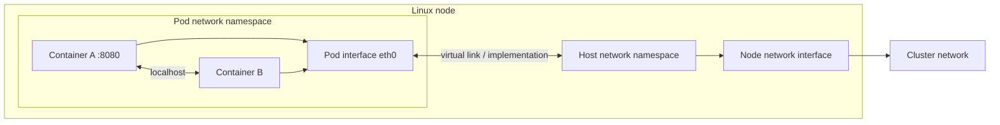
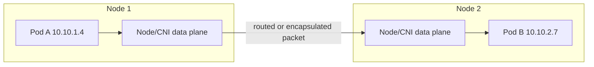
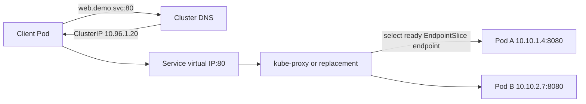
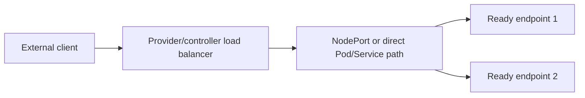
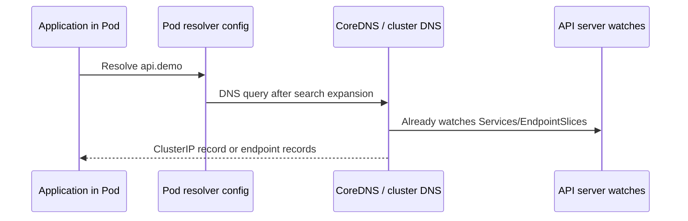
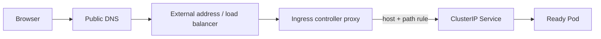
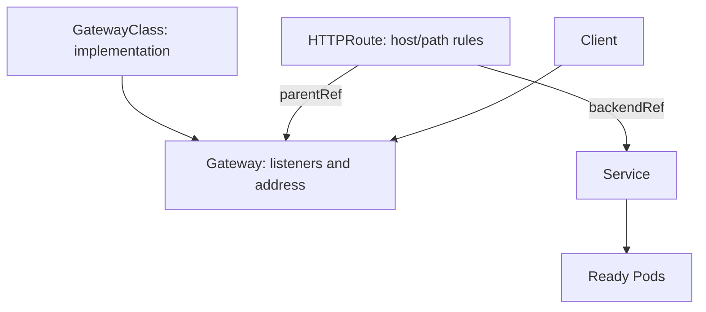
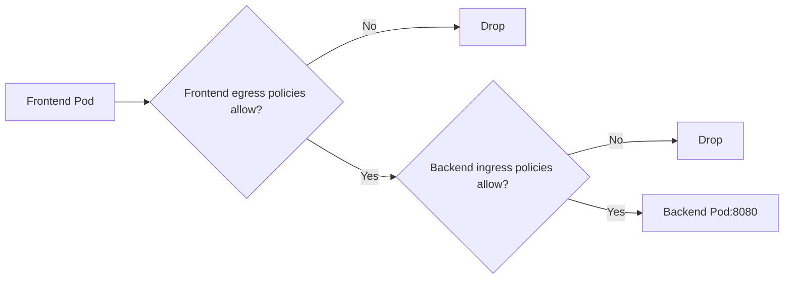
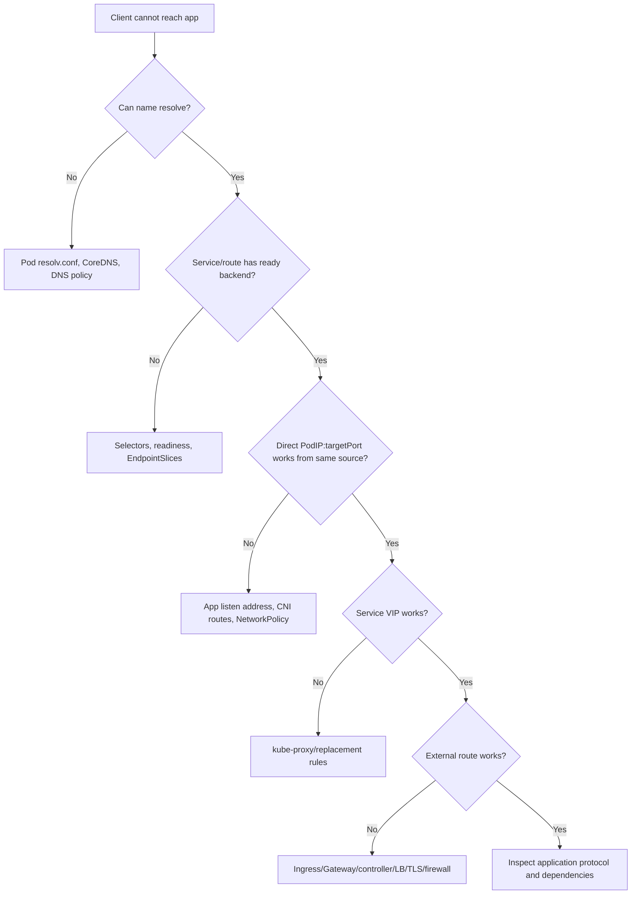

# Day 5 — Kubernetes Networking, Services, DNS, Gateway, and NetworkPolicy

## Learning objectives

Today you will learn:

- the Linux/networking vocabulary Kubernetes assumes;
- how Pods receive IPs and communicate through a CNI implementation;
- how Services, EndpointSlices, and service proxies provide stable destinations;
- how ClusterIP, NodePort, LoadBalancer, headless, and ExternalName differ;
- how CoreDNS and namespace-based service discovery work;
- how Ingress and Gateway API require controllers/implementations;
- how NetworkPolicy selects and isolates traffic and where it stops.

**Why this matters:** “the network is broken” can mean DNS, Service selection, endpoint readiness, a proxy rule, CNI routing, MTU, NetworkPolicy, ingress routing, TLS, or the application port. Good engineers locate the first broken hop.

**Prerequisites:** Days 1–4; basic shell access to a disposable cluster.

**Estimated time:** 6–8 hours.

**Recommended order:** networking basics → Pod/CNI → Services → DNS → Gateway/Ingress → policy → lab.

Official reading:

- [Services, load balancing, and networking](https://kubernetes.io/docs/concepts/services-networking/)
- [Service](https://kubernetes.io/docs/concepts/services-networking/service/)
- [EndpointSlices](https://kubernetes.io/docs/concepts/services-networking/endpoint-slices/)
- [DNS for Services and Pods](https://kubernetes.io/docs/concepts/services-networking/dns-pod-service/)
- [Ingress](https://kubernetes.io/docs/concepts/services-networking/ingress/)
- [Gateway API](https://gateway-api.sigs.k8s.io/)
- [NetworkPolicy](https://kubernetes.io/docs/concepts/services-networking/network-policies/)

---

## 1. Networking vocabulary

- **IP address:** numeric address assigned to a network interface.
- **Port:** numeric transport endpoint used by a process, such as TCP 8080.
- **TCP:** connection-oriented transport with ordered delivery and retransmission.
- **UDP:** datagram transport without TCP's connection/reliability behavior.
- **Interface:** a network attachment visible to an operating system.
- **Route:** rule choosing the next hop/interface for a destination prefix.
- **Packet:** unit of data sent through the network.
- **Forwarding:** receiving a packet on one interface and sending it through another.
- **NAT:** rewriting source or destination network addresses/ports.
- **DNS:** maps names to records such as IP addresses.
- **Network namespace:** isolated Linux view of interfaces, routes, firewall rules, and ports.
- **MTU:** maximum packet size sent without fragmentation on a link.

Containers in one Pod share one network namespace. They can reach one another through `localhost` and must avoid binding the same port/address combination.



---

## 2. Kubernetes network model and CNI

The common Kubernetes network model expects:

- every Pod gets a unique cluster-wide IP;
- Pods can communicate directly with other Pods across nodes without application-visible NAT in the basic model, unless intentional isolation applies;
- node agents can reach local Pods;
- containers within a Pod share one IP and ports.

The [current upstream networking overview](https://kubernetes.io/docs/concepts/services-networking/) describes these assumptions; exact implementation is delegated.

### CNI responsibilities

A CNI implementation typically:

1. creates/connects a Pod network interface;
2. allocates or receives an IP through IPAM;
3. configures routes and link properties;
4. returns the result to the runtime integration;
5. removes networking when the sandbox is deleted.

It may additionally implement:

- NetworkPolicy;
- encryption;
- observability;
- Service load balancing/kube-proxy replacement;
- multi-network attachments through extensions.

Those are implementation features, not guaranteed by “CNI” alone.

### CNI versus runtime versus kube-proxy

| Component | Main responsibility |
|---|---|
| Runtime/CRI | Pod sandbox and container lifecycle |
| CNI plugin | Pod network attachment, address, routes; sometimes policy/service features |
| kube-proxy/replacement | Service virtual IP/NodePort traffic to EndpointSlices |
| CoreDNS | name resolution/service discovery |

### Same-node and cross-node flows



### Overlay versus routed networking

- **Overlay:** encapsulates a Pod packet inside another packet across the underlay. Easier to isolate address space, but adds overhead and reduces effective MTU.
- **Native/routed:** infrastructure routes Pod prefixes directly or through node routing. Can reduce encapsulation overhead but requires route integration and address planning.

Neither is universally superior. Evaluate scale, underlay control, performance, encryption, cloud integration, and operations.

### IP address management (IPAM)

IPAM allocates non-conflicting Pod addresses from configured pools/subnets. Exhaustion can leave new Pod sandboxes failing. Deallocation bugs can leak IPs. Dual-stack clusters manage IPv4 and IPv6 families according to implementation/configuration.

### MTU failures

Encapsulation/encryption consumes bytes. If Pod MTU is too large for the underlying path, small packets can work while larger responses hang or fragment. Diagnose path MTU, CNI configuration, tunnel overhead, ICMP handling, and cloud network settings.

### CNI troubleshooting

Start at Pod Events:

```bash
kubectl describe pod <pod> -n <ns>
kubectl get pods -n kube-system -o wide
kubectl get daemonsets -n kube-system
kubectl get nodes -o wide
```

Then, if authorized, inspect the relevant CNI DaemonSet logs and node routing/interfaces. Do not assume a plugin name; discover what the cluster uses.

---

## 3. Services and EndpointSlices

Pod IPs change when Pods are replaced. A **Service** provides stable discovery and a virtual destination for a changing set of endpoints.



A Service object does not forward packets itself. A service proxy implementation watches Services and EndpointSlices and programs the data plane.

### Selector and endpoints

```yaml
apiVersion: v1
kind: Service
metadata:
  name: web
  namespace: demo
spec:
  selector:
    app: web
  ports:
    - name: http
      port: 80
      targetPort: http
```

This Service selects Pods with `app=web`. The EndpointSlice controller creates EndpointSlices for matching eligible endpoints. Named `targetPort: http` resolves against the container/Pod port name.

Multiple Pods can back one Service. Distribution is usually per connection/flow, implementation-dependent—not guaranteed even request-by-request round robin.

### Session affinity

By default, repeated connections from one client are not guaranteed to reach the same backend. Setting `sessionAffinity: ClientIP` asks the Service implementation to keep a client's IP-based flows on one endpoint for a configured timeout. This is coarse stickiness: NAT can make many users appear as one source, endpoint changes break affinity, and it does not replace application sessions stored in a shared database/cache. Prefer stateless replicas when possible.

### Port vocabulary

- `containerPort`: metadata describing a container's port; it does not itself open a firewall or make the process listen.
- `targetPort`: backend port sent to endpoints.
- `port`: Service-facing port.
- `nodePort`: port allocated/exposed on nodes for NodePort-style access.

### ClusterIP

Default Service type. Gets a stable cluster-internal virtual IP and is usually reachable only through cluster networking.

```text
Client → ClusterIP:port → proxy/data plane → ready PodIP:targetPort
```

### NodePort

Builds on ClusterIP and allocates a port, normally in 30000–32767 unless configured otherwise, on selected node addresses according to proxy implementation/configuration.

```text
External/internal client → NodeIP:nodePort → Service data plane → endpoint
```

NodePort is not automatically a secure internet exposure. Firewalls, source IP behavior, node reachability, health, and implementation mode matter.

### LoadBalancer

Requests an external load balancer from a supporting implementation/cloud controller.



Many implementations build on NodePort, but Kubernetes can request no NodePort allocation and some providers route directly. Never assume one universal packet path. Kubernetes defines the API; the provider/controller provisions the external system.

### Headless Service

Set `clusterIP: None`. No Service virtual IP or platform load balancing is created. DNS publishes endpoint addresses so clients can connect directly and implement discovery/load selection. Common with StatefulSets.

### ExternalName

Returns a DNS CNAME pointing to `spec.externalName`. No proxy or forwarding occurs. Some protocols, TLS names, and HTTP `Host` behavior can make aliases surprising.

### Service table

| Type | Stable virtual IP? | External exposure? | Data path |
|---|---:|---:|---|
| ClusterIP | Yes | No by itself | Service proxy to endpoints |
| NodePort | Yes | Via node addresses/port | NodePort + Service behavior |
| LoadBalancer | Usually | Yes when implementation exists | Provider-specific; often NodePort or direct |
| Headless | No | No by itself | DNS returns endpoint IPs |
| ExternalName | No cluster VIP | Name may point external | DNS CNAME; no proxy |

### kube-proxy modes and replacements

Current Kubernetes supports service proxy implementations/modes whose details evolve. iptables, IPVS on applicable versions, nftables in newer Kubernetes, and eBPF/plugin replacements have different rules and observability.

Do not debug all clusters with one assumed `iptables` command. First inspect kube-proxy configuration or CNI/provider docs. Upstream v1.37 has mode-specific NodePort behavior, and `externalIPs` is deprecated—another reason to verify the target version.

### Service with no endpoints

```bash
kubectl get service web -n demo -o yaml
kubectl get endpointslice -n demo -l kubernetes.io/service-name=web -o wide
kubectl get pods -n demo -l app=web --show-labels
kubectl get pods -n demo -l app=web -o custom-columns=NAME:.metadata.name,READY:.status.conditions[?\(@.type=="Ready"\)].status,IP:.status.podIP
```

Read-only. Common causes:

- Service selector does not match Pod labels;
- Pods are not Ready;
- target port/name mismatch;
- manually managed endpoints are missing;
- wrong namespace;
- controller unavailable.

---

## 4. DNS and service discovery

Cluster DNS is usually CoreDNS running as an add-on behind a Service. Kubelet writes Pod resolver configuration according to `dnsPolicy`/`dnsConfig`.

For Service `api` in namespace `demo`, the common fully qualified name is:

```text
api.demo.svc.cluster.local
```

The cluster domain can differ from `cluster.local`.

From a Pod in `demo`, search suffixes often allow `api`. From another namespace, use `api.demo` or the FQDN.

### DNS resolution flow



CoreDNS does not query the API synchronously for every DNS packet; it watches/caches relevant state.

### Headless DNS

A headless selector Service returns A/AAAA records for ready endpoint addresses, subject to readiness/publication settings. StatefulSets use headless Services for stable Pod names when configured correctly.

### Caching and TTL

DNS answers are cached at multiple layers: CoreDNS, node-local cache if installed, OS/library, and application. Changes are not universally instantaneous. Long application caching can keep stale IPs; overly low TTL increases load.

### DNS troubleshooting

Use a disposable diagnostic Pod:

```bash
kubectl run dns-test -n demo --image=registry.k8s.io/e2e-test-images/agnhost:2.53 --restart=Never -- sleep 3600
kubectl exec -n demo dns-test -- cat /etc/resolv.conf
kubectl exec -n demo dns-test -- nslookup kubernetes.default.svc
kubectl get service -n kube-system
kubectl get pods -n kube-system -l k8s-app=kube-dns
kubectl logs -n kube-system -l k8s-app=kube-dns --tail=100
```

Creating/execing changes/enters Pod state and needs permissions; other gets/logs are read-only. The label for DNS Pods is distribution-dependent.

Distinguish:

- name does not resolve: resolver/CoreDNS/record/policy issue;
- name resolves but TCP fails: Service/endpoints/policy/app issue;
- FQDN works, short name fails: namespace/search path issue;
- intermittent stale address: caching/TTL/endpoints convergence.

---

## 5. Ingress and Gateway API

### Four separate concepts

- **Service:** stable endpoint/load distribution to backends.
- **Ingress resource:** Kubernetes API object containing HTTP(S) routing rules.
- **Ingress controller:** software that watches Ingress and configures a reverse proxy/load balancer.
- **Gateway implementation/controller:** software implementing Gateway API resources.

Creating an Ingress or Gateway object alone does not make traffic work. A compatible controller, address exposure, DNS, firewall, and backend Service are required.

### Ingress

Ingress is stable, but its API is frozen; upstream recommends Gateway for new capabilities. Ingress normally defines host/path routing and TLS termination configuration.



Example:

```yaml
apiVersion: networking.k8s.io/v1
kind: Ingress
metadata:
  name: web
  namespace: demo
spec:
  ingressClassName: example
  tls:
    - hosts: ["web.example.com"]
      secretName: web-tls
  rules:
    - host: web.example.com
      http:
        paths:
          - path: /
            pathType: Prefix
            backend:
              service:
                name: web
                port:
                  number: 80
```

Controller-specific annotations and supported features vary. `web-tls` is a namespaced TLS Secret read by the implementation; certificate issuance/renewal requires separate management.

### TLS termination

If the edge proxy terminates TLS, it proves the external hostname identity and decrypts traffic. Traffic from proxy to backend may be plaintext or re-encrypted depending on implementation/configuration. “HTTPS outside” does not prove end-to-end encryption.

### Gateway API

Gateway API separates roles and infrastructure:

- `GatewayClass`: implementation/class, generally infrastructure-owned.
- `Gateway`: listener/address infrastructure instance.
- Route such as `HTTPRoute`: application routing attached to a Gateway.
- Service: backend destination.



Gateway API can express richer ownership and routing than frozen Ingress, but its CRDs and a supporting controller must be installed. Check the Gateway API/controller conformance and version, not just Kubernetes version.

### Troubleshooting external routing

Walk inward:

1. Public DNS resolves expected address.
2. Firewall/security group permits port.
3. External load balancer/controller address is ready.
4. Gateway/Ingress class is handled by an installed controller.
5. Route is accepted and attached; inspect status conditions.
6. TLS Secret/certificate/hostname match.
7. Backend Service exists and port matches.
8. EndpointSlices have ready endpoints.
9. NetworkPolicy permits controller-to-backend flow.
10. Application listens and responds to expected host/path.

Useful commands:

```bash
kubectl get ingress -A
kubectl describe ingress <name> -n <ns>
kubectl get gatewayclass,gateway,httproute -A
kubectl get service,endpointslice -n <ns>
kubectl logs -n <controller-namespace> deployment/<controller>
```

Gateway resources require installed CRDs. Controller namespace/name is implementation-specific.

---

## 6. NetworkPolicy

A NetworkPolicy is a Kubernetes API for Layer 3/4 traffic rules around selected Pods. It requires a network implementation that enforces NetworkPolicy. The API object can exist and have no effect if the CNI does not support/enforce it.

### Selection and isolation

- A policy's `podSelector` selects destination Pods for ingress rules and source Pods for egress rules in that namespace.
- Once a Pod is selected by an ingress policy, allowed ingress is the union of matching ingress rules.
- Once selected by an egress policy, allowed egress is the union of matching egress rules.
- Source egress and destination ingress must both allow a flow when both sides are isolated.
- Policies add allowances; they do not override another policy with a deny exception.
- With no applicable policy for a direction, that direction is allowed by default.



### Default deny

```yaml
apiVersion: networking.k8s.io/v1
kind: NetworkPolicy
metadata:
  name: default-deny
  namespace: demo
spec:
  podSelector: {}
  policyTypes: [Ingress, Egress]
```

This selects all Pods and allows nothing in either direction. It also blocks DNS egress unless another policy allows it.

### Allow frontend to backend

```yaml
apiVersion: networking.k8s.io/v1
kind: NetworkPolicy
metadata:
  name: backend-from-frontend
  namespace: demo
spec:
  podSelector:
    matchLabels:
      app: backend
  policyTypes: [Ingress]
  ingress:
    - from:
        - podSelector:
            matchLabels:
              app: frontend
      ports:
        - protocol: TCP
          port: 8080
```

Because only a `podSelector` is present in `from`, source Pods are in the policy's namespace. To select namespaces too, combine selectors carefully.

### Allow only API to database

```yaml
apiVersion: networking.k8s.io/v1
kind: NetworkPolicy
metadata:
  name: database-from-api
  namespace: demo
spec:
  podSelector:
    matchLabels:
      app: database
  policyTypes: [Ingress]
  ingress:
    - from:
        - podSelector:
            matchLabels:
              app: backend
      ports:
        - protocol: TCP
          port: 5432
```

### Allow DNS egress

CoreDNS labels/IPs vary. A common same-cluster policy uses namespace plus Pod labels:

```yaml
apiVersion: networking.k8s.io/v1
kind: NetworkPolicy
metadata:
  name: allow-cluster-dns
  namespace: demo
spec:
  podSelector: {}
  policyTypes: [Egress]
  egress:
    - to:
        - namespaceSelector:
            matchLabels:
              kubernetes.io/metadata.name: kube-system
          podSelector:
            matchLabels:
              k8s-app: kube-dns
      ports:
        - protocol: UDP
          port: 53
        - protocol: TCP
          port: 53
```

Validate actual CoreDNS namespace/labels. Some implementations use node-local DNS or paths for which standard policy behavior differs.

### Restrict general outbound traffic

After default-deny egress, add explicit destinations needed by the workload. Standard NetworkPolicy cannot generally express DNS names/FQDNs, application identities, TLS principals, or HTTP paths. CNI extensions/service meshes may add nonportable features.

### Important limitations

Standard NetworkPolicy does not natively provide:

- HTTP method/path authorization;
- TLS/user/service identity authentication;
- guaranteed logging;
- explicit deny rules with ordering;
- FQDN policy;
- control over all host/network implementation traffic;
- prevention of every exfiltration technique.

It is network isolation, not application authorization. An allowed source still needs database credentials and application permissions.

### Policy troubleshooting

```bash
kubectl get networkpolicy -n demo -o yaml
kubectl get pods -n demo --show-labels -o wide
kubectl get namespaces --show-labels
kubectl get endpointslice -n demo
```

Then test exact source → destination → protocol → port from a diagnostic Pod. Verify whether the installed CNI enforces policies and inspect CNI flow logs/tools if available.

Common mistakes:

- selector matches no Pods;
- wrong namespace selector semantics;
- YAML indentation makes namespace and Pod selectors separate alternatives instead of one combined peer;
- allowed Service port but policy needs actual endpoint destination port;
- default-deny blocks DNS;
- source egress allowed but destination ingress denied;
- testing from a host where Pod policy does not apply the same way.

---

## 7. End-to-end packet troubleshooting



Use `curl -v`, `nc`, `nslookup`/`dig`, or app-specific clients only from images you trust. Ephemeral debug containers and `exec` require elevated permissions and may expose production data.

---

## 8. Practical lab

### Deploy frontend-like web replicas and Service

```bash
kubectl create namespace net-lab
kubectl create deployment web -n net-lab --image=nginx:1.27-alpine --replicas=3
kubectl expose deployment web -n net-lab --name=web --port=80 --target-port=80
kubectl rollout status deployment/web -n net-lab
```

These commands change state. Inspect:

```bash
kubectl get pod,service,endpointslice -n net-lab -o wide
kubectl get endpointslice -n net-lab -l kubernetes.io/service-name=web -o yaml
```

### Test DNS and Service

```bash
kubectl run client -n net-lab --image=curlimages/curl:8.12.1 --restart=Never -- sleep 3600
kubectl wait -n net-lab --for=condition=Ready pod/client --timeout=90s
kubectl exec -n net-lab client -- nslookup web.net-lab.svc.cluster.local
kubectl exec -n net-lab client -- curl -fsS http://web
```

If the curl image lacks `nslookup`, use the agnhost image for DNS diagnostics. Image availability/version can change; substitute a trusted equivalent.

### Break the Service selector safely

```bash
kubectl patch service web -n net-lab --type=merge -p '{"spec":{"selector":{"app":"does-not-exist"}}}'
kubectl get endpointslice -n net-lab -l kubernetes.io/service-name=web
kubectl exec -n net-lab client -- curl --max-time 3 http://web
```

Expected: Service still resolves, but no ready endpoints; connection times out/refuses depending on data plane. Restore:

```bash
kubectl patch service web -n net-lab --type=merge -p '{"spec":{"selector":{"app":"web"}}}'
```

### Apply ingress default deny and allow client

```yaml
apiVersion: networking.k8s.io/v1
kind: NetworkPolicy
metadata:
  name: web-ingress
  namespace: net-lab
spec:
  podSelector:
    matchLabels:
      app: web
  policyTypes: [Ingress]
  ingress:
    - from:
        - podSelector:
            matchLabels:
              access: web
      ports:
        - protocol: TCP
          port: 80
```

```bash
kubectl apply -f web-policy.yaml
kubectl exec -n net-lab client -- curl --max-time 3 http://web
kubectl label pod client -n net-lab access=web
kubectl exec -n net-lab client -- curl -fsS http://web
```

Expected only if the CNI enforces NetworkPolicy: first blocked, second allowed. If both work, check CNI support and policy selection rather than assuming the API rejected the policy.

### Cleanup

```bash
kubectl delete namespace net-lab
```

Destructive for lab resources.

---

## Key takeaways

- Pod networking, Service proxying, DNS, ingress, and policy are separate mechanisms.
- CNI is an interface; features vary by implementation.
- Services select Pods indirectly through EndpointSlices and a data plane.
- DNS success does not prove transport/application success.
- LoadBalancer and Gateway/Ingress need external/controller implementations.
- NetworkPolicy rules are additive allowances and require CNI enforcement.
- Trace traffic one hop at a time.

## Concise revision notes

```text
Pod = one network namespace and IP
CNI = Pod interface/IP/routes
Service = stable API abstraction
EndpointSlice = current backends
kube-proxy/replacement = Service data plane
ClusterIP = internal virtual IP
NodePort = node address + allocated port
LoadBalancer = request external implementation
Headless = DNS endpoints, no VIP proxy
ExternalName = DNS CNAME
Ingress = frozen HTTP routing API
Gateway API = role-oriented successor, needs CRDs/controller
NetworkPolicy = L3/L4 isolation, implementation required
```

## Practical exercises

1. Scale the web Deployment from one to five replicas and watch EndpointSlices update.
2. Create a headless Service and compare its DNS answer with ClusterIP Service DNS.
3. Use a named container port and named Service `targetPort`; then break the name deliberately.
4. Add egress default-deny and only DNS + backend allowances. Verify both allowed and blocked paths.

## Troubleshooting exercises

1. Service DNS resolves, but no connection. Inspect EndpointSlices, target port, readiness, and policy before DNS.
2. Only large responses fail cross-node. Investigate MTU/encapsulation/firewall ICMP behavior.
3. Ingress has no address. Check controller/class, controller logs, provider permissions/quota, and Service exposure.
4. NetworkPolicy object exists but traffic remains allowed. Confirm selected Pods and that the CNI enforces NetworkPolicy.

## Interview questions and answers

**Q: What is the difference between CNI and kube-proxy?**  
CNI integrates Pod networking. kube-proxy is the default Service virtual-IP/NodePort data plane; some CNI implementations replace it.

**Q: How does a Service find Pods?**  
Its selector matches Pod labels; the control plane creates EndpointSlices, and service proxies/controllers watch those endpoints.

**Q: Why can a Service exist with no traffic?**  
It may have no matching/ready endpoints, wrong target port, broken proxy data plane, policy blocking, or an application not listening.

**Q: Does creating an Ingress expose an app?**  
Not alone. A compatible Ingress controller plus external address/DNS/firewall/TLS/backend configuration is required.

**Q: How do multiple NetworkPolicies combine?**  
Allowed traffic is the union of applicable allow rules for each isolated direction. Both source egress and destination ingress must allow when both are isolated.

**Q: Is NetworkPolicy application authorization?**  
No. It controls network peers/ports at L3/L4; application credentials and authorization are still required.

## Self-assessment checklist

- [ ] I can define IP, port, route, NAT, DNS, namespace, and MTU.
- [ ] I can draw Pod-to-Pod traffic across nodes.
- [ ] I can distinguish CNI, runtime, Service proxy, and DNS.
- [ ] I can explain every Service type and its limitations.
- [ ] I can trace DNS and Service resolution separately.
- [ ] I can compare Ingress and Gateway API.
- [ ] I can reason through NetworkPolicy selection and both traffic directions.
- [ ] I can troubleshoot traffic one hop at a time.

## Day 6 preview

Day 6 combines security contexts, Pod security, ServiceAccounts and cloud identity, Secrets, resource governance/autoscaling, and CSI-backed persistent storage.

