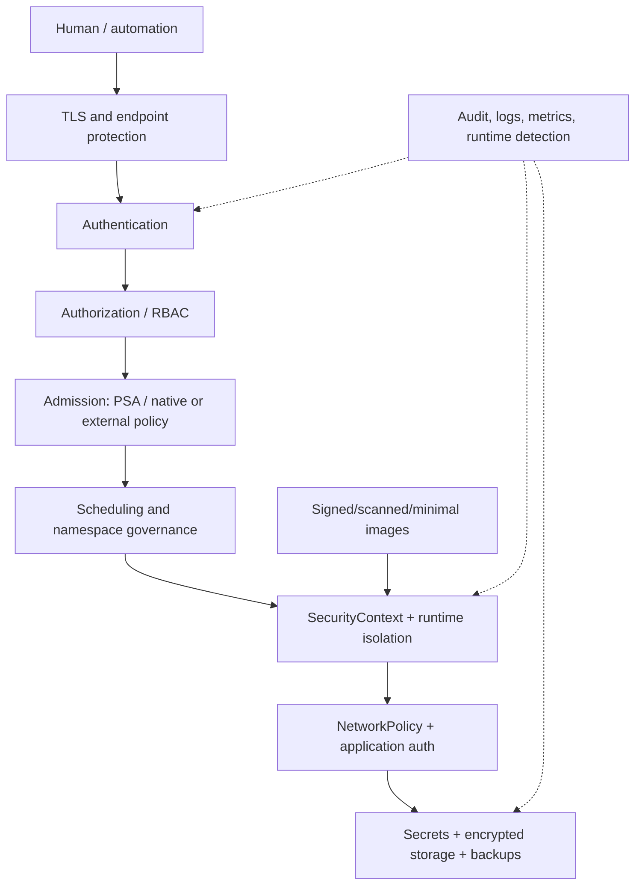
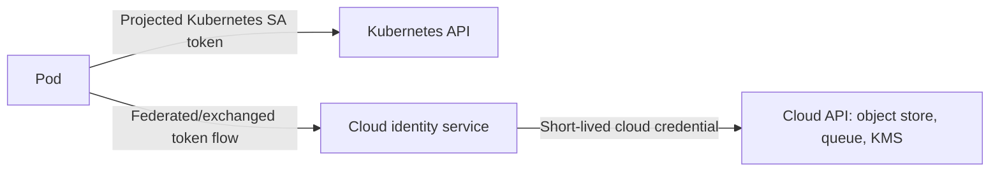
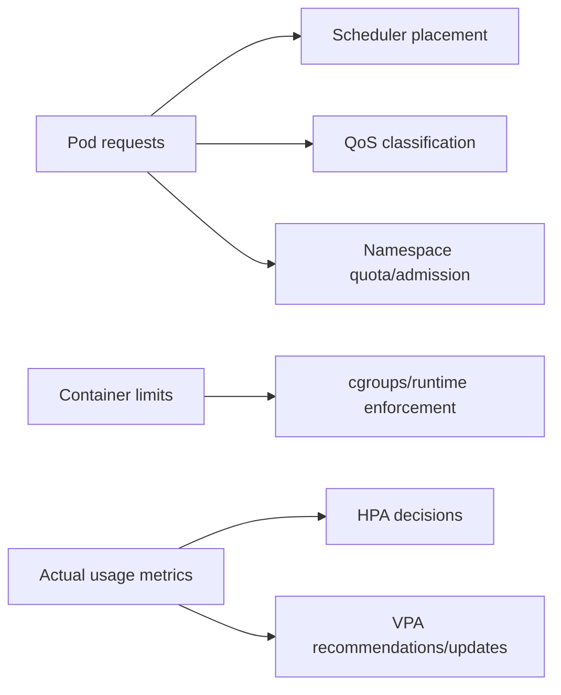
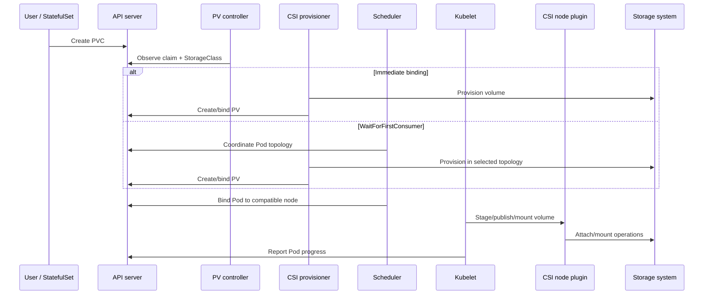
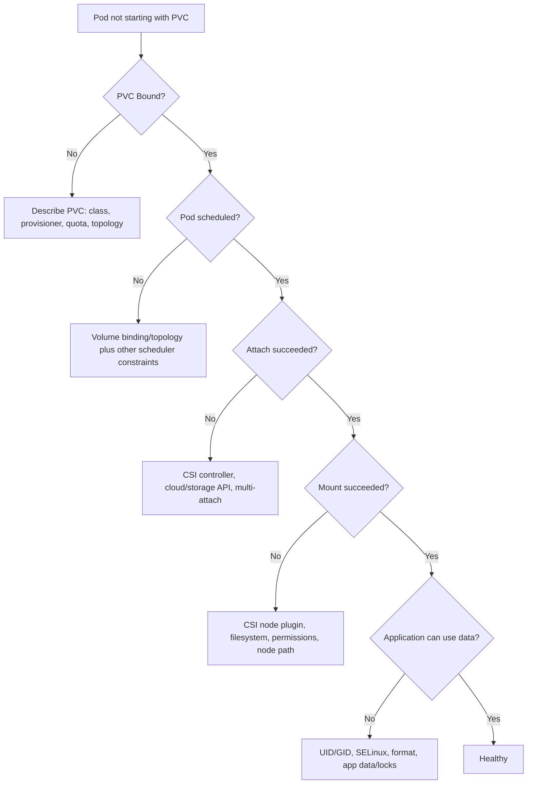

# Day 6 — Security, Resource Management, Autoscaling, and Storage

## Learning objectives

Today you will learn:

- how defense in depth protects control plane, nodes, workloads, API access, secrets, and supply chain;
- how Pod/container security contexts, capabilities, seccomp, AppArmor, SELinux, and runtime isolation differ;
- how Kubernetes ServiceAccount identity differs from cloud workload identity;
- how Secrets are mounted, leaked, rotated, and encrypted;
- how requests, limits, QoS, quotas, priority, eviction, and autoscalers interact;
- how ephemeral volumes, PVs, PVCs, StorageClasses, CSI, snapshots, expansion, topology, and reclaim policies work.

**Why this matters:** Kubernetes schedules untrusted code near valuable infrastructure. Security, capacity, and data durability are architecture—not cleanup tasks after deployment.

**Prerequisites:** Days 1–5; a disposable cluster and permission for namespaced workloads/policies.

**Estimated time:** 7–9 hours.

**Recommended order:** security model → Pod hardening → identity/secrets → resources/autoscaling → storage → lab.

Official reading:

- [Security overview](https://kubernetes.io/docs/concepts/security/)
- [Application security checklist](https://kubernetes.io/docs/concepts/security/application-security-checklist/)
- [Security contexts](https://kubernetes.io/docs/tasks/configure-pod-container/security-context/)
- [ServiceAccounts](https://kubernetes.io/docs/concepts/security/service-accounts/)
- [Resource management](https://kubernetes.io/docs/concepts/configuration/manage-resources-containers/)
- [Persistent volumes](https://kubernetes.io/docs/concepts/storage/persistent-volumes/)
- [StorageClasses](https://kubernetes.io/docs/concepts/storage/storage-classes/)

---

## 1. Security model: several gates, not one shield

**Defense in depth** means independent controls limit the damage when one control fails.



Passing one gate does not imply the others pass:

- Authenticated user may lack authorization.
- Authorized Pod creation may violate admission policy.
- Admitted container may contain a vulnerable image.
- Network-allowed request may lack application authorization.
- Encrypted Secret at rest may be exposed to an over-privileged Pod.

### Security boundaries

- **Control plane:** API endpoint, etcd, certificates, admission, audit, HA.
- **Node:** OS/kernel, kubelet/runtime sockets, credentials, metadata service, host filesystem.
- **Workload:** image, process user, syscalls, capabilities, filesystem, tokens, network.
- **Supply chain:** source, dependencies, build system, registry, signature, provenance.
- **Data:** Secrets, volumes, backups, logs, external systems.

Containers share the host kernel; they are not a perfect tenant boundary. Use stronger runtime/VM isolation or separate clusters when the threat model requires it.

### Threat modeling

For each workload, ask:

1. What assets can it reach?
2. Which identities/credentials does it receive?
3. What if its image or dependency is compromised?
4. Can it reach the node, control plane, metadata service, or other namespaces?
5. How is abuse detected and contained?
6. How are credentials, images, and data recovered/rotated?

---

## 2. Pod and container security

### Pod versus container securityContext

- Pod-level settings apply broadly and include shared fields such as `runAsUser`, `runAsGroup`, `fsGroup`, and Pod seccomp defaults.
- Container-level settings can override applicable fields and include capabilities, privilege escalation, and read-only root filesystem.

```yaml
apiVersion: v1
kind: Pod
metadata:
  name: hardened-web
spec:
  automountServiceAccountToken: false
  securityContext:
    runAsNonRoot: true
    runAsUser: 10001
    runAsGroup: 10001
    seccompProfile:
      type: RuntimeDefault
  containers:
    - name: web
      image: nginxinc/nginx-unprivileged:1.27-alpine
      securityContext:
        allowPrivilegeEscalation: false
        readOnlyRootFilesystem: true
        capabilities:
          drop: ["ALL"]
      volumeMounts:
        - name: tmp
          mountPath: /tmp
      resources:
        requests:
          cpu: 50m
          memory: 64Mi
        limits:
          memory: 128Mi
  volumes:
    - name: tmp
      emptyDir: {}
```

### Run as non-root

`runAsNonRoot: true` asks kubelet/runtime to reject a container known to run as UID 0. Set a numeric nonzero UID where image compatibility permits. A username in an image may not be verifiable in all cases.

Non-root reduces damage but is not a sandbox by itself. File ownership, bind ports, capabilities, and application behavior must support it.

### Linux capabilities

Capabilities split root privileges into smaller units. Drop all and add only a demonstrated requirement:

```yaml
capabilities:
  drop: ["ALL"]
  add: ["NET_BIND_SERVICE"]
```

Avoid adding broad capabilities such as `SYS_ADMIN`; many are near-root in impact.

### Privileged and privilege escalation

- `privileged: true` grants extensive host-like power and bypasses many isolation controls.
- `allowPrivilegeEscalation: false` prevents gaining more privileges than the parent process through mechanisms such as setuid; it has kernel/runtime interactions and is not a substitute for non-root/capability controls.

### Read-only root filesystem

`readOnlyRootFilesystem: true` prevents writes to the image root filesystem. Mount explicit writable paths such as `emptyDir` for `/tmp`. It reduces persistence/tampering but does not make mounted writable volumes read-only.

### Seccomp

Seccomp filters Linux system calls. `RuntimeDefault` uses the runtime's default profile. Custom `Localhost` profiles require node distribution/management. `Unconfined` removes this syscall filter.

### AppArmor and SELinux

- **AppArmor:** path-oriented mandatory access control profiles on supported Linux nodes/distributions.
- **SELinux:** label-based mandatory access control on supported systems.

Kubernetes fields and support evolve; node OS must enable/load profiles. An API field does not make an unsupported kernel enforce it.

### Host namespaces and hostPath

- `hostNetwork`, `hostPID`, `hostIPC` weaken isolation by sharing host namespaces.
- `hostPath` mounts arbitrary node filesystem paths and can expose credentials/runtime sockets or make Pods node-dependent.

Avoid unless a trusted node-level component genuinely needs them. Constrain with admission and separate privileged workloads onto dedicated nodes.

### RuntimeClass and stronger isolation

`RuntimeClass` selects a configured runtime handler. Sandbox runtimes or microVM-backed runtimes can add isolation at performance/compatibility cost. The cluster must install/configure handlers; naming a nonexistent class leaves Pods unable to run.

### Image security

- use minimal, maintained images;
- pin controlled versions/digests;
- scan dependencies and OS packages;
- generate SBOM/provenance;
- sign and verify images through supply-chain policy;
- restrict allowed registries;
- protect registry credentials;
- rebuild/patch rather than modifying running containers.

Image scanning finds known issues; it does not prove runtime safety or absence of malicious logic.

---

## 3. Pod Security Standards and admission

Recall:

- PSS defines Privileged, Baseline, Restricted profiles.
- PSA enforces/audits/warns using namespace labels.
- Restricted generally expects non-root, safe seccomp, capability drops, and disallows dangerous host/privilege configurations.

Use warn/audit to discover impact, pin versions for controlled upgrades, then enforce. Exemptions are powerful and should be narrow, documented, and audited.

PSA does not enforce every organization rule, scan images, authorize application requests, or restrict network traffic.

---

## 4. RBAC and workload identity

### ServiceAccount identity

A Pod's Kubernetes ServiceAccount is its identity when calling the Kubernetes API with a projected token.

Good pattern:

```yaml
apiVersion: v1
kind: ServiceAccount
metadata:
  name: orders
  namespace: shop
automountServiceAccountToken: false
```

- Give each workload a dedicated ServiceAccount.
- Grant only required namespaced verbs/resources.
- Disable mounting when no Kubernetes API call is needed.
- If needed, use short-lived projected tokens with a narrow audience.
- Do not reuse the default ServiceAccount for convenience.

### Kubernetes identity versus cloud workload identity



Kubernetes RBAC controls Kubernetes API access. Cloud IAM controls cloud APIs. Provider workload identity commonly maps/federates a Kubernetes ServiceAccount to a cloud principal without storing a long-lived cloud key in a Secret.

Provider setup, token audience, annotations, IAM trust policies, and metadata behavior differ. Use official provider guidance and least privilege.

### Token rotation

Projected tokens are files that kubelet rotates. Applications should reread the token or use libraries that handle rotation; reading once at startup can cause later `401` after expiry.

---

## 5. ConfigMaps, Secrets, and encryption

### ConfigMap versus Secret

| Object | Intended data | Default storage confidentiality |
|---|---|---|
| ConfigMap | non-sensitive configuration | none |
| Secret | sensitive bytes/credentials | base64 representation; not encryption by default |

Anyone allowed to create a Pod that can mount a powerful Secret can often obtain its content even without direct `get secrets` permission. Control workload creation, ServiceAccounts, admission, and namespace boundaries accordingly.

### Mount as file versus environment

- Volume file: permissions can be constrained; projected updates can arrive eventually; application can reread.
- Environment variable: easy to use, but fixed for the process lifetime and prone to leakage in diagnostics, child processes, or crash reporting.

Avoid passing secret values on command lines, storing them in Git, or printing them to logs.

Example file mount:

```yaml
volumes:
  - name: credentials
    secret:
      secretName: database-credentials
      defaultMode: 0400
containers:
  - name: app
    volumeMounts:
      - name: credentials
        mountPath: /var/run/app-secrets
        readOnly: true
```

### Encryption at rest

The API server can encrypt selected API resources before etcd using an `EncryptionConfiguration`. This is cluster-administrator work. KMS v2 can keep the key-encryption key outside Kubernetes.

Encryption at rest protects stolen etcd data/backups, not:

- an authorized API reader;
- a Pod that legitimately receives the Secret;
- a compromised API server/node able to use keys;
- Secret values copied into logs;
- application/PV data unless separately encrypted.

### External secret managers

Common patterns:

- CSI driver mounts external secret data;
- operator synchronizes external values into Kubernetes Secrets;
- application authenticates directly to external manager.

Trade-offs include Kubernetes persistence, rotation latency, startup dependency, cache behavior, provider IAM, audit, and failure mode. “External” does not automatically mean no Kubernetes Secret is ever created—check the integration.

### Rotation

A complete rotation plan includes:

1. issue new credential/version;
2. distribute/update it without exposing value;
3. make applications reload/restart safely;
4. verify new credential use;
5. revoke old credential;
6. audit failures and roll back if needed.

Updating a Secret object does not guarantee every application reloads it.

---

## 6. Resource management

### Requests and limits



- CPU request: schedulable capacity/accounting; `100m` = 0.1 core.
- CPU limit: kernel throttles CPU time.
- Memory request: placement and pressure/QoS input.
- Memory limit: exceeding can trigger OOM kill; enforcement is reactive in common behavior.
- Ephemeral-storage requests/limits protect node disks when configured/supported.

### QoS classes

- **Guaranteed:** every container has CPU and memory request equal to limit, meeting class rules.
- **Burstable:** at least one request/limit, but not Guaranteed.
- **BestEffort:** no CPU/memory request or limit.

QoS influences eviction and OOM behavior but is not an absolute promise that Guaranteed Pods never fail.

### ResourceQuota

Limits aggregate namespace consumption/object counts. It is enforced at admission. A quota can require requests/limits indirectly by defining quota for those categories.

```yaml
apiVersion: v1
kind: ResourceQuota
metadata:
  name: team-budget
  namespace: shop
spec:
  hard:
    requests.cpu: "4"
    requests.memory: 8Gi
    limits.memory: 16Gi
    pods: "30"
```

Quota does not reserve a specific node or isolate CPU between namespaces by itself.

### LimitRange

Sets per-object/container minimum, maximum, or defaults in a namespace. Defaults can unexpectedly change scheduling requests; inspect the live Pod and LimitRange.

```yaml
apiVersion: v1
kind: LimitRange
metadata:
  name: container-defaults
  namespace: shop
spec:
  limits:
    - type: Container
      defaultRequest:
        cpu: 100m
        memory: 128Mi
      default:
        memory: 256Mi
```

### Priority, preemption, and eviction

- Priority orders scheduling importance and can trigger lower-priority preemption.
- Node-pressure eviction protects node stability based on resource signals and QoS/priority/usage.
- API eviction is a voluntary-disruption mechanism and can respect PodDisruptionBudgets.
- OOM kill can target a container/process due to memory enforcement/host pressure.

These are not interchangeable.

### When a Pod requests too much

If no node has sufficient unallocated requested capacity, it stays Pending with `FailedScheduling`. Kubernetes does not split a Pod across nodes.

### When a running container exceeds limits

- CPU: throttled, which can raise latency without restarting.
- Memory: process/container can be OOM-killed and restarted based on Pod policy.

### HPA, VPA, and node autoscaling

| Mechanism | Changes | Inputs | Important limitation |
|---|---|---|---|
| HPA | replica count | resource/custom/external metrics | needs correct requests and metrics; cannot fix all bottlenecks |
| VPA | Pod requests/limits | history/current usage/OOM signals | separately installed; updates may restart/replace Pods depending mode/version |
| Node autoscaler | node count/capacity | unschedulable Pods and utilization/provider model | cannot fix impossible constraints, quota, or slow app startup |

HPA is a Kubernetes API/controller capability, but Metrics Server/custom metric adapters may be add-ons. VPA and typical node autoscalers are installed separately/provider-specific.

Avoid uncontrolled conflict: HPA on CPU utilization and VPA changing CPU requests can interact. Choose metrics/modes deliberately.

### Capacity planning

- measure percentiles and bursts, not only averages;
- include rollout surge, node failure, system DaemonSets, and eviction headroom;
- set realistic requests from evidence;
- load-test startup and shutdown;
- alert on saturation, throttling, OOM, Pending Pods, and quota;
- treat autoscaling as a feedback loop with delay, not instant magic.

---

## 7. Storage architecture

### Four stores that beginners confuse

| Store | Purpose | Survives Pod replacement? |
|---|---|---:|
| Container writable layer | temporary process writes | No guarantee |
| `emptyDir` | Pod-lifetime shared scratch | No; deleted with Pod |
| PersistentVolume | application data through storage system | Designed to, based on reclaim/backup/storage health |
| etcd | Kubernetes API state | Separate from application volume data |

### Volume concepts

- **Volume:** storage made available in a Pod.
- **PersistentVolume (PV):** cluster-scoped representation of storage capacity.
- **PersistentVolumeClaim (PVC):** namespaced request for storage by a workload.
- **StorageClass:** class/provisioner/policy for dynamic storage.
- **CSI driver:** implementation performing provision/attach/mount/etc.
- **Access mode:** requested/advertised access pattern such as RWO, ROX, RWX, RWOP; actual semantics depend on driver.
- **Reclaim policy:** what happens to underlying storage after claim release (`Delete` or `Retain`).

### Dynamic provisioning lifecycle



The exact components depend on driver and attach model, but PVC → class/provisioner → PV binding → topology-aware scheduling → node mount is the mental path.

### Static versus dynamic provisioning

- **Static:** administrator creates PV representing existing storage; PVC binds when class, capacity, access modes, and selectors fit.
- **Dynamic:** StorageClass provisioner creates storage/PV in response to PVC.

### `emptyDir`

Created when a Pod is placed and removed when that Pod is removed from the node. Containers in the Pod share it. `medium: Memory` uses memory-backed tmpfs and counts against memory/resource behavior. Container restart inside the same Pod does not delete the `emptyDir`; Pod replacement does.

### `hostPath`

Mounts a node path. It is node-specific, highly privileged, and not portable persistent storage. A rescheduled Pod may see different/missing data. Restrict aggressively.

### Access modes

- `ReadWriteOnce` (RWO): mounted read-write by a single node; multiple Pods on that same node may still share depending on driver.
- `ReadOnlyMany` (ROX): read-only by many nodes.
- `ReadWriteMany` (RWX): read-write by many nodes.
- `ReadWriteOncePod` (RWOP): one Pod cluster-wide for supporting CSI drivers.

Access mode describes capabilities/constraints, not automatic filesystem-level application coordination.

### Reclaim policies

- `Delete`: deleting/releasing claim can lead to deleting underlying dynamically provisioned storage according to lifecycle.
- `Retain`: keep underlying storage for manual recovery/reuse; requires cleanup.

Before deleting a PVC, inspect PV reclaim policy and backup requirements. Deletion-protection finalizers reduce some races but are not backups.

### StatefulSets

`volumeClaimTemplates` create per-ordinal PVCs. Replacing `db-0` can reattach its claim. Scaling/deleting a StatefulSet does not automatically delete associated volumes in common safe defaults; lifecycle policy must be explicit.

StatefulSet identity does not solve database consistency, replication, fencing, or backup.

### Snapshots and backups

CSI `VolumeSnapshot` APIs require snapshot CRDs/controller and driver support; they are not guaranteed by core cluster existence. A storage snapshot may be crash-consistent, not application-consistent. Databases often need quiescing or native backup plus restore tests.

### Expansion

PVC expansion requires driver support and `allowVolumeExpansion: true`. You can normally grow, not shrink. Filesystem expansion may happen online or need Pod/node action depending on filesystem/driver.

### Topology

Zonal disks cannot usually attach across zones. `WaitForFirstConsumer` helps avoid provisioning in a zone incompatible with the scheduled Pod. Node affinity on PV and scheduler volume plugins enforce compatibility.

### Storage security

- encryption at rest in storage provider;
- encryption in transit where relevant;
- per-workload identity and least-privilege driver/cloud IAM;
- filesystem UID/GID/SELinux handling;
- restrict hostPath and raw block access;
- protect snapshots/backups and delete old copies;
- audit attach/mount and administrative access.

---

## 8. Storage failure path



Commands:

```bash
kubectl get pvc,pv,storageclass
kubectl describe pvc <claim> -n <ns>
kubectl describe pod <pod> -n <ns>
kubectl get events -n <ns> --sort-by=.metadata.creationTimestamp
kubectl get csidrivers,csinodes
kubectl get pods -A | grep -i csi
```

Read-only. Driver logs and cloud volume inspection require additional permissions. Never detach/delete a production volume just because a Pod is stuck; confirm attachment ownership and application safety.

---

## 9. Practical lab

### Create a governed namespace

```bash
kubectl create namespace secure-lab
kubectl label namespace secure-lab \
  pod-security.kubernetes.io/enforce=restricted \
  pod-security.kubernetes.io/enforce-version=v1.37
```

State-changing; pin to your cluster minor if not v1.37.

Apply quota and limits:

```yaml
apiVersion: v1
kind: ResourceQuota
metadata:
  name: budget
  namespace: secure-lab
spec:
  hard:
    requests.cpu: "1"
    requests.memory: 1Gi
    limits.memory: 2Gi
    pods: "10"
---
apiVersion: v1
kind: LimitRange
metadata:
  name: defaults
  namespace: secure-lab
spec:
  limits:
    - type: Container
      defaultRequest:
        cpu: 50m
        memory: 64Mi
      default:
        memory: 128Mi
```

```bash
kubectl apply -f governance.yaml
kubectl describe resourcequota -n secure-lab
kubectl describe limitrange -n secure-lab
```

### Apply the hardened Pod

Use the hardened Pod manifest from section 2 with namespace `secure-lab`:

```bash
kubectl apply --dry-run=server -f hardened-web.yaml
kubectl apply -f hardened-web.yaml
kubectl get pod hardened-web -n secure-lab -o yaml
```

Inspect the live `resources` values to see LimitRange defaults if you intentionally omitted some fields.

### Prove ServiceAccount token absence

```bash
kubectl exec -n secure-lab hardened-web -- sh -c 'test ! -e /var/run/secrets/kubernetes.io/serviceaccount/token'
```

Expected exit success and no output because automount is false. `exec` is not read-only from an access perspective and requires `pods/exec` permission, though this command does not modify cluster API objects.

### PVC experiment

Discover storage first:

```bash
kubectl get storageclass
```

If a default dynamic class exists, create:

```yaml
apiVersion: v1
kind: PersistentVolumeClaim
metadata:
  name: data
  namespace: secure-lab
spec:
  accessModes: ["ReadWriteOnce"]
  resources:
    requests:
      storage: 1Gi
```

```bash
kubectl apply -f pvc.yaml
kubectl get pvc,pv -n secure-lab
kubectl describe pvc data -n secure-lab
```

If `WaitForFirstConsumer`, the claim may remain Pending until a Pod uses it; that is expected, not a failure.

Before cleanup, inspect the bound PV reclaim policy:

```bash
kubectl get pvc data -n secure-lab -o wide
kubectl get pv
```

Then, only for the disposable lab:

```bash
kubectl delete namespace secure-lab
```

This deletes the PVC. With `Delete` reclaim policy, underlying storage may also be deleted. Confirm no valuable data exists.

---

## Key takeaways

- Security requires layered controls from identity through runtime and data.
- Non-root, dropped capabilities, no escalation, seccomp, and read-only root reduce workload attack surface.
- Kubernetes ServiceAccount identity and cloud IAM identity are distinct.
- Secret base64 is not encryption; rotation requires application behavior.
- Requests drive placement; limits drive runtime constraints; actual usage drives many autoscaling decisions.
- HPA, VPA, and node autoscaling solve different dimensions.
- PVC/PV/StorageClass/CSI separate request, representation, policy, and implementation.
- Snapshots and volumes are not automatically application-consistent backups.

## Concise revision notes

```text
Defense in depth = independent layers
runAsNonRoot + drop capabilities + no escalation + seccomp
PSA enforces PSS; not general authorization
ServiceAccount token = Kubernetes API identity
Cloud workload identity = cloud API identity
Secret base64 ≠ encryption
Request = schedule/account
CPU limit = throttle
Memory limit = possible OOM kill
Quota = namespace aggregate
LimitRange = per-object defaults/bounds
HPA = replicas; VPA = requests; node autoscaler = machines
PVC = request; PV = storage representation; StorageClass = provisioning policy; CSI = driver
```

## Practical exercises

1. Take an unsafe Pod and make it pass Restricted PSS without granting new privilege.
2. Create a workload ServiceAccount with only `get` on one ConfigMap and prove denied access elsewhere.
3. Trigger quota rejection with a server dry run; explain why no Pod exists.
4. Mount an `emptyDir`, write data, restart only the container, then replace the Pod and compare persistence.
5. Inspect a StorageClass's provisioner, binding mode, reclaim policy, and expansion support.

## Troubleshooting exercises

1. Pod fails `runAsNonRoot` because image declares root. Rebuild/use compatible image or explicit nonzero UID; do not disable the policy blindly.
2. App gets 401 after an hour. Check projected token reread/rotation and audience, not only RBAC.
3. Pod is Pending with sufficient current node usage. Compare requested allocation, quota, affinity, and volume topology; actual usage is not scheduler capacity.
4. PVC is Pending under `WaitForFirstConsumer`. Create/inspect the consuming Pod and scheduling constraints before changing class.

## Interview questions and answers

**Q: Why isn't a Kubernetes Secret automatically secure?**  
Its API data is base64-encoded and, by default upstream, can be stored unencrypted in etcd. RBAC, at-rest encryption, safe injection, logging discipline, and rotation are needed.

**Q: CPU versus memory limit failure?**  
CPU is throttled. Memory excess can trigger OOM termination because memory cannot be throttled the same way.

**Q: HPA versus VPA versus cluster autoscaler?**  
HPA changes replica count, VPA changes/recommends Pod resource requests, and node autoscaling changes cluster machine capacity.

**Q: PVC versus PV?**  
A PVC is a namespaced request; a PV is a cluster-scoped storage resource representation bound to a claim.

**Q: Does StatefulSet guarantee data safety?**  
No. It provides stable identity and storage association. Replication, consistency, fencing, backup, and restore remain application/storage responsibilities.

**Q: What does `automountServiceAccountToken: false` protect?**  
It avoids giving a Pod a Kubernetes API bearer token it does not need, reducing credential exposure.

## Self-assessment checklist

- [ ] I can explain defense in depth across all main layers.
- [ ] I can harden a Pod without relying on privileged mode.
- [ ] I can distinguish Kubernetes and cloud workload identities.
- [ ] I can explain Secret storage, injection, leakage, and rotation.
- [ ] I can predict scheduling/runtime effects of requests and limits.
- [ ] I can compare HPA, VPA, and node autoscaling.
- [ ] I can draw dynamic PVC provisioning and troubleshoot each stage.
- [ ] I understand data behavior after restart, replacement, rescheduling, and PVC deletion.

## Day 7 preview

Day 7 turns all of this into operations: observability, systematic troubleshooting, upgrades, maintenance, HA, backup, extensibility, and a complete secured frontend/backend project.

