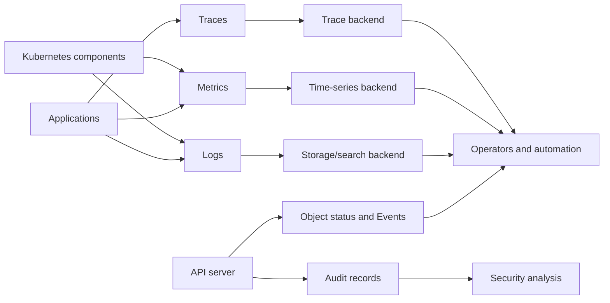
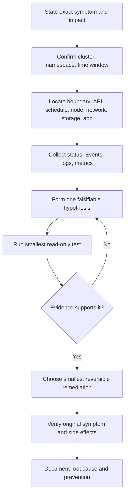
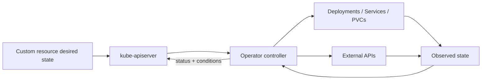
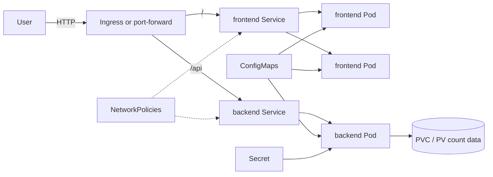
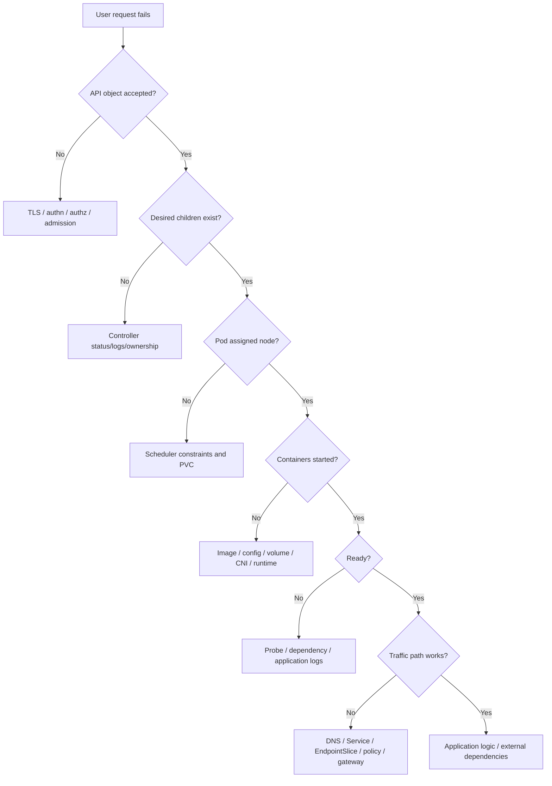

# Day 7 — Production Operations, Observability, Troubleshooting, and Advanced Concepts

## Learning objectives

Today you will learn:

- how logs, metrics, traces, Events, status, and audit answer different questions;
- a repeatable troubleshooting method for common Kubernetes failures;
- how to handle rollouts, node maintenance, disruption, upgrades, HA, certificates, backup, and capacity;
- how CRDs, controllers/operators, aggregation, admission extensions, schedulers, service meshes, and multi-tenancy fit;
- how to deploy and validate a secured, observable frontend/backend project.

**Why this matters:** production skill is not command memorization. It is reducing uncertainty safely, finding the responsible boundary, recovering service, and preventing recurrence.

**Prerequisites:** Days 1–6, a disposable cluster, `kubectl`, and a default StorageClass for the persistence portion. Ingress/Gateway, metrics, and policy behavior require the corresponding installed implementations.

**Estimated time:** 8–10 hours plus project practice.

**Recommended order:** observability → troubleshooting method → runbooks → operations → extensions → final project.

Official reading:

- [Observability](https://kubernetes.io/docs/concepts/cluster-administration/observability/)
- [Monitoring, logging, and debugging](https://kubernetes.io/docs/tasks/debug/)
- [Logging architecture](https://kubernetes.io/docs/concepts/cluster-administration/logging/)
- [Disruptions](https://kubernetes.io/docs/concepts/workloads/pods/disruptions/)
- [Version skew policy](https://kubernetes.io/releases/version-skew-policy/)
- [Extending Kubernetes](https://kubernetes.io/docs/concepts/extend-kubernetes/)

---

## 1. Observability: evidence, not guesses

**Observability** means inferring system state from emitted signals. The three common pillars are metrics, logs, and traces; Kubernetes status, Events, and audit records add important control-plane evidence.



### Logs

Logs are timestamped records from applications or components.

```bash
kubectl logs <pod> -n <ns> -c <container>
kubectl logs <pod> -n <ns> -c <container> --previous
kubectl logs -n <ns> deployment/<name> --all-containers --since=15m
```

`kubectl logs` is useful but not durable cluster-level logging. When a node disappears, local logs can disappear. Kubernetes does not ship a built-in long-term log store; common designs use a node DaemonSet agent or application/sidecar forwarding to an external backend.

Good logs include timestamp, severity, request/trace ID, stable service identity, and actionable error context. They should not include tokens, passwords, private keys, or sensitive request bodies.

### Metrics

Metrics are numeric time-series samples. Kubernetes components expose Prometheus-format endpoints, but Kubernetes does not automatically deploy Prometheus/Grafana.

- Metrics Server implements the resource Metrics API for `kubectl top` and autoscaling inputs.
- Prometheus is a common third-party scraper/time-series store.
- Grafana is a common third-party visualization/alerting UI.
- kube-state-metrics is an add-on that exports object-state metrics.

```bash
kubectl top nodes
kubectl top pods -A --containers
```

These require a working Metrics API. “Metrics API not available” means the add-on/API aggregation path is absent or unhealthy, not necessarily that workloads use zero resources.

Monitor four golden signals where applicable: latency, traffic, errors, saturation. For Kubernetes also monitor API latency/error rate, scheduler queue, controller workqueues, etcd latency/capacity/leader changes, node conditions, Pod restarts, Pending Pods, resource pressure, and certificate expiry.

### Events

Events are short-lived Kubernetes objects describing observations such as `FailedScheduling`, `BackOff`, or `FailedMount`.

```bash
kubectl get events -n <ns> --sort-by=.metadata.creationTimestamp
kubectl events -n <ns> --for pod/<pod>
```

Events can repeat/aggregate and expire. Absence of an old Event is not proof it never happened.

### Object status and conditions

`spec` is intent; `status`/conditions are component observations. Inspect generation relationships:

```bash
kubectl get deployment <name> -n <ns> -o jsonpath='{.metadata.generation}{" desired; observed="}{.status.observedGeneration}{"\n"}'
kubectl get pod <pod> -n <ns> -o yaml
```

An old `observedGeneration` suggests the controller has not processed the newest spec.

### Traces

Distributed tracing connects one request across services using trace/span identifiers. Kubernetes does not provide an application tracing backend by default. OpenTelemetry instrumentation/collectors and compatible backends are common optional choices.

Tracing answers “where did this request spend time?” Metrics show patterns; logs explain discrete events.

### Audit

API audit records answer who attempted what API action, when, against which resource, and how it was decided, according to configured policy. Audit is control-plane configuration and may be provider-managed. Protect it as sensitive evidence.

### Health endpoints

- Application startup/readiness/liveness are workload-level.
- API server commonly exposes `/livez` and `/readyz` under authorization/anonymous endpoint configuration.
- Component metrics and health endpoints need TLS/auth/network protection.

Do not alert solely on one successful health check. Monitor user-visible service-level objectives.

---

## 2. A senior-engineer troubleshooting method



### The first five commands

```bash
kubectl config current-context
kubectl get <resource> <name> -n <namespace> -o wide
kubectl describe <resource> <name> -n <namespace>
kubectl get events -n <namespace> --sort-by=.metadata.creationTimestamp
kubectl logs <pod> -n <namespace> -c <container> --previous
```

Adjust the last command when no previous container exists. All are read-only, but logs/resource output may contain sensitive information.

### Boundary checklist

1. Can the client reach and trust the API endpoint?
2. Was the caller authenticated?
3. Was the action authorized?
4. Did admission accept it?
5. Was it persisted?
6. Did a controller observe/reconcile it?
7. Was the Pod scheduled?
8. Did kubelet prepare network/volumes/config/image?
9. Did the process start and remain alive?
10. Did readiness make it an endpoint?
11. Do DNS/Service/policy/ingress deliver traffic?
12. Does the application behave correctly?

---

## 3. Troubleshooting runbooks

Each runbook begins read-only. Change state only after evidence identifies the cause.

### 3.1 Pod Pending / Unschedulable

**Meaning:** Pod accepted but not yet fully running. If `nodeName` is empty, placement is unfinished.

Possible causes: resource requests, taints, node selector/affinity, topology spread, priority, host ports, PVC binding/topology, nonexistent scheduler, nodes cordoned/not ready.

```bash
kubectl get pod <pod> -n <ns> -o wide
kubectl describe pod <pod> -n <ns>
kubectl get nodes
kubectl describe nodes
kubectl get pvc -n <ns>
```

Interpret scheduler Events. Remediate by correcting impossible constraints/requests, adding legitimate capacity, fixing PVC/storage, or restoring the scheduler. Do not lower requests below real need just to force placement.

Verify: node name appears, phase progresses, readiness succeeds.

Prevent: capacity headroom, tested affinity/topology, quota dashboards, Pending alerts.

### 3.2 `ErrImagePull` / `ImagePullBackOff`

**Meaning:** runtime failed pulling; backoff is retry delay.

Causes: wrong reference/tag, private registry auth, registry/DNS/egress outage, rate limit, architecture mismatch, untrusted cert.

```bash
kubectl describe pod <pod> -n <ns>
kubectl get pod <pod> -n <ns> -o jsonpath='{range .spec.containers[*]}{.name}{"="}{.image}{"\n"}{end}'
kubectl get serviceaccount <sa> -n <ns> -o yaml
kubectl get secret <pull-secret> -n <ns> -o jsonpath='{.type}{"\n"}'
```

Do not print Secret data into chat/tickets. Correct image/digest, registry credential reference, CA, or node egress. Verify `Pulled/Created/Started` Events.

### 3.3 `CrashLoopBackOff`

**Meaning:** process or probe repeatedly terminates/restarts; kubelet backs off.

```bash
kubectl logs <pod> -n <ns> -c <container>
kubectl logs <pod> -n <ns> -c <container> --previous
kubectl describe pod <pod> -n <ns>
kubectl get pod <pod> -n <ns> -o jsonpath='{.status.containerStatuses[0].lastState.terminated}'
```

Causes: bad command/config, missing dependency, permission, OOM (`137` often but verify reason), panic, liveness kill, architecture. Fix cause; do not merely increase restart delay. Verify stable restart count and health.

### 3.4 `CreateContainerConfigError`

**Meaning:** kubelet cannot build container config, commonly missing ConfigMap/Secret or invalid reference.

```bash
kubectl describe pod <pod> -n <ns>
kubectl get configmap,secret -n <ns>
kubectl get pod <pod> -n <ns> -o yaml
```

Check exact names, keys, namespace, optional flags, ServiceAccount/imagePullSecrets. Fix reference/source; verify container starts.

### 3.5 Readiness/liveness/startup failure

```bash
kubectl describe pod <pod> -n <ns>
kubectl logs <pod> -n <ns> -c <container>
kubectl get endpointslice -n <ns> -l kubernetes.io/service-name=<service>
```

Check scheme/path/port, bind address, timeout/threshold, startup duration, dependencies, and whether the probe tests the right health property. Liveness should not depend on fragile external systems if that causes restart storms.

### 3.6 Pod stuck Terminating

Causes: kubelet/node unreachable, long grace/preStop, process ignores signal, volume unmount, finalizer, API deletion dependency.

```bash
kubectl get pod <pod> -n <ns> -o yaml
kubectl describe pod <pod> -n <ns>
kubectl get node <node>
```

Force deletion removes the API object and does not prove the process stopped on an unreachable node. Use only after understanding duplicate/stateful risk. Finalizer removal can leak external resources.

### 3.7 Node NotReady

```bash
kubectl get node <node> -o wide
kubectl describe node <node>
kubectl get pods -A --field-selector spec.nodeName=<node>
```

On authorized self-managed nodes: inspect kubelet/runtime services, disk/inodes/memory/PIDs, certificates, time, routes, and API connectivity. In managed services, use provider health/logging/replace workflow.

Do not reboot/delete first if stateful fencing or forensic evidence matters.

### 3.8 DNS failure

From the affected Pod/network policy context:

```bash
kubectl exec -n <ns> <pod> -- cat /etc/resolv.conf
kubectl exec -n <ns> <pod> -- nslookup kubernetes.default.svc
kubectl get service,endpointslice -n kube-system
kubectl get networkpolicy -n <ns>
```

Check short versus FQDN, CoreDNS readiness/logs, Service endpoints, egress UDP/TCP 53, node-local DNS, upstream resolver.

### 3.9 Service connectivity

```bash
kubectl get service <svc> -n <ns> -o yaml
kubectl get endpointslice -n <ns> -l kubernetes.io/service-name=<svc> -o wide
kubectl get pods -n <ns> --show-labels -o wide
```

Test direct endpoint and Service from the same source. Selector/readiness/targetPort errors are more common than magical Service failures.

### 3.10 Ingress/Gateway failure

Check DNS → external address/firewall → controller/class → route status → TLS → Service → endpoint → policy. Inspect controller logs/status. Creating a route without a controller is inert configuration.

### 3.11 NetworkPolicy blocks traffic

List all policies selecting source/destination, evaluate source egress and destination ingress, namespace labels, Pod labels, actual endpoint port, and DNS. Confirm CNI enforcement/logs. Change one rule narrowly and retest exact flow.

### 3.12 Persistent-volume mount failure

```bash
kubectl describe pod <pod> -n <ns>
kubectl get pvc <pvc> -n <ns> -o wide
kubectl describe pvc <pvc> -n <ns>
kubectl get pv <pv> -o yaml
kubectl get storageclass <class> -o yaml
```

Separate provision/bind, schedule topology, attach, mount, filesystem/permission. Avoid force-detach until you know whether another node still writes.

### 3.13 RBAC permission error

`401`: credential. `403`: permission.

```bash
kubectl auth can-i <verb> <resource> -n <ns>
kubectl auth can-i <verb> <resource> -n <ns> --as=<identity>
kubectl get role,rolebinding -n <ns>
```

Grant the smallest rule at correct scope. Avoid cluster-admin as debugging.

### 3.14 Admission webhook failure

Distinguish explicit denial from call failure. Inspect webhook configuration/rules, Service and ready endpoints, certificate SAN/CA/expiry, network from API server, timeout, webhook logs/metrics, failurePolicy.

Never delete security enforcement merely to clear an outage without approved break-glass procedure.

### 3.15 API server connectivity

```bash
kubectl config view --minify
kubectl cluster-info
kubectl get --raw='/readyz?verbose'
```

Check DNS/TCP/TLS separately. HA load balancer health, certificates, API readiness, etcd health, and overload/APF may be involved. `--insecure-skip-tls-verify` is not a root-cause fix.

### 3.16 etcd health/persistence

Symptoms: API writes time out/fail, readiness reports etcd, latency spikes, alarms/full backend, leader churn.

Only control-plane administrators should run authenticated `etcdctl endpoint health/status --cluster`, inspect member/alarm/space metrics, or perform maintenance. Restore quorum/member health before broad control-plane restarts. Use tested backups for disaster recovery.

### 3.17 Resource exhaustion/high CPU or memory

```bash
kubectl top pod <pod> -n <ns> --containers
kubectl top node
kubectl describe pod <pod> -n <ns>
kubectl describe node <node>
kubectl get resourcequota,limitrange -n <ns>
```

Correlate metrics with throttling, OOM/restarts, latency, requests/limits, and node pressure. A snapshot is not capacity planning. Profile/load test before resizing or scaling.

### 3.18 Failed rollout and rollback

```bash
kubectl rollout status deployment/<name> -n <ns>
kubectl rollout history deployment/<name> -n <ns>
kubectl get replicaset,pod -n <ns> -l app=<label>
kubectl describe deployment <name> -n <ns>
```

Pause/undo changes only after identifying the bad revision and data/schema compatibility. `kubectl rollout undo` changes state and cannot undo database migrations or external side effects.

Verify desired image, ready replicas, error rate, latency, and business checks.

---

## 4. Production operations and reliability

### High availability

HA is end-to-end:

- multiple API servers behind a stable endpoint;
- etcd odd-member quorum with backups;
- replicated scheduler/controllers using leader election;
- multiple worker nodes/failure domains;
- replicated applications and topology spread;
- redundant networking/DNS/storage controllers;
- disruption budgets and tested failover;
- external dependency HA.

Three replicas on one node are not highly available against node failure.

### Node maintenance

```bash
kubectl cordon <node>
kubectl drain <node> --ignore-daemonsets --delete-emptydir-data
# perform maintenance
kubectl uncordon <node>
```

- `cordon`: state-changing; prevents new scheduling, does not move existing Pods.
- `drain`: disruptive; uses evictions/deletions, respects many PDB cases, skips DaemonSets, and `--delete-emptydir-data` accepts loss of Pod-local `emptyDir` data.
- `uncordon`: allows scheduling again.

Before drain: check workloads, PDBs, local storage, stateful quorum, capacity elsewhere, maintenance window, and provider autoscaling behavior.

### PodDisruptionBudget (PDB)

A PDB limits simultaneous unavailability from voluntary disruptions using the Eviction API. It does not prevent node crashes, OOM, direct Pod deletion, or workload-controller rolling updates in the same way.

Misconfigured PDBs can block maintenance. A PDB cannot create replicas; pair it with sufficient replica count and topology spread.

### Graceful shutdown

- mark endpoint unready promptly;
- allow routing to converge;
- handle SIGTERM;
- stop accepting new work;
- finish/checkpoint in-flight work;
- set realistic `terminationGracePeriodSeconds`;
- use `PreStop` only when needed and remember it consumes grace time.

### Upgrades and version skew

Read the exact [version skew policy](https://kubernetes.io/releases/version-skew-policy/) and distribution guide before each upgrade.

General process:

1. Read release notes/deprecations/API removals and plugin compatibility.
2. Verify etcd backup and restore procedure.
3. Test in staging with representative workloads/admission/controllers.
4. Upgrade control plane in supported order.
5. Drain and upgrade nodes in batches within skew rules.
6. Verify CNI, CSI, DNS, metrics, admission, workloads, SLOs.
7. Keep rollback/recovery conditions explicit.

Do not infer that because kubelet can remain several minors behind temporarily, permanent skew is a recommended target.

### Certificates

Inventory CA/client/server certificates, owner, expiry, rotation mechanism, and failure impact. kubeadm, managed services, and custom PKI differ. Alert before expiry; test rotation with HA instances one at a time. Rotating a CA is more complex than renewing a leaf certificate.

### Backups and recovery

Separate:

- etcd/API state backup;
- PersistentVolume/application-consistent data backup;
- external database/object storage backup;
- manifests/Git desired state;
- certificates/encryption configuration/KMS dependencies;
- container registry/artifact availability.

A backup is not proven until restore is tested with recovery time and recovery point objectives.

### Configuration and deployment management

- store manifests/templates/policies in version control without plaintext secrets;
- review/diff changes;
- promote immutable image digests;
- use staged/canary/rolling rollout with metrics gates;
- record field ownership and avoid competing managers;
- keep an emergency/break-glass process audited and tested.

### Capacity and availability

Plan for one failure domain unavailable, rollout surge, system Pods, autoscaler delay, storage/network quotas, API limits, and traffic bursts. Availability depends on the narrowest dependency, not replica count alone.

---

## 5. Extensibility and advanced architecture

### CRD and custom resource

A **CustomResourceDefinition (CRD)** adds a new API type/schema. A **custom resource (CR)** is an instance of that type. Kubernetes stores CRs and applies ordinary API authentication/authorization/audit.

A CRD alone stores data; it does not create behavior.

### Controller and Operator

A custom controller watches resources and reconciles desired state. An **Operator** is the pattern of encoding application/domain operational knowledge in custom resources and controllers—for example, database backup, upgrade, or failover.



Operators add privileged code and failure modes. Review CRDs, RBAC, webhooks, image provenance, upgrade path, finalizers, and uninstall behavior.

### API aggregation

An `APIService` can make an extension API server appear behind kube-apiserver. Unlike CRDs, it runs another server capable of specialized API behavior/storage. Metrics Server commonly uses aggregation. Availability/latency and authentication delegation must be secured.

### Admission extensions

Native admission policy, webhooks, and external policy engines extend write-time behavior. They sit on a critical API path; scope narrowly, test failure, monitor latency, and provide a recovery design.

### Custom schedulers

Pods can select another scheduler via `.spec.schedulerName`. Custom scheduling is appropriate for specialized placement/batch/domain needs, but brings compatibility, HA, fairness, security, and unscheduled-Pod risks.

### Service mesh

A service mesh commonly adds workload traffic proxies or node-level data planes plus a control plane for mTLS identity, traffic policy, telemetry, and routing. It can improve service-to-service security/visibility but adds latency, certificates, policy layers, and debugging complexity. It does not replace Kubernetes RBAC, admission, or application authorization.

### Runtime security

Runtime detection observes processes, syscalls, file/network behavior, or audit events after admission. It complements prevention and image scanning. Products/tools are optional third-party components and need tuning to avoid noise.

### Multi-tenancy

Namespaces alone are weak isolation. Combine dedicated identities, least-privilege RBAC, quota/limits, PSS/admission, default-deny networking, secret separation, node isolation where needed, audit, and possibly separate clusters/strong runtime sandboxes for hostile tenants.

---

## 6. Final project: Secure Notes Counter

The project has:

- frontend Deployment and Service;
- backend Deployment and Service;
- backend state stored on a PVC;
- ConfigMap-hosted application/configuration;
- Secret-injected message;
- probes, requests, limits, non-root security;
- ServiceAccounts with token automount disabled;
- PSA namespace and NetworkPolicies;
- optional Ingress routing;
- observability and failure exercises.

### Architecture



### Suggested directory structure

```text
k8s-final-project/
├── 00-namespace.yaml
├── 01-config.yaml
├── 02-rbac-identities.yaml
├── 03-backend-storage.yaml
├── 04-backend.yaml
├── 05-frontend.yaml
├── 06-networkpolicy.yaml
└── 07-ingress-optional.yaml
```

The manifests are presented below. Save each document under the indicated filename.

### `00-namespace.yaml`

```yaml
apiVersion: v1
kind: Namespace
metadata:
  name: notes
  labels:
    pod-security.kubernetes.io/enforce: restricted
    pod-security.kubernetes.io/enforce-version: v1.37
    pod-security.kubernetes.io/audit: restricted
    pod-security.kubernetes.io/audit-version: v1.37
    pod-security.kubernetes.io/warn: restricted
    pod-security.kubernetes.io/warn-version: v1.37
```

If your cluster is not v1.37, pin to its supported minor version.

### `01-config.yaml`

This Python server uses only the standard library, stores a counter on `/data`, and removes `/api` from the start of routed paths.

```yaml
apiVersion: v1
kind: ConfigMap
metadata:
  name: backend-code
  namespace: notes
data:
  server.py: |
    import json, os, threading
    from http.server import BaseHTTPRequestHandler, ThreadingHTTPServer

    DATA = "/data/count"
    LOCK = threading.Lock()
    MESSAGE = os.environ.get("MESSAGE", "hello")

    def read_count():
        try:
            with open(DATA, "r", encoding="utf-8") as f:
                return int(f.read().strip())
        except (FileNotFoundError, ValueError):
            return 0

    def write_count(value):
        tmp = DATA + ".tmp"
        with open(tmp, "w", encoding="utf-8") as f:
            f.write(str(value))
        os.replace(tmp, DATA)

    class Handler(BaseHTTPRequestHandler):
        def send_json(self, code, body):
            data = json.dumps(body).encode()
            self.send_response(code)
            self.send_header("Content-Type", "application/json")
            self.send_header("Content-Length", str(len(data)))
            self.end_headers()
            self.wfile.write(data)

        def do_GET(self):
            path = self.path.removeprefix("/api")
            if path in ("/health", "/ready"):
                return self.send_json(200, {"status": "ok"})
            if path == "/count":
                with LOCK:
                    value = read_count() + 1
                    write_count(value)
                return self.send_json(200, {"count": value, "message": MESSAGE})
            self.send_json(404, {"error": "not found"})

        def log_message(self, fmt, *args):
            print(json.dumps({"client": self.client_address[0], "message": fmt % args}), flush=True)

    ThreadingHTTPServer(("0.0.0.0", 8080), Handler).serve_forever()
---
apiVersion: v1
kind: ConfigMap
metadata:
  name: frontend-config
  namespace: notes
data:
  index.html: |
    <!doctype html>
    <html lang="en">
      <meta charset="utf-8">
      <title>Kubernetes Notes Counter</title>
      <body>
        <h1>Kubernetes Notes Counter</h1>
        <button id="count">Call backend</button>
        <pre id="result">Ready</pre>
        <script>
          document.querySelector('#count').onclick = async () => {
            const response = await fetch('/api/count');
            document.querySelector('#result').textContent = await response.text();
          };
        </script>
      </body>
    </html>
---
apiVersion: v1
kind: Secret
metadata:
  name: backend-message
  namespace: notes
type: Opaque
stringData:
  message: "served by a secured Kubernetes backend"
```

`stringData` is convenient input, not encryption. Do not commit real secret values; use your approved secret workflow.

### `02-rbac-identities.yaml`

The applications do not call the Kubernetes API, so no Roles are needed.

```yaml
apiVersion: v1
kind: ServiceAccount
metadata:
  name: frontend
  namespace: notes
automountServiceAccountToken: false
---
apiVersion: v1
kind: ServiceAccount
metadata:
  name: backend
  namespace: notes
automountServiceAccountToken: false
```

This is intentionally better than inventing unused RBAC permissions merely to include an RBAC object. The ServiceAccounts are the identity boundary; least privilege here is no Kubernetes API grant.

### `03-backend-storage.yaml`

```yaml
apiVersion: v1
kind: PersistentVolumeClaim
metadata:
  name: backend-data
  namespace: notes
spec:
  accessModes: ["ReadWriteOnce"]
  resources:
    requests:
      storage: 1Gi
```

Requires a default StorageClass. If none exists, specify a valid class or provide a PV. Inspect reclaim policy before project deletion.

### `04-backend.yaml`

```yaml
apiVersion: apps/v1
kind: Deployment
metadata:
  name: backend
  namespace: notes
spec:
  replicas: 1
  strategy:
    type: Recreate
  selector:
    matchLabels:
      app: backend
  template:
    metadata:
      labels:
        app: backend
    spec:
      serviceAccountName: backend
      automountServiceAccountToken: false
      securityContext:
        runAsNonRoot: true
        runAsUser: 10001
        runAsGroup: 10001
        fsGroup: 10001
        seccompProfile:
          type: RuntimeDefault
      containers:
        - name: backend
          image: python:3.13-alpine
          command: ["python", "/app/server.py"]
          env:
            - name: MESSAGE
              valueFrom:
                secretKeyRef:
                  name: backend-message
                  key: message
          ports:
            - name: http
              containerPort: 8080
          readinessProbe:
            httpGet:
              path: /ready
              port: http
            periodSeconds: 5
          livenessProbe:
            httpGet:
              path: /health
              port: http
            initialDelaySeconds: 10
            periodSeconds: 10
          resources:
            requests:
              cpu: 50m
              memory: 64Mi
            limits:
              cpu: 500m
              memory: 256Mi
          securityContext:
            allowPrivilegeEscalation: false
            readOnlyRootFilesystem: true
            capabilities:
              drop: ["ALL"]
          volumeMounts:
            - name: code
              mountPath: /app
              readOnly: true
            - name: data
              mountPath: /data
            - name: tmp
              mountPath: /tmp
      volumes:
        - name: code
          configMap:
            name: backend-code
            defaultMode: 0444
        - name: data
          persistentVolumeClaim:
            claimName: backend-data
        - name: tmp
          emptyDir: {}
---
apiVersion: v1
kind: Service
metadata:
  name: backend
  namespace: notes
spec:
  selector:
    app: backend
  ports:
    - name: http
      port: 8080
      targetPort: http
```

`Recreate` avoids concurrent writers to this deliberately simple single-file demo. It is not an HA database. `fsGroup` support depends on volume/CSI behavior; if the app gets permission denied, inspect ownership and driver support instead of running privileged.

### `05-frontend.yaml`

```yaml
apiVersion: apps/v1
kind: Deployment
metadata:
  name: frontend
  namespace: notes
spec:
  replicas: 2
  selector:
    matchLabels:
      app: frontend
  template:
    metadata:
      labels:
        app: frontend
    spec:
      serviceAccountName: frontend
      automountServiceAccountToken: false
      securityContext:
        runAsNonRoot: true
        runAsUser: 101
        runAsGroup: 101
        seccompProfile:
          type: RuntimeDefault
      containers:
        - name: frontend
          image: nginxinc/nginx-unprivileged:1.27-alpine
          ports:
            - name: http
              containerPort: 8080
          readinessProbe:
            httpGet:
              path: /
              port: http
            periodSeconds: 5
          livenessProbe:
            httpGet:
              path: /
              port: http
            initialDelaySeconds: 10
            periodSeconds: 10
          resources:
            requests:
              cpu: 25m
              memory: 32Mi
            limits:
              cpu: 250m
              memory: 128Mi
          securityContext:
            allowPrivilegeEscalation: false
            readOnlyRootFilesystem: true
            capabilities:
              drop: ["ALL"]
          volumeMounts:
            - name: html
              mountPath: /usr/share/nginx/html/index.html
              subPath: index.html
              readOnly: true
            - name: cache
              mountPath: /var/cache/nginx
            - name: run
              mountPath: /var/run
            - name: tmp
              mountPath: /tmp
      volumes:
        - name: html
          configMap:
            name: frontend-config
        - name: cache
          emptyDir: {}
        - name: run
          emptyDir: {}
        - name: tmp
          emptyDir: {}
---
apiVersion: v1
kind: Service
metadata:
  name: frontend
  namespace: notes
spec:
  selector:
    app: frontend
  ports:
    - name: http
      port: 80
      targetPort: http
```

### `06-networkpolicy.yaml`

This policy set defaults to deny and allows frontend-to-backend. The optional ingress-controller allowance must be adapted to your controller namespace/labels.

```yaml
apiVersion: networking.k8s.io/v1
kind: NetworkPolicy
metadata:
  name: default-deny
  namespace: notes
spec:
  podSelector: {}
  policyTypes: [Ingress, Egress]
---
apiVersion: networking.k8s.io/v1
kind: NetworkPolicy
metadata:
  name: frontend-ingress
  namespace: notes
spec:
  podSelector:
    matchLabels:
      app: frontend
  policyTypes: [Ingress]
  ingress:
    - from:
        - namespaceSelector:
            matchLabels:
              kubernetes.io/metadata.name: ingress-nginx
          podSelector:
            matchLabels:
              app.kubernetes.io/component: controller
      ports:
        - protocol: TCP
          port: 8080
---
apiVersion: networking.k8s.io/v1
kind: NetworkPolicy
metadata:
  name: backend-from-frontend-and-ingress
  namespace: notes
spec:
  podSelector:
    matchLabels:
      app: backend
  policyTypes: [Ingress]
  ingress:
    - from:
        - podSelector:
            matchLabels:
              app: frontend
      ports:
        - protocol: TCP
          port: 8080
    - from:
        - namespaceSelector:
            matchLabels:
              kubernetes.io/metadata.name: ingress-nginx
          podSelector:
            matchLabels:
              app.kubernetes.io/component: controller
      ports:
        - protocol: TCP
          port: 8080
---
apiVersion: networking.k8s.io/v1
kind: NetworkPolicy
metadata:
  name: allow-dns-egress
  namespace: notes
spec:
  podSelector: {}
  policyTypes: [Egress]
  egress:
    - to:
        - namespaceSelector:
            matchLabels:
              kubernetes.io/metadata.name: kube-system
          podSelector:
            matchLabels:
              k8s-app: kube-dns
      ports:
        - protocol: UDP
          port: 53
        - protocol: TCP
          port: 53
---
apiVersion: networking.k8s.io/v1
kind: NetworkPolicy
metadata:
  name: frontend-to-backend
  namespace: notes
spec:
  podSelector:
    matchLabels:
      app: frontend
  policyTypes: [Egress]
  egress:
    - to:
        - podSelector:
            matchLabels:
              app: backend
      ports:
        - protocol: TCP
          port: 8080
```

Important: browser traffic routed directly by Ingress to backend does not originate from frontend Pods. That is why the backend policy includes the ingress controller. Adapt or omit those ingress-controller rules if your implementation has different namespace/labels or uses a node/host data path not selected this way. Apply policies only after validating discovery and controller paths.

### `07-ingress-optional.yaml`

```yaml
apiVersion: networking.k8s.io/v1
kind: Ingress
metadata:
  name: notes
  namespace: notes
spec:
  ingressClassName: nginx
  rules:
    - host: notes.local
      http:
        paths:
          - path: /api
            pathType: Prefix
            backend:
              service:
                name: backend
                port:
                  number: 8080
          - path: /
            pathType: Prefix
            backend:
              service:
                name: frontend
                port:
                  number: 80
```

This needs an installed Ingress controller handling class `nginx`. Ingress is frozen; for a production design, consider equivalent Gateway/HTTPRoute resources supported by your implementation.

### Implementation sequence

Before applying, confirm context:

```bash
kubectl config current-context
kubectl version
kubectl get storageclass
kubectl get ingressclass
```

Then:

```bash
kubectl apply -f 00-namespace.yaml
kubectl apply -f 01-config.yaml
kubectl apply -f 02-rbac-identities.yaml
kubectl apply -f 03-backend-storage.yaml
kubectl apply -f 04-backend.yaml
kubectl apply -f 05-frontend.yaml
```

Wait and inspect before policy:

```bash
kubectl get all,pvc -n notes
kubectl rollout status deployment/backend -n notes --timeout=180s
kubectl rollout status deployment/frontend -n notes --timeout=180s
kubectl get endpointslice -n notes
kubectl describe pvc backend-data -n notes
```

Test through local forwards before exposing:

```bash
kubectl port-forward -n notes service/frontend 8080:80
kubectl port-forward -n notes service/backend 8081:8080
```

Run each in a separate terminal. Port-forward uses an authenticated API stream and is for diagnostics, not production exposure.

```bash
curl -fsS http://127.0.0.1:8080/
curl -fsS http://127.0.0.1:8081/count
curl -fsS http://127.0.0.1:8081/count
```

Expected: frontend HTML, then incrementing backend count and Secret-sourced message.

Apply NetworkPolicies only if your CNI enforces them and after adapting controller/DNS labels:

```bash
kubectl apply -f 06-networkpolicy.yaml
```

Apply optional Ingress only when a matching controller exists:

```bash
kubectl apply -f 07-ingress-optional.yaml
kubectl describe ingress notes -n notes
```

For local DNS testing, map `notes.local` to the controller address in a safe local environment, then:

```bash
curl -H 'Host: notes.local' http://<ingress-address>/
curl -H 'Host: notes.local' http://<ingress-address>/api/count
```

### Validation checklist

```bash
kubectl get namespace notes --show-labels
kubectl get pod -n notes -o wide
kubectl get deployment -n notes
kubectl get service,endpointslice -n notes
kubectl get pvc -n notes
kubectl get networkpolicy -n notes
kubectl auth can-i get pods -n notes --as=system:serviceaccount:notes:backend
kubectl logs -n notes deployment/backend --since=10m
kubectl top pod -n notes
```

Expected:

- namespace has pinned Restricted labels;
- Pods are Ready and run with dedicated ServiceAccounts;
- backend PVC is Bound (or clear storage evidence explains otherwise);
- Services have ready endpoints;
- backend ServiceAccount cannot get Pods (`no`);
- backend emits JSON access logs;
- `kubectl top` works only if Metrics API exists.

### Failure exercises

1. **Bad image:** change frontend image tag to nonexistent. Observe rollout creates a bad ReplicaSet while old availability may remain depending strategy; use rollout status, Pods, Events, then undo.
2. **Readiness failure:** change readiness path to `/missing`. Pod runs but becomes unready and disappears from ready endpoints.
3. **Selector failure:** change backend Service selector. DNS still resolves but EndpointSlice has no backends.
4. **Policy failure:** remove ingress-controller allowance and test external `/api`; then inspect policies rather than restarting Pods.
5. **Secret rotation:** change message Secret. Existing backend env does not change; safely restart rollout and verify new message. Explain why mounted files differ.
6. **Storage failure:** temporarily reference a nonexistent PVC in a copy of backend Deployment; accepted Pod remains Pending with volume Events.
7. **Resource failure:** set impossible backend CPU request; accepted replacement remains unschedulable while old Pod behavior depends rollout strategy.

### Cleanup and data warning

Before deleting:

```bash
kubectl get pvc -n notes -o wide
kubectl get pv
```

Then only when the counter data is disposable:

```bash
kubectl delete namespace notes
```

Namespace deletion removes the PVC. If the bound PV uses reclaim policy `Delete`, underlying storage can be deleted. If `Retain`, manual cleanup may be needed and data may remain recoverable.

---

## 7. Final troubleshooting map



---

## Key takeaways

- Observability signals answer different questions; combine them by time and identity.
- Locate the first failed boundary before changing state.
- Production reliability includes control plane, nodes, plugins, storage, dependencies, and application design.
- PDBs cover only specific voluntary disruptions.
- Upgrade using exact version skew and component/plugin compatibility.
- CRDs add data types; controllers/operators add behavior.
- The final project deliberately applies least privilege instead of decorative RBAC.

## Concise revision notes

```text
Metrics = trends/numbers
Logs = event details
Traces = request path
Events = short-lived Kubernetes observations
Audit = API security trail
Symptom → boundary → evidence → hypothesis → small fix → verify
Cordon = no new scheduling
Drain = evict workloads for maintenance
PDB = limits eligible voluntary disruption
CRD = new API type
Controller = reconciliation behavior
Operator = domain-aware controller pattern
API aggregation = extension server behind kube-apiserver
Backup success requires tested restore
```

## Practical exercises

1. Complete the final project and draw the actual traffic path for your cluster implementation.
2. Build a dashboard/runbook containing readiness, restart rate, request latency/error, PVC health, Pending Pods, and node pressure.
3. Cordon a disposable node, observe placement, then uncordon. Drain only if the lab has enough nodes and no valuable local data.
4. Create a tiny CRD in a lab cluster, create a custom resource, and prove that without a controller it stores data but creates no workload.

## Troubleshooting exercises

Choose any five final-project failures. For each, write:

1. exact user-visible symptom;
2. first failed boundary;
3. responsible component;
4. read-only evidence;
5. falsifiable hypothesis;
6. smallest safe remediation;
7. recovery verification;
8. prevention/alert.

## Interview questions and answers

**Q: What is your Kubernetes troubleshooting process?**  
Confirm context and impact, separate lifecycle boundaries, inspect status/conditions/Events/logs/metrics, test one hypothesis read-only, apply the smallest reversible fix, then verify the original symptom and document prevention.

**Q: Cordon versus drain?**  
Cordon marks a node unschedulable for new Pods. Drain cordons and evicts/deletes eligible existing Pods for maintenance.

**Q: What does a PDB protect?**  
It limits simultaneous unavailability from voluntary evictions that honor it. It does not prevent involuntary failure, direct deletion, or guarantee replicas/capacity.

**Q: CRD versus Operator?**  
A CRD defines a custom API type. An Operator is a controller pattern that watches resources and performs domain-specific reconciliation.

**Q: How do you back up Kubernetes?**  
Separately protect etcd/API state, application/PV data, external services, Git configuration, certificates/encryption dependencies, and images; encrypt backups and repeatedly test restoration.

**Q: Why can `kubectl top` fail while Pods are healthy?**  
It depends on the optional Metrics API implementation/aggregation path, usually Metrics Server. Workloads can run without that telemetry.

## Self-assessment checklist

- [ ] I can select the right signal for a troubleshooting question.
- [ ] I can diagnose every common state in the runbook without guessing.
- [ ] I can plan safe node maintenance and explain PDB limits.
- [ ] I can outline a version-aware upgrade and recovery plan.
- [ ] I can distinguish CRDs, controllers, operators, aggregation, admission, and custom schedulers.
- [ ] I deployed and verified the final project or can explain each prerequisite preventing it.
- [ ] I can explain the entire Kubernetes lifecycle from authenticated API request to user traffic.

## After Day 7

Continue with repeated practice:

1. Rebuild the project using Gateway API on your chosen implementation.
2. Package it with Kustomize or Helm while keeping generated output reviewable.
3. Add Prometheus metrics and OpenTelemetry tracing.
4. Test backup/restore of both etcd in a self-managed lab and application data.
5. Study one CNI and one CSI driver deeply.
6. Build a controller that reconciles a small CRD.
7. Practice incident scenarios under a time limit, then write post-incident reviews.

You now have the conceptual map. Competence comes from using it repeatedly under real evidence and carefully controlled failure.

