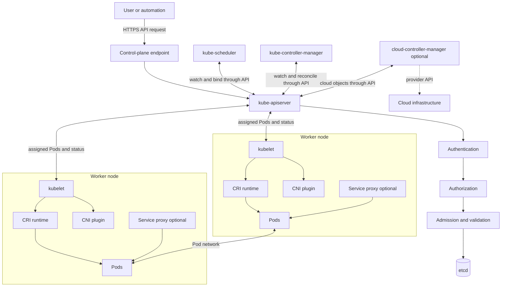
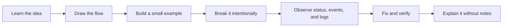

# Complete Kubernetes Learning Roadmap

## Beginner to Mid-Level Cloud Engineer in 7 Days

This course teaches Kubernetes as a working system, not as a list of commands. You will learn what each component owns, how an API request becomes a running Pod, where failures appear, and how to investigate them safely.

> Seven days gives you a strong foundation. Real operational confidence comes from repeating the labs, breaking test clusters on purpose, and troubleshooting without immediately reading the answer.

## Version and scope

- Documentation baseline: **upstream Kubernetes v1.37** (checked October 23, 2026).
- Supported upstream release branches at the time of writing: 1.37, 1.36, and 1.35.
- Commands use a local learning cluster unless a section explicitly says that control-plane or cloud access is required.
- Managed services can hide or replace components. Always compare these notes with your provider documentation.
- Kubernetes-native, optional add-on, third-party, and cloud-provider behavior are labeled separately.

Official starting points:

- [Kubernetes concepts](https://kubernetes.io/docs/concepts/)
- [Cluster architecture](https://kubernetes.io/docs/concepts/architecture/)
- [Tasks](https://kubernetes.io/docs/tasks/)
- [API reference v1.37](https://kubernetes.io/docs/reference/generated/kubernetes-api/v1.37/)
- [Security](https://kubernetes.io/docs/concepts/security/)
- [Release information](https://kubernetes.io/releases/)

## What you will be able to do

By the end, you should be able to:

1. Draw and explain a Kubernetes cluster without confusing component responsibilities.
2. Trace an API request through TLS, authentication, authorization, admission, persistence, watches, and reconciliation.
3. Choose an appropriate workload controller, Service type, policy, and storage model.
4. Diagnose common Pod, node, networking, RBAC, admission, and storage failures.
5. Apply least privilege and defense in depth to workloads.
6. Discuss scheduling, controllers, etcd, CNI, CSI, CRI, and production operations in interviews.
7. Deploy and validate a small multi-tier application with security and observability controls.

## The seven-day roadmap

| Day | Focus | Main outcome |
|---|---|---|
| [Day 1](Day-01-README.md) | Fundamentals, architecture, objects, workloads | Understand the cluster and deploy workloads safely |
| [Day 2](Day-02-README.md) | API server, authentication, authorization | Explain who can call the API and what they may do |
| [Day 3](Day-03-README.md) | Admission, policy, webhooks, etcd | Trace a complete request and understand persistence |
| [Day 4](Day-04-README.md) | Scheduling, controllers, kubelet, runtime | Explain how desired state becomes running containers |
| [Day 5](Day-05-README.md) | Networking, Services, DNS, Gateway, policy | Trace packets and isolate workloads |
| [Day 6](Day-06-README.md) | Security, resources, autoscaling, storage | Build safer and more predictable workloads |
| [Day 7](Day-07-README.md) | Operations, observability, troubleshooting, final project | Operate and troubleshoot an end-to-end application |

## One picture of the whole system



Read it from top to bottom:

- Clients ask the API server to change or read desired state.
- The API server protects the request and persists accepted API objects in etcd.
- Schedulers and controllers observe changes through the API; they do not normally edit etcd directly.
- The scheduler chooses a node. The kubelet on that node asks the container runtime to run containers.
- CNI provides Pod networking. A Service proxy such as kube-proxy is optional because some networking implementations replace it.
- Cloud integration is optional and provider-specific.

## Native, optional, third-party, and cloud features

| Category | Examples | Important distinction |
|---|---|---|
| Kubernetes core API and components | Pods, Deployments, Services, RBAC, kube-apiserver, scheduler | Defined and maintained by upstream Kubernetes |
| Optional Kubernetes component or feature | cloud-controller-manager, kube-proxy replacement, audit backend configuration | Still Kubernetes-aware, but deployment/configuration varies |
| Cluster add-on | CoreDNS, Metrics Server | Commonly installed, not the same as an always-built-in control-plane function |
| Interface implementation | CNI, CSI, CRI implementation | Kubernetes defines an interface; another component implements it |
| Third-party integration | Prometheus, Grafana, Gatekeeper, Kyverno, service meshes | Installed and operated separately |
| Cloud-provider service | managed load balancer, workload identity, managed disks | Semantics and permissions vary by provider |

## Prerequisites

- Comfortable with a Linux shell and basic files/directories.
- Basic knowledge of processes, IP addresses, ports, and YAML is helpful but not required.
- `kubectl` plus a disposable cluster: `kind`, `minikube`, or an online playground. The [official learning-environment guide](https://kubernetes.io/docs/setup/learning-environment/) describes these choices.
- Recommended local capacity: 2 CPU cores, 4–8 GiB RAM, and 15 GiB free disk.
- Never run destructive labs against production.

## Recommended study method

Use this loop for every major topic:



Suggested daily rhythm:

1. **Concepts — 90 minutes:** read definitions and component boundaries.
2. **Flows — 45 minutes:** redraw the Mermaid diagrams on paper.
3. **Lab — 90 minutes:** run commands and inspect objects.
4. **Failure lab — 45 minutes:** create one safe failure and diagnose it.
5. **Review — 30 minutes:** answer interview questions aloud.

## Safe command conventions

Each command is labeled conceptually as one of:

- **Read-only:** observes state, such as `kubectl get`, `describe`, `logs`, `auth can-i`, and `events`.
- **State-changing:** creates or changes an API object, such as `apply`, `scale`, `rollout undo`, and `label`.
- **Destructive or privileged:** deletes resources, drains nodes, reads Secrets, touches etcd, or changes control-plane configuration.

Start troubleshooting with read-only commands. Confirm context before every state-changing command:

```bash
kubectl config current-context
kubectl cluster-info
kubectl get nodes
```

These commands run on your workstation. They are read-only, require a working kubeconfig, and reveal which cluster you are about to use.

## Core mental model

Kubernetes is an API-driven reconciliation system:

```text
You declare desired state
          ↓
API server accepts and stores it
          ↓
Controllers and node agents observe it
          ↓
They take repeatable actions
          ↓
Status reports actual state
          ↺
The loop continues
```

Three distinctions prevent many beginner mistakes:

1. **Accepted is not running.** An API object can be successfully stored while its Pod remains Pending or unhealthy.
2. **Authentication is not authorization.** Proving your identity does not grant permission.
3. **A Service is not a process.** It is API state plus a data-plane implementation that routes to eligible endpoints.

## Before Day 1

1. Open [Day 1](Day-01-README.md).
2. Create or select a disposable cluster.
3. Run the three context checks above.
4. Keep a learning journal with four columns: observation, hypothesis, evidence, conclusion.
5. Do not memorize command output. Learn which component produced it and why.

## Course limitations

This course covers core upstream behavior relevant to junior-to-mid-level engineers. It cannot cover every distribution, CNI, CSI driver, cloud controller, service mesh, policy engine, or vendor-specific failure. Alpha and beta behavior can change; follow the linked documentation for the exact minor version you operate.

# K8s-Tutorial
